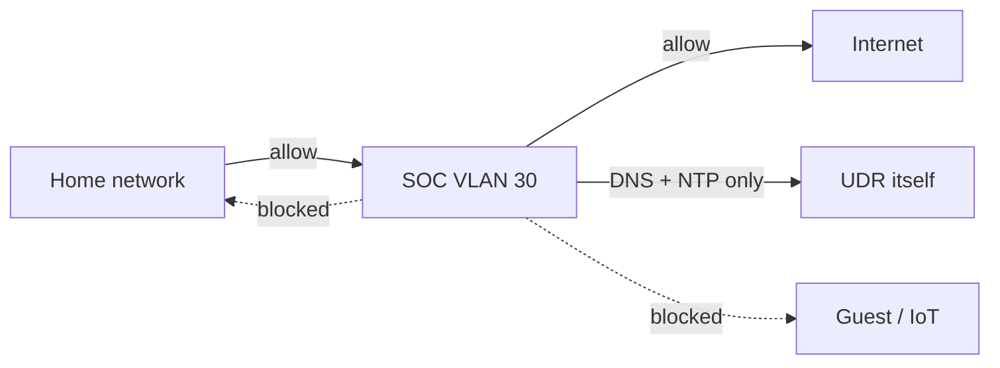

# 1.3 · SOC VLAN and Zone Firewall (UniFi UDR)

**Result:** An isolated SOC network (VLAN 30, 10.30.0.0/24) that can watch my home network but can't reach into it.

## Why I segmented the SOC
SOC tools ingest untrusted data all day: threat feeds, raw packets, and logs from every device. If one of them gets compromised, I don't want an attacker pivoting into the home network or taking over the router.

## Decisions
- **Locked the SOC out of the router's management.** SOC → Gateway defaulted to Allow All. Owning the router means owning every VLAN, so the SOC gets DNS and NTP from it and nothing else.
- **Allow above block.** UniFi evaluates first match wins, so the DNS/NTP allow sits ahead of the block.
- **I only log the block.** Nothing in the SOC should ever touch router management, so every hit on that rule is worth looking at.
- **I caught a backwards rule before saving.** My first draft allowed SOC → Home, which would have defeated the point.

**Skills:** network segmentation · zone-based firewalls · least privilege · rule ordering

➡️ [Deep dive](deep-dives/03-udr-soc-segment.md)
