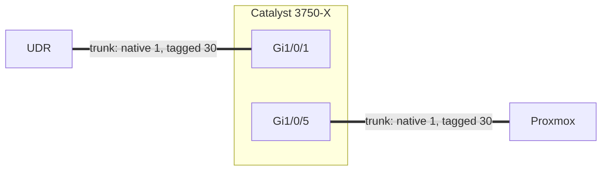

# 1.4 · Catalyst 3750-X: Recovery, Hardening and Trunking

**Result:** VLAN 30 trunked through my core switch to the Proxmox host. Along the way I found and fixed three risks I hadn't planned for.

## Getting back in
I'd lost the enable password from when I first set the switch up. I recovered it through the console boot loader, set a new hashed `enable secret`, regenerated the SSH key, and made management SSH-only.

## What the audit turned up
Before touching the config, I audited the switch:

| Finding | Risk | What I did |
| --- | --- | --- |
| Two cables between the router and the switch: a Layer 2 loop | Spanning tree was the only thing preventing a broadcast storm | Shut the port and pulled the cable |
| `ip routing` enabled | Traffic between VLANs could bypass the UDR firewall | `no ip routing` |
| VTP server mode | Could overwrite or adopt another switch's VLANs | `vtp mode transparent` |

I spotted the loop from one port in spanning-tree role **Backup**. A switch only assigns that role when it hears its own BPDUs, which means the port leads back to itself.

## The change
Both trunks allow only VLANs 1 and 30, with trunk negotiation off. My SSH session ran over one of the ports I was changing, so I set `reload in 10` first: if I'd locked myself out, the switch would have rebooted into the old config.

**Skills:** Cisco IOS · password recovery · STP troubleshooting · 802.1Q · change management

➡️ [Deep dive](deep-dives/04-catalyst-3750x-trunking.md)
