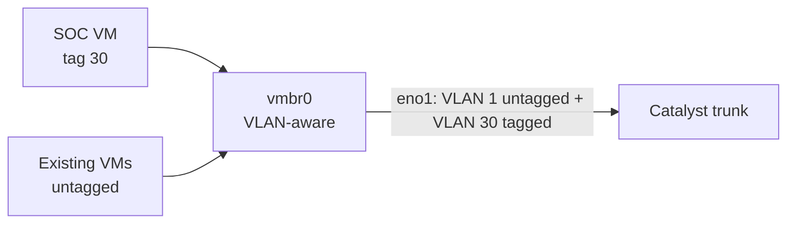

# 1.5 · VLAN-Aware Proxmox Bridge

**Result:** A VM joins any VLAN with one tag on its network card, and nothing already running on the host was disrupted.

## What I changed
I made the host's main bridge (`vmbr0`) 802.1Q-aware. Untagged traffic (Proxmox management, my other VMs) stays on VLAN 1 exactly as before. A VM with `tag=30` lands on the SOC network. Future VLANs won't need another host network change, and every host network change is a chance to lose remote access.

## Decisions
- **I made the change from the LAN, not over the VPN.** My VPN VM ran on this same host, so a failed bridge reload would have cut me off.
- **I backed up the config, applied it through the GUI so it was validated, and reviewed the diff** with the rollback command ready.
- **The bridge isn't my security boundary.** It permits VLANs, but the switch trunk (1 and 30 only) and the UDR firewall decide what actually flows.

I also confirmed three unused NICs on the host, so the network sensor gets a dedicated capture port later.

**Skills:** Linux bridging · VLAN tagging · change management

➡️ [Deep dive](deep-dives/05-proxmox-vlan-aware-bridge.md)
