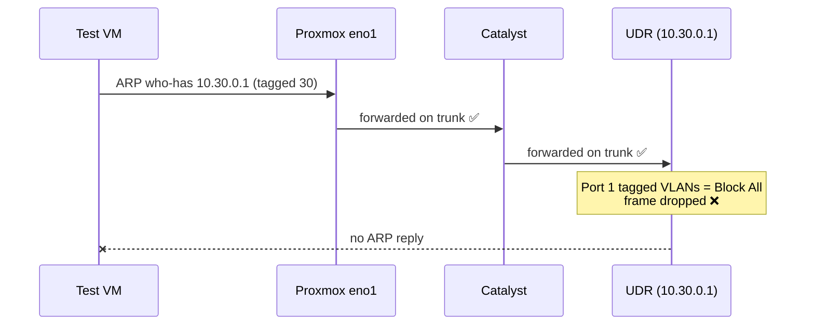

# 1.6 · End-to-End Smoke Test

**Result:** I verified the full VLAN 30 path and every SOC firewall policy, after tracking down a failure with packet captures.

## The failure
My first test VM on VLAN 30 had no connectivity at all. Instead of guessing, I captured on the host uplink to see how far traffic got:

The VM's requests left the host tagged, and the switch was forwarding VLAN 30, but the gateway never answered. The router's switch-facing port had tagged VLANs set to **Block All**: one side was tagging, the other was dropping. I changed it to allow SOC, and the gateway answered within seconds.

## Results
| Test | Expected | Result |
| --- | --- | --- |
| SSH from home → SOC VM | Connects | ✅ |
| SOC → internet | Works | ✅ |
| SOC → DNS | Resolves | ✅ |
| SOC → router admin UI | Blocked | ✅ |
| SOC → home network | Blocked | ✅ |

The firewall hit counters confirmed each policy matched.

## An open question
The idle test VM generated about 2,800 hits on the SOC → Gateway block. I guessed IPv6 and disabled it in step 1.7 rather than adding an allow rule. In step 2.3, the firewall logs showed the real cause: the UDR's own discovery broadcasts.

**Skills:** packet analysis · structured troubleshooting · firewall validation

➡️ [Deep dive](deep-dives/06-smoke-test-vlan30.md)
