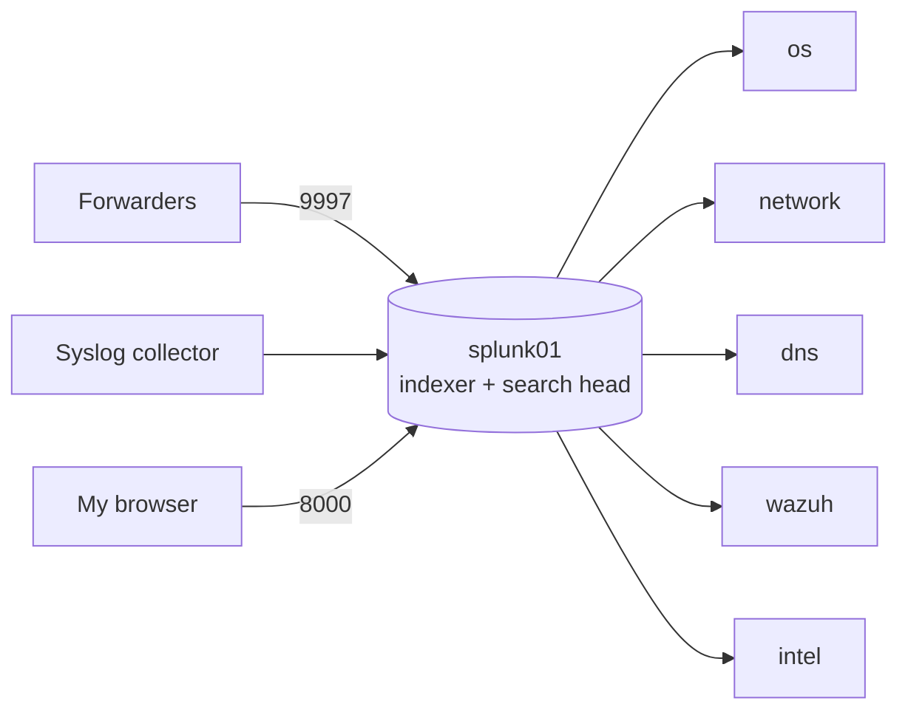

# 2.1 · Splunk Enterprise (SIEM)

**Result:** Splunk Enterprise 10.6 running on `splunk01` as a locked-down service, with an index for each kind of data I plan to collect.

## What I built
- **One all-in-one instance** (indexer, search head and receiver). At lab volume, splitting the roles across servers would just cost RAM.
- **A systemd service under a dedicated non-root `splunk` user**, starting at boot
- **Transparent Huge Pages disabled** across reboots, per Splunk's guidance
- **Receiving on 9997** for Universal Forwarders

## Index design
| Index | Data |
| --- | --- |
| `os` | Windows / Linux / Sysmon |
| `network` | Firewall, IDS, switch, Zeek, Suricata, VPN |
| `dns` | Every DNS query on the network |
| `wazuh` | Endpoint alerts, FIM, vulnerabilities |
| `intel` | Threat-intel IOCs and matches |

I split the data so searches stay fast, retention can be set per data type, and access can be granted per role. Nothing lands in `main`.

## Decisions
- **I created the admin through `user-seed.conf`** before the first start, so there were never default credentials. Splunk deletes the file after reading it.
- **The service and CLI run as `splunk`,** never root.
- **I treated a password leak as an incident.** The admin password ended up in my shell history and in pasted output, so I rotated it, and I now use `splunk login` instead of putting `-auth` on the command line.

## Backlog
TLS certificates · HTTPS for the web UI · developer license before the trial ends · per-index retention · non-admin analyst account

**Skills:** SIEM deployment · Splunk architecture · systemd · least privilege · credential hygiene

➡️ [Deep dive](deep-dives/08-splunk-installation.md)
