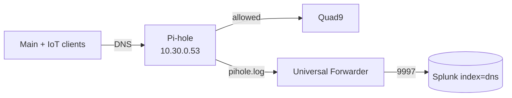

# 2.2 · Pi-hole DNS Sinkhole and DNS Logging

**Result:** Every DNS query on my Main and IoT networks goes through Pi-hole on `dns01`, is checked against about 72k known-bad domains, and lands in Splunk (`index=dns`) within seconds.

## Why I started with DNS
Almost every connection starts with a lookup, so a resolver that logs every query and the client behind it gives me network-wide visibility without an agent on every device.

## What I built
- Pi-hole v6 in an unprivileged container on the SOC VLAN, forwarding to Quad9, which filters malicious domains with its own threat intel
- UDR DHCP hands out Pi-hole as DNS for Main and IoT
- A Splunk Universal Forwarder on `dns01` ships the query log to Splunk, running under its own non-root user

## Issues I ran into
| Issue | Cause | What I did |
| --- | --- | --- |
| Pi-hole received zero queries | The UDR's ad-block content filter was intercepting all port 53 traffic and answering it itself | Removed the filter. Pi-hole is now my single DNS control point |
| My workstation bypassed Pi-hole | A static third-party DNS server set on the NIC | Reset it to DHCP-assigned DNS |
| Pi-hole ignored other subnets | By default it only answers its local subnet | Set listening mode to all. The UDR firewall controls who can reach it |
| IoT could reach every SOC system | IoT sits in the Internal zone, so my Internal → SOC allow covered it | Narrowed that rule to Main, and gave IoT DNS-only access to Pi-hole |

## Decisions
- **Full query logging, privacy level 0.** For a SOC, I need the domain and the client that asked.
- **The forwarder joins the `pihole` group** to read the log, rather than running as root or loosening the file's permissions.

**Skills:** DNS security · log onboarding · Splunk Universal Forwarder · firewall troubleshooting · segmentation

➡️ [Deep dive](deep-dives/09-pihole-dns.md)
