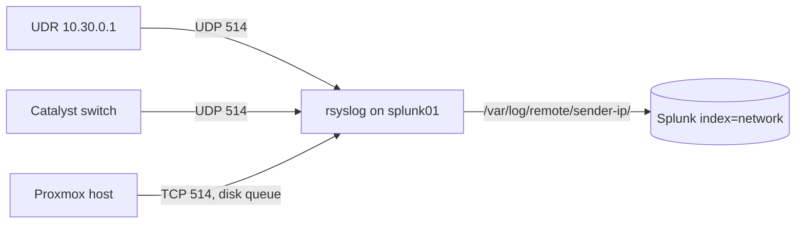

# 2.3 · Infrastructure Logs

**Result:** My firewall (UDR), core switch (Catalyst 3750-X) and hypervisor (Proxmox) all send their logs to a syslog collector on `splunk01`. Every event lands in `index=network`, tagged with the sender's real IP and the correct UTC time.

## What I built
- **rsyslog in front of Splunk.** I didn't want UDP syslog dropped every time Splunk restarts, so rsyslog writes everything to disk and Splunk reads the files.
- **One folder per sender IP**, which becomes the `host` field.
- **Switch:** moved to UTC with NTP, and turned on logging for every login attempt and every config command (passwords masked).
- **Proxmox:** forwards over TCP with a disk-backed queue, so I don't lose auth logs if the collector is down.
- **UDR:** all 12 activity categories, including firewall, IPS, admin, VPN and client events.

## Issues I ran into
| Issue | Cause | What I did |
| --- | --- | --- |
| Proxmox failed logins weren't showing under its IP | Splunk's `syslog` sourcetype overwrites `host` with the hostname inside the message | Kept the IP. The hostname in a syslog header is self-reported and can be spoofed |
| Proxmox events were 5 hours in the past | The classic syslog format has no timezone; the host is on local time, the collector on UTC | Switched Proxmox to RFC 5424, which carries the offset |
| UDR events were 5 hours in the past | Same cause, and UniFi doesn't let me change the format | Stamped UDR events with the collector's receive time instead |

## Closing out the block-count question from 1.6
In step 1.6, the *SOC → Gateway Block* rule had thousands of hits I couldn't explain, and I'd guessed IPv6. Once the firewall logs were in Splunk, one `stats` search answered it: every block was the UDR's own Ubiquiti discovery broadcast (UDP 10001), sent about every 10 seconds. It's benign. I left the rule's logging on and will exclude that exact pattern in my detections rather than mute the rule.

## Other decisions
- **SNMP off.** It's health polling, not security events, and v1/2c sends its secret in plain text.
- **Retired my old OpenVPN VM** instead of onboarding it. I built it while learning, and I'll rebuild remote access on the UDR's VPN server, whose logs already reach Splunk.

**Skills:** syslog architecture · rsyslog · Cisco IOS logging · timestamp normalization · Splunk inputs · firewall log analysis

➡️ [Deep dive](deep-dives/10-infrastructure-logs.md)
