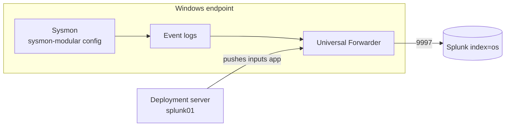

# 2.4 · Endpoint Telemetry: Sysmon + Universal Forwarder

**Result:** My Windows PC sends Security, System, Application, PowerShell and Sysmon logs to Splunk (`index=os`). The forwarder is managed centrally from splunk01, and the whole onboarding is one script.

## What I built
- **Sysmon** with the sysmon-modular config, which tags events with MITRE ATT&CK technique IDs
- **PowerShell script block logging** and logon success/failure auditing
- **Splunk Universal Forwarder**, installed silently with a random local admin password, running as a least-privilege service account
- **A deployment server** on splunk01: what to collect lives in one app there and gets pushed to every Windows endpoint
- **`Install-SocEndpoint.ps1`**, which does all of the above on a new machine
- **Parsing and content add-ons** on splunk01: Windows, Sysmon, Unix/Linux, CIM, Security Essentials, Lookup Editor

## Issues I ran into
| Issue | Cause | What I did |
| --- | --- | --- |
| Sysmon config download returned 404 | sysmon-modular moved its built configs to release assets | Pulled from the latest release URL instead |
| Forwarder checked in but got no inputs | The deployment server had no `serverclass.conf` yet | Wrote the server class and app, reloaded the deployment server |
| Every log arrived except Sysmon | Access denied: the forwarder's service account can't read the Sysmon channel | Added it to the built-in **Event Log Readers** group instead of running it as SYSTEM |
| 76% of Security events were noise | Event 5379 (credential manager reads), ~4,000/day | Blacklisted 5379 at the forwarder through the deployment app |

## Decisions
- **Least privilege for the agent.** It gets read access to event logs and nothing more.
- **Central management from the start.** Even with one endpoint, inputs live on the deployment server and in this repo, not on the PC.
- **Kept low-volume group enumeration events (4798/4799).** They're cheap and they're reconnaissance signals.
- **Honest coverage numbers.** I recorded DNS visibility as 80% in Security Essentials: the SOC VLAN doesn't use Pi-hole yet, and DoH or hard-coded resolvers bypass it.

**Skills:** Sysmon · Splunk Universal Forwarder · deployment server · Windows audit policy · least privilege · log volume tuning · PowerShell automation

➡️ [Deep dive](deep-dives/11-endpoint-telemetry.md)
