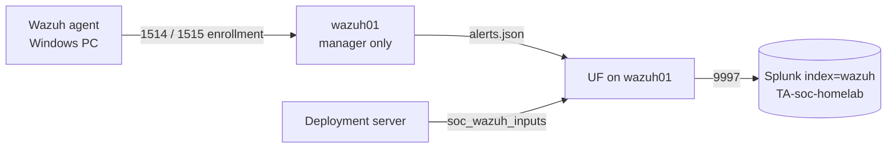

# 2.5 · Wazuh: Endpoint Detection and Compliance Scanning

**Result:** A Wazuh manager on `wazuh01` runs detection rules, file integrity monitoring, vulnerability detection and CIS benchmark scans for my PC and itself. Its alerts land in Splunk (`index=wazuh`), parsed by my own add-on.

## What I built
- **Wazuh manager only**, no Wazuh indexer or dashboard. Splunk is already my SIEM, and the full Wazuh stack needs 4–8 GB of RAM that wazuh01 doesn't have.
- **Password-protected agent enrollment**, so nothing can register itself as an agent and feed fake data in
- **A forwarder on wazuh01**, managed by the deployment server, shipping `alerts.json` to Splunk
- **`TA-soc-homelab`**, my own Splunk add-on. Its first job is parsing Wazuh's JSON alerts with the right timestamps.
- **The Wazuh agent added to `Install-SocEndpoint.ps1`.** It prompts for the enrollment password at run time.

## Compliance baseline
| System | Benchmark | Score | Passed | Failed |
| --- | --- | --- | --- | --- |
| wazuh01 | CIS Ubuntu Linux 24.04 LTS v1.0.0 | 49% | 118 | 119 |
| My PC | CIS Microsoft Windows 11 Enterprise v3.0.0 | 26% | 124 | 344 |

These are unhardened defaults. They're the starting point for the GRC program, not a problem to fix today.

## Issues I ran into
| Issue | Cause | What I did |
| --- | --- | --- |
| Vulnerability scanner wouldn't start | It was set to store results in the Wazuh indexer, which I'd turned off | Set `index-status` to `no`. It now runs locally and alerts through `alerts.json` |
| Constant indexer-connector warnings | The inventory feature retries an indexer that doesn't exist | Known noise with manager-only installs; documented, not fixed |
| SCA search returned nothing | Wazuh sends the full score on the first scan, then mostly changes; my time window started after the baselines | Searched a wider window and used `dedup` for the latest result per system |

## Detections already working
The first level-8 alerts were **"New user added"** and **"New group added"** on wazuh01. That was the `splunkfwd` account the forwarder install created. Real, explainable, and exactly what that rule is for.

**Skills:** Wazuh · CIS benchmarks · Splunk add-on development · deployment server · secure agent enrollment · log pipeline design

➡️ [Deep dive](deep-dives/12-wazuh.md)
