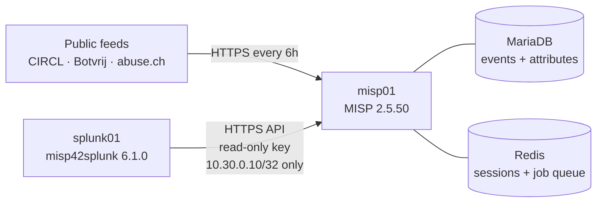

# 2.6 · MISP: Threat Intelligence Platform

**Result:** MISP 2.5.50 runs natively on `misp01` within its 3 GB RAM budget. Five public feeds (CIRCL OSINT, Botvrij.eu, abuse.ch URLhaus, ThreatFox and Feodo) refresh every 6 hours, giving me about 2,100 events and 650,000+ indicators. Splunk queries MISP live through the misp42splunk add-on, using a read-only API key that only works from splunk01, and keeps 132,571 detection-ready domains and hostnames in a local lookup (`misp_dns_iocs.csv`) that rebuilds every 6 hours. Pi-hole logs now carry CIM DNS fields, so the lookup can be matched against every DNS query.

## What I built
- **A native MISP install** using MISP's official Ubuntu 24.04 script, which I read before running it as root. I skipped the Docker version because its extra containers don't fit in 3 GB.
- **Memory tuning for a 3 GB VM:** a 2 GB swapfile as a safety net, and MariaDB's buffer pool cut from about 1.45 GB (the script's 50%-of-RAM default) to 768 MB
- **Hardening from MISP's own security audit:** config files no longer world-readable, a Redis password, an encryption key for stored secrets, browser caching off, suspicious-login alerts on
- **Five feeds stored as events**, with caching off so feed data lives on disk rather than in RAM
- **Least-privilege API access for Splunk:** an `API Read Only` role, a dedicated service account, and an auth key that is read-only and only accepted from splunk01
- **misp42splunk 6.1.0 on splunk01**, so Splunk searches can pull indicators from MISP with `| mispgetioc`
- **A Splunk lookup of MISP's DNS indicators** (`domain` and `hostname`, `to_ids` only, warning lists applied), rebuilt by a scheduled report 28 minutes after each feed fetch, so matching runs locally instead of calling a slow API for every event
- **DNS fields for Pi-hole logs** (`query`, `record_type`, `src`) in my `TA-soc-homelab` add-on, exported to every Splunk app
- **Auto-publish and `tlp:clear` tags on the abuse.ch feeds**, so their events reach Splunk and carry their sharing level

## Issues I ran into
| Issue | Cause | What I did |
| --- | --- | --- |
| Installer would have set an unreachable base URL | Its default domain is `misp.local`, which nothing on my network resolves | Ran it with `MISP_DOMAIN=10.30.0.30` |
| MariaDB sized for a bigger machine | The script gives the buffer pool 50% of RAM | Set it to 768 MB and confirmed the live value |
| The Redis password was printed to my terminal | MISP's `setSetting` command echoes the new value | Rotated the password with output sent to `/dev/null` |
| Web UI returned HTTP 500 after I added the Redis password | PHP stores login sessions in Redis through its own `php.ini` setting, which still had no password | Traced it through MISP's error log to `NOAUTH`, added the password to `session.save_path`, and locked down `php.ini` |
| No users in the auth key form | The built-in Read Only role has no API key permission | Created an `API Read Only` role with only that permission added |
| `MISP instance not found: misp01` in Splunk | The add-on had no instance configured yet | Added `misp01` under Configuration with the read-only key and certificate checking off |
| misp42splunk searches came back empty | MISP was slow to answer under a growing database, and the abuse.ch events were unpublished | Proved the MISP side with `curl` against `/attributes/restSearch`, then reran the search (40 indicators back) and published the abuse.ch events |
| `mispgetioc` refused to run | The time picker was on a real-time window, and the command needs one of `last`, `date`, `eventid` or similar | Used a historical range and `last=3650d` |
| DNS fields worked with `rex` but not from the add-on | Search-time extractions stay inside their app unless it exports them | Added `metadata/default.meta` with `export = system` |
| URLhaus enabled twice | Both the CSV and the MISP-format URLhaus feeds matched my search when I enabled feeds | Disabled the MISP-format one before it imported anything, to avoid duplicate matches |

## Decisions
- **Native install, not Docker:** about 850 MB idle and 1.4 GB still available during the first feed import
- **Fetch and store, caching off:** Splunk reads MISP events through the API, so caching whole feeds in Redis would only cost RAM
- **A local lookup instead of live API calls for matching:** MISP takes seconds to answer a single search on 3 GB, which is fine for an analyst but not for every DNS query
- **CIM field names** (`query`, `record_type`, `src`) so Splunk's security content can use Pi-hole data without translation
- **misp-modules deferred:** enrichment lookups need another 300–500 MB, and nothing in this step depends on them
- **Benign diagnostics left alone:** two schema differences that come from MariaDB vs MySQL defaults (database version 159 of 159, no failed migrations)

## Intel loaded
| Source | Events | Indicators |
| --- | --- | --- |
| CIRCL OSINT + Botvrij.eu (various original authors) | ~2,110 | ~615,000 |
| abuse.ch URLhaus | 1 | ~33,400 |
| abuse.ch ThreatFox | 1 | ~7,700 |
| abuse.ch Feodo (active botnet C2 only) | 1 | ~5 |

URLhaus is the biggest feed and also the shortest-lived, since malware URLs often die within days. That matters for false positives when I build Splunk alerts on it.

**Skills:** MISP · threat intel feeds · Linux memory tuning · MariaDB · Redis · PHP session troubleshooting · API least privilege · secret handling · Splunk add-on integration · REST API troubleshooting · Splunk lookups · field extraction and CIM

➡️ [Deep dive](deep-dives/13-misp.md)
