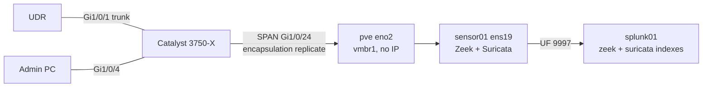

# 2.7 · Zeek + Suricata: Network Sensor on a SPAN Feed

**Result:** sensor01 receives a mirror of the Catalyst's uplink and my admin PC's port. Zeek 8.0 (LTS) logs every connection as JSON, and Suricata runs 53,000+ ET Open rules plus my own test rule, both inside the VM's 3 GB. A Universal Forwarder ships Zeek's logs to `index=zeek` and only Suricata's alerts to `index=suricata`, and my test alert shows up in Splunk end to end. This completes Phase 2: every source is searchable in Splunk.

## What I built
- **A SPAN session** that mirrors Gi1/0/1 (UDR uplink) and Gi1/0/4 (admin PC) in both directions to Gi1/0/24, keeping 802.1Q tags
- **A capture path with no IP:** a dedicated cable to Proxmox `eno2`, a bridge that never learns MACs (`bridge-ageing 0`), NIC offloads off, and a second sensor NIC that has no address
- **Zeek** standalone on that NIC, with JSON logs, 14-day retention, a systemd unit and a BPF filter that drops my own SSH session to the sensor
- **Suricata** from the OISF PPA with a low-memory profile, Hyperscan, ET Open rules, a daily `suricata-update` and a live rule reload
- **A Universal Forwarder on sensor01** running as `splunkfwd` with read access through the `zeek` and `suricata` groups, managed by the deployment server
- **Splunk side:** two new indexes, per-log sourcetypes in TA-soc-homelab, a nullQueue filter that keeps only Suricata alerts, and a `soc_sensor_inputs` deployment app

## Issues I ran into
| Issue | Cause | What I did |
| --- | --- | --- |
| `eno2` showed no link after cabling | The interface was administratively down | Brought it up with `ifreload -a` and checked with `ethtool` |
| Suricata rules failed and `suricata-update` rolled back | Putting `vars:` in my include file replaced the whole section, so `EXTERNAL_NET` and the port variables disappeared | Took `vars` out of the include and set `HOME_NET` in the main file |
| testmynids.org test returned nothing | The domain no longer exists (NXDOMAIN from Pi-hole and 1.1.1.1) | Wrote local rule sid 9000001 and triggered it with HTTP to an IP |
| 742 "Ethertype unknown" alerts in about 20 minutes | Switch housekeeping frames (STP/PVST+, CDP and keepalive loopback) on the mirror | Identified them with tcpdump and dropped them by MAC and ethertype in the BPF filter: 0 alerts since |
| A full eve.json would have cost about 440 MB/day | Flow, TLS, DNS and QUIC events duplicate what Zeek already logs | Filtered in Splunk at parse time: only `alert` events are indexed |
| About 50,000 HTTP parser anomalies a day reached Splunk | I had first kept `anomaly` events too, and one HTTP response pattern (repeated headers) fired constantly | Narrowed the filter to alerts only; anomalies stay in eve.json on the sensor |

## Hardening findings
- Gi1/0/2 and the module ports Gi1/1/1–4 and Te1/1/1–2 had been left enabled since step 1.4. I shut them down.
- While re-cabling, UDR Port 1 was briefly set to native SOC / Allow All. I put it back to native Default, tagged SOC only, and disabled the unused UDR ports.
- My PC moved off the UDR onto Gi1/0/4, a hardened access port (portfast, BPDU guard, no trunk negotiation).
- CDP was advertising the switch model and IOS version on the uplink and admin ports, and nothing there uses it. I disabled it on both.

## Decisions
- **Mirror the uplink plus the PC port, and accept duplicates:** PC↔SOC traffic appears three times and PC↔internet twice. In exchange, I see PC↔Proxmox management traffic that never crosses the uplink.
- **Wi-Fi is a known blind spot:** wireless clients never touch the Catalyst, so the UDR's IDS and Pi-hole remain the only coverage for them.
- **Zeek first, then Suricata:** I checked RAM before adding the second engine (2.6 GB available, later 1.9 GB with both running).
- **Filter noise at the sensor and on the switch:** the BPF filter keeps the sensor quiet whatever the switch config, and disabling CDP fixes the leak at its source.
- **Zeek for metadata, Suricata for alerts:** this keeps the projected Splunk volume at about 250 MB/day, inside the trial license.

**Skills:** Cisco SPAN · Linux bridging · packet capture · Zeek · Suricata · ET Open · BPF · IDS tuning · Splunk indexing and nullQueue filtering · license sizing

➡️ [Deep dive](deep-dives/14-zeek-suricata.md)
