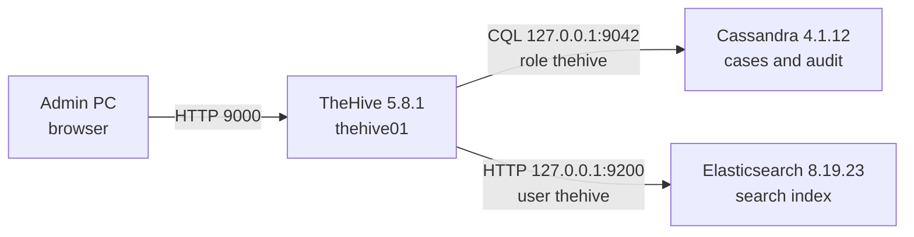

# 3.1 · TheHive: Case Management

**Result:** TheHive 5.8.1 runs on thehive01 with its own Cassandra 4.1 database and Elasticsearch 8.19 index, all three inside a 6 GB VM. Cassandra and Elasticsearch require logins and listen only on localhost, so the web UI on port 9000 is the only thing reachable from the network. I created a SOC-Homelab organisation, an analyst account and a first test case, and all three services came back on their own after a reboot with the case intact.

## What I built
- **A RAM decision based on the vendor's current numbers:** TheHive runs three JVMs. StrangeBee's single-host table adds up to 12 GB, far above the 4 GB the VM had. I raised thehive01 to 6 GB and the SOC budget from 24 GB to about 26 GB, with every heap set by hand.
- **Java 11 (Amazon Corretto)**, the only Java version TheHive supports
- **Cassandra 4.1.12:** cluster `thp`, password authentication, role-based authorization, localhost only, the default `cassandra` superuser replaced by `admin`, and a non-superuser `thehive` role limited to its own keyspace
- **Elasticsearch 8.19.23:** security on, HTTP on 127.0.0.1 only without TLS, a 1 GB heap, and a `thehive` user whose role covers only `thehive*` indices instead of the superuser role the vendor guide uses
- **TheHive 5.8.1** from the signed package, checked against its SHA256 and StrangeBee's GPG key, with its service passwords kept in a separate root-only file so `application.conf` holds no secrets
- **First setup:** organisation SOC-Homelab, an analyst account for day-to-day work, and test case #1 with a task and an observable

## Issues I ran into
| Issue | Cause | What I did |
| --- | --- | --- |
| The VM was too small for TheHive | Three JVMs on one host; the vendor's single-host table adds up to 12 GB | Sized thehive01 to 6 GB with hand-set heaps and no swap |
| `nodetool` got `Connection refused` right after `systemctl enable --now cassandra` | Cassandra was still starting and hadn't opened JMX on 7199 yet. The "not a native service" message was the SysV wrapper, which also means the unit state alone doesn't prove the JVM is up | Checked the unit and the Java process separately (`pgrep -f CassandraDaemon`), then confirmed `UN 127.0.0.1` |
| `cqlsh` crashed with `No module named 'six.moves'` | cqlsh loads its own bundled, older `six`, which relies on an import hook Python 3.12 removed | Installed Python 3.9 alongside the system Python and pointed cqlsh at it with `CQLSH_PYTHON` |
| `Unable to locate package elasticsearch` | The Elastic repo I thought I had added wasn't on the VM: no list file and no keyring | Added the Elastic key and 8.x repo, then the dry run showed only `elasticsearch 8.19.23` |
| TheHive failed to start: Cassandra rejected `thehive`, then Elasticsearch returned 401, then the `elastic` superuser itself was rejected | Three stored passwords didn't match what each service had: I had pasted from mixed-up password manager entries | Reset the `elastic` password, then set both `thehive` passwords from shell variables that were used for the reset and the config file in one session, and tested the file's value against Elasticsearch before starting |

## Decisions
- **6 GB, not 4 GB or a full rebalance now:** 4 GB was below every vendor figure, and a full rebalance would have delayed Phase 3. The extra 2 GB came out of free host RAM.
- **No swap on this VM:** Elasticsearch's guidance is to disable swap or lock its heap in RAM, so I broke from the swapfile pattern I used on misp01 and sensor01.
- **Everything but the UI on localhost:** Cassandra and Elasticsearch never need to be reachable from the SOC VLAN, which is also why HTTP TLS on Elasticsearch adds nothing here.
- **Least privilege for service accounts:** neither `thehive` account is a superuser, and my own TheHive login is an analyst, not an org admin.
- **Secrets outside the main config:** `credentials.conf` (root:thehive, 640) holds both passwords, so `application.conf` can go into the repo unchanged.
- **Verify before installing:** a dry run before every package, plus SHA256 and GPG checks on TheHive's .deb.

**Skills:** capacity planning · JVM heap sizing · Apache Cassandra · CQL roles · Elasticsearch security and roles · package signature verification · HOCON configuration · secrets handling · TheHive administration · systematic troubleshooting from logs

➡️ [Deep dive](deep-dives/15-thehive.md)
