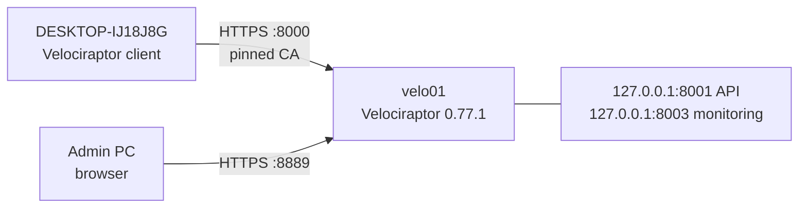

# 3.3 · Velociraptor: Endpoint Forensics

**Result:** Velociraptor 0.77.1 runs on velo01, a 1 GB unprivileged LXC, as a systemd service under its own `velociraptor` account. My Windows 11 PC enrolled through a repacked MSI and returned a 316-row process listing on its first collection. Every binary was checked against Velocidex's GPG key before use, the client config carries no private key, and the API and monitoring ports stay on localhost.

## What I built
- **A 1 GB server:** the Velociraptor server used 141 MiB at idle with one client enrolled, so velo01 kept the size planned in 1.7
- **A verified binary:** `velociraptor-v0.77.1-linux-amd64` checked with `gpg --verify` against key `0572 F28B 4EF1 9A04 3F4C BBE0 B22A 7FB1 9CB6 CFA1`
- **A self-signed deployment** generated with `config generate -i` under `umask 077`, with the frontend on `10.30.0.22:8000`, the GUI on `10.30.0.22:8889`, and the API (8001) and monitoring (8003) on 127.0.0.1
- **A server package** built with `debian server --binary`: a systemd unit (`velociraptor_server`), enabled at boot, running as the `velociraptor` system user instead of root
- **A client config derived from the server config** with `config client`, pointing at `https://10.30.0.22:8000/` and containing the CA certificate but no private key
- **A repacked Windows MSI:** the signed vendor MSI, verified, with my client config embedded, so it installs as an automatic service and enrolls with no extra steps
- **A first collection:** `Windows.System.Pslist` against my PC, triaged by signature, path and user

## Issues I ran into
| Issue | Cause | What I did |
| --- | --- | --- |
| The download, key import and `apt upgrade` ran on pve instead of velo01 | I pasted into the pve shell; both prompts end in `~#` | Moved the verified binary in with `pct push`, matched its SHA256 on both sides, then removed the files and the GPG key from pve. The 4 Debian security updates applied to pve stayed |
| The wizard wrote only `server.config.yaml` | In 0.77 the wizard doesn't write a client config | Derived it with `config client` and checked it had no private key |
| The GUI was on 127.0.0.1:8889 | The wizard's default; the browser on my PC couldn't reach it | Changed only the `GUI:` block's `bind_address` to 10.30.0.22, after keeping a copy of the original |
| `dpkg -i` said "No such file" | I assumed Debian's `name_version_arch.deb` pattern; Velociraptor names it `velociraptor-server-0.77.1.amd64.deb` | Used the name `ls -l *.deb` showed |
| `initial_users` listed `admin` twice | A repeated entry in the wizard | Left it: the server created one `admin` account, and the login worked |
| `curl: command not found` | The minimal Debian 12 LXC template ships without curl or gnupg | Installed both from Debian's repo |
| The repacked MSI is no longer vendor-signed | Embedding the config changes the file, which breaks its Authenticode signature | Verified the original MSI's GPG signature before repacking, and checked the repacked file's SHA256 after the transfer |

## Decisions
- **Keep 1 GB:** idle use was 141 MiB; I'll revisit it after hunts across more clients
- **Self-signed, addressed by IP:** the SOC VLAN has no internal DNS records yet, and clients pin the server's own CA from the client config, so a public certificate would add nothing to client trust
- **Bind the GUI to the SOC address, not 0.0.0.0:** the API and monitoring ports never need to leave the host
- **Use the server package, not the binary by hand:** it gives a systemd unit and a dedicated non-root service account
- **Verify, then modify:** both the Linux binary and the MSI were GPG-checked before I changed or ran anything
- **Client on my own PC only:** household devices stay out of the lab
- **Keep collection exports out of the repo:** the process list holds my username, paths and command lines, so only counts and a screenshot go in

**Skills:** DFIR tooling · Velociraptor deployment · VQL artifacts · endpoint triage · process analysis · Authenticode and GPG verification · PKI and certificate pinning · Linux packaging and systemd · Proxmox LXC file transfer · MSI deployment

➡️ [Deep dive](deep-dives/17-velociraptor.md)
