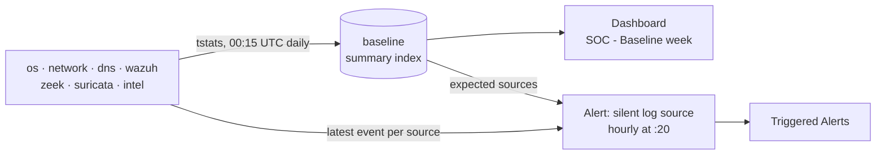

# 3.4 · Baseline Week: What Normal Looks Like

> **In progress.** Recording since 2026-10-26, with 10/24–10/26 in the index. This summary gets the findings once seven days are recorded.

**Result so far:** A scheduled search writes one row per log source per day (events and active hours) into a summary index, and three days are recorded with one copy each. A Dashboard Studio dashboard shows daily volume, active hours and trends per source. An hourly alert compares every expected source against its latest event and fires when one goes quiet for longer than its own threshold. The first scheduled run reported success but wrote nothing; I traced that to the report's search being overwritten and backfilled the missing day.

## What I built
- **A summary index** `baseline`, defined alongside the other seven indexes; its `stash` events don't count against the license
- **A daily report** `SOC - Baseline daily summary` (cron `15 0 * * *`): `tstats` counts per index, sourcetype, source and host by hour, then `collect` writes events and active hours for the previous UTC day
- **A backfill** of 10/24, 10/25 and 10/26: 24, 24 and 23 sources; 531,798, 420,001 and 470,898 events
- **A dashboard** `SOC - Baseline week` in Dashboard Studio: last-day tiles, a silence check, daily events per index, per-source volume and active hours, and a log-scale trend
- **A silence alert** `SOC - Baseline silent log source` (cron `20 * * * *`): sources seen on two or more baseline days are expected; each gets a threshold of 2, 26 or 74 hours depending on how many hours a day it normally reports; one alert per silent source, throttled for 12 hours
- **The definitions in the repo:** both saved searches and the dashboard JSON under `siem/splunk/`

## Issues I ran into
| Issue | Cause | What I did |
| --- | --- | --- |
| `intel` and Catalyst syslog had no row on quiet days | `tstats` returns nothing for a source with zero events | Built the silence alert on a list of expected sources instead of looking for zeros |
| A check of the new index returned nothing | The time picker was on real-time, which only sees new events | Searched the summary index over All time |
| 10/25 was in the index three times | `collect` appends, and Splunk Web reruns the search bar on reload or time-picker changes | Granted `can_delete` temporarily, deleted the day, re-collected once from a fresh tab, removed the role |
| The first scheduled run succeeded with 0 results | Pressing Save in a search tab opened from the report had replaced its search with my row-count check | Restored the search through Edit Search, read it back over REST, backfilled 10/26 once |
| The dashboard showed one source called `baseline · stash · splunk01` | `collect` overwrites `index`, `sourcetype`, `source` and `host` and keeps the originals as `orig_*` | Rebuilt every dashboard and alert search on the `orig_*` fields |
| The new alert would have fired for all 24 sources every hour | It was saved with the status search (no `where`) that was still on my clipboard | Replaced the search and verified search, trigger and throttle over REST |

## Decisions
- **Count with `tstats`:** it reads index metadata, so covering every index takes about a second
- **UTC days:** Splunk, Shuffle and Velociraptor all run on UTC, so the days line up across tools
- **Thresholds from the data, not one number:** a source that reports around the clock is suspicious after 2 hours; one that logs a few times a day isn't until it misses three days
- **Not expected until seen twice:** a source that appeared once (Catalyst syslog, `intel`) can't define normal yet
- **Triggered Alerts for now:** the Shuffle workflow only handles Suricata alerts; routing silence alerts to TheHive is on the backlog
- **Verify saved searches over REST:** the UI showed the right name and schedule both times the search behind it was wrong

**Skills:** Splunk summary indexing · `tstats` · scheduled searches and alerts · alert throttling · Dashboard Studio · REST endpoints · baselining log sources · data-gap detection · troubleshooting scheduled jobs

➡️ [Deep dive](deep-dives/18-baseline-week.md)
