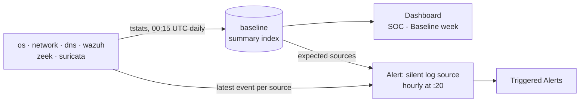

# 3.4 · Baseline Week: What Normal Looks Like

**Result:** I recorded 11 days (2026-10-24 to 11-03) of event counts and active hours for every log source into a summary index, with 7 of 7 scheduled runs successful. The SOC takes in a median of 454k events a day (329k–631k). Infrastructure logs stayed within about ±15% of normal; DNS, Zeek and endpoint logs follow household use and swing 40–60%. An hourly silence alert, built on the list of expected sources, caught `zeek:ssh` going quiet for a week. I confirmed the sensor still saw SSH and that I simply hadn't used it, then retuned every threshold from each source's longest recorded gap.

## What I built
- **A summary index** `baseline`, defined alongside the other seven indexes; its `stash` events don't count against the license
- **A daily report** `SOC - Baseline daily summary` (cron `15 0 * * *`): `tstats` counts per index, sourcetype, source and host by hour, then `collect` writes events and active hours for the previous UTC day
- **A dashboard** `SOC - Baseline week` in Dashboard Studio: last-day tiles, a silence check, daily events per index, per-source volume and active hours, and a log-scale trend
- **A silence alert** `SOC - Baseline silent log source` (cron `20 * * * *`): sources seen on two or more baseline days are expected, each with a threshold from its own behaviour (3, 8, 26 or 74 hours; 168 for `zeek:ssh`, 336 for Catalyst syslog), one alert per silent source, throttled for 12 hours
- **The definitions in the repo:** both saved searches and the dashboard JSON under `siem/splunk/`

## What normal looks like
| Index | Median per day | Range | Spread |
| --- | --- | --- | --- |
| zeek | 209,823 | 169,775 – 330,973 | −19% / +58% |
| dns | 121,840 | 76,158 – 174,440 | −37% / +43% |
| os | 54,902 | 42,848 – 77,909 | −22% / +42% |
| network | 32,778 | 28,861 – 37,167 | −12% / +13% |
| suricata | 8,165 | 2,109 – 22,136 | −74% / +171% |
| wazuh | 826 | 697 – 967 | −16% / +17% |
| **Total** | **454,263** | 328,811 – 631,453 | −28% / +39% |

- 10/27 was the peak (dns, zeek and suricata all highest); 10/30–11/01 was the low, with dns and zeek down while syslog and Wazuh held steady
- Suricata's volume swings too much for a count-based alert; signatures matter more than totals
- `zeek:ssh` and Catalyst syslog are event-driven: they log only when someone connects or changes something

## Issues I ran into
| Issue | Cause | What I did |
| --- | --- | --- |
| `intel` and Catalyst syslog had no row on quiet days | `tstats` returns nothing for a source with zero events | Built the silence alert on a list of expected sources instead of looking for zeros |
| 10/25 was in the index three times | `collect` appends, and Splunk Web reruns the search bar on reload or time-picker changes | Granted `can_delete` temporarily, deleted the day, re-collected once from a fresh tab, removed the role |
| The first scheduled run succeeded with 0 results | Pressing Save in a search tab opened from the report had replaced its search with my row-count check | Restored the search through Edit Search, read it back over REST, backfilled 10/26 once |
| The dashboard showed one source called `baseline · stash · splunk01` | `collect` overwrites `index`, `sourcetype`, `source` and `host` and keeps the originals as `orig_*` | Rebuilt every dashboard and alert search on the `orig_*` fields |
| The new alert would have fired for all 24 sources every hour | It was saved with the status search that was still on my clipboard | Replaced the search and verified search, trigger and throttle over REST |
| Two dashboard tables showed "Unknown sid" and the tiles kept old numbers | Chained panels reused an expired base search | Gave every panel its own search |
| The alert fired on 168 of 169 runs | `zeek:ssh` had no events after 10/25; I hadn't used SSH all week | Proved the sensor still logged SSH with one test session, gave `zeek:ssh` a 168 h override, and retuned the tiers from each source's longest gap |
| A 168 h threshold could never fire | The search only looked 4 days back, so silence topped out at 96 h | Widened the lookback to 15 days and added a 336 h Catalyst override |

## Decisions
- **Count with `tstats`:** it reads index metadata, so covering every index takes about a second
- **UTC days:** Splunk, Shuffle and Velociraptor all run on UTC, so the days line up across tools
- **Thresholds from recorded gaps, not one number:** a source that reports around the clock is suspicious after 3 hours; one that logs a few times a day isn't until it misses three days
- **Keep event-driven sources expected, with long thresholds:** a week with no SSH reaching the sensor is still worth knowing about
- **Triggered Alerts for now:** the Shuffle workflow only handles Suricata alerts; routing silence alerts to TheHive is on the backlog
- **Verify saved searches over REST:** twice the UI showed the right name and schedule while the search behind it was wrong

**Skills:** Splunk summary indexing · `tstats` and `streamstats` · scheduled searches and alerts · alert throttling and tuning · Dashboard Studio · REST endpoints · baselining log sources · data-gap detection · troubleshooting scheduled jobs · Zeek

➡️ [Deep dive](deep-dives/18-baseline-week.md)
