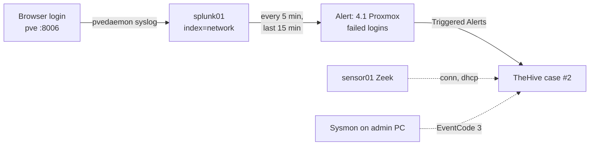

# 4.1 · Failed Proxmox Logins

**Result:** A Splunk alert watches the Proxmox web UI and API for password guessing, username guessing and any failed login from a machine other than my admin PC. I built it from the raw logs, set the thresholds from 30 days of history (two typos in a month), tested each condition on its own, and worked the first alert as TheHive case #2: closed as a true positive, authorised test, no impact. The case also turned up a blind spot: Sysmon on my PC doesn't record browser connections to internal web UIs.

## What I built
- **A field extraction** for the `pvedaemon` failure line: source IP (with the IPv6 `::ffff:` prefix stripped), user, realm and reason
- **The alert** `SOC - 4.1 Proxmox failed logins` (cron `*/5 * * * *`, last 15 minutes), one row per source IP, firing on any of:
  - 5 or more failures (password guessing, T1110.001)
  - 3 or more different usernames (username guessing)
  - a failure from any IP other than the admin PC
- **One alert per source IP**, throttled for 30 minutes on `src_ip`, severity High; definition in `detections/splunk/soc_4_1_proxmox_failed_logins.conf`
- **TheHive case #2** with observables, three mandatory tasks (Scope, Source, Verdict) and an evidence log for each

## Issues I ran into
| Issue | Cause | What I did |
| --- | --- | --- |
| Each failed attempt appeared twice | PAM logins write a `pam_unix` line and a `pvedaemon` line | Counted only the `pvedaemon` line, which every realm writes |
| The source IP read `::ffff:192.168.1.11` | Proxmox listens on IPv6 and logs IPv4 clients as IPv4-mapped addresses | Made the prefix optional in the `rex` and left it out of `src_ip` |
| A search I expected to be empty fired on 3 usernames | The 15-minute history bins split my tests in two; the alert's sliding window didn't | Kept the sliding window; it's the one that can't split a burst |
| The alert saved as "Once" with no throttle field | The throttle field only appears after choosing "For each result" | Changed both in Edit Alert after a REST read-back showed them |
| My first test of the unknown-IP condition proved nothing | The row also had 6 failures, so another `OR` condition matched | Tested the condition alone, with a positive and a negative case |
| The test search's tab offered Save | It had been opened from the alert itself, so Save would have overwritten the alert | Closed it and ran every test from New Search |
| Zero successful logins needed proof | An empty search proves nothing until the pattern is known to match | Found 1,124 `successful auth` lines in 30 days before relying on the zero |
| Sysmon showed no browser connections to pve | sysmon-modular logs Chrome only for mDNS, almost never for web ports | Recorded it in the case and on the backlog |

## Decisions
- **Thresholds from history:** two typos in 30 days and never more than one failure per 15 minutes, so 5 failures or 3 usernames is well above normal
- **One allowed source:** the Proxmox UI has only ever been used from the admin PC, so any failure from elsewhere is worth a look
- **Every 5 minutes over 15:** alerts within 5 minutes, and a burst split across one run's edge is complete in the next; the throttle stops it alerting three times
- **Worked the case by hand:** automated routing to TheHive waits for a general Shuffle workflow (roadmap tier ②)
- **True positive, not false positive:** the rule's condition really happened; who did it is the verdict, recorded separately

**Skills:** detection engineering · Splunk `rex` and `stats` · threshold tuning from history · alert scheduling and throttling · positive and negative testing · TheHive case management · alert triage · MITRE ATT&CK T1110 · Zeek and Sysmon pivoting · finding telemetry gaps

➡️ [Deep dive](deep-dives/19-proxmox-failed-logins.md)
