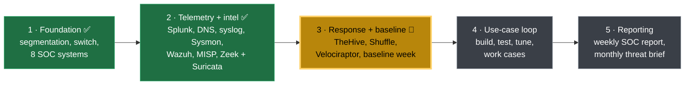
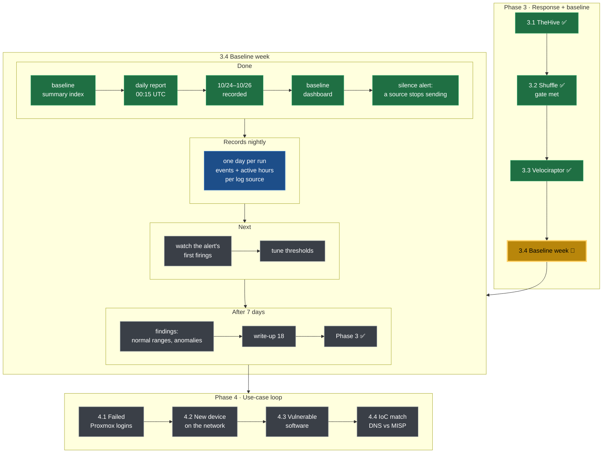
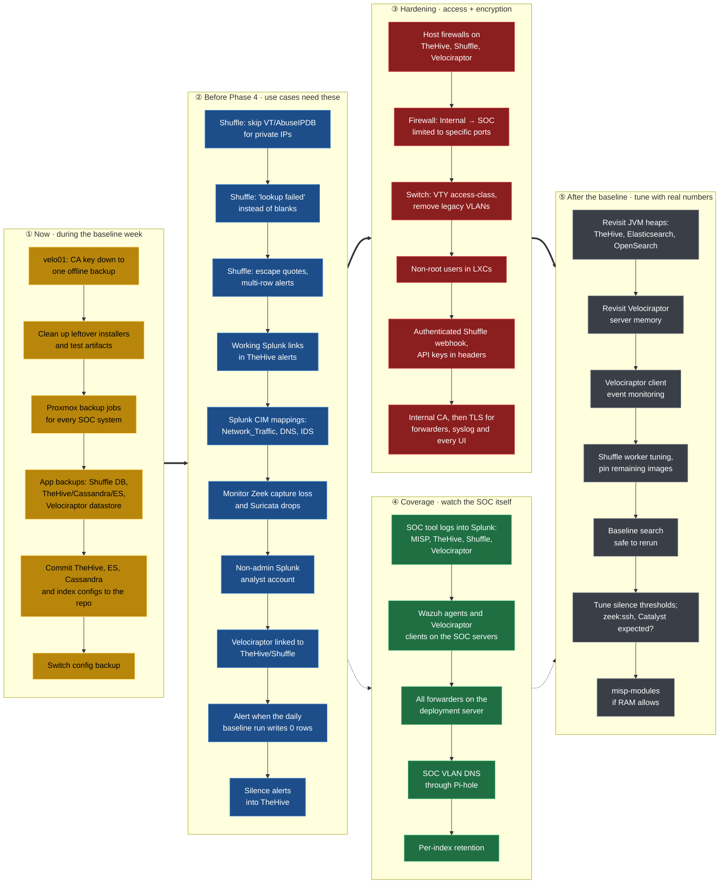

# 🗺️ Roadmap

_Updated 2026-10-27._

Where the build stands, what comes next, and the improvements queued alongside it. Write-ups for every finished step are in the [Build Log](README.md).

## Phases

## Phase 3 in detail

## Improvement backlog

Each build step ends with a backlog. These are those items, grouped and put in the order I plan to work them: housekeeping during the baseline week, then what the Phase 4 use cases depend on, then hardening, monitoring of the SOC itself, and tuning once the baseline gives real numbers.

Backups come first on purpose: Phase 4 triggers detections on live systems, so restore points should exist before that starts.
