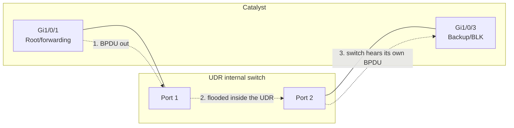
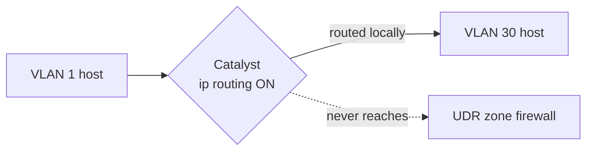
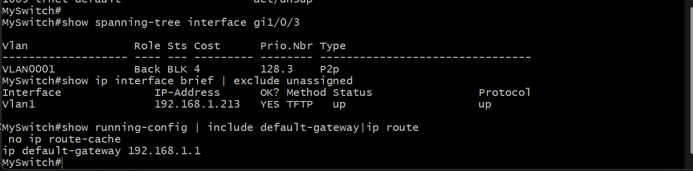
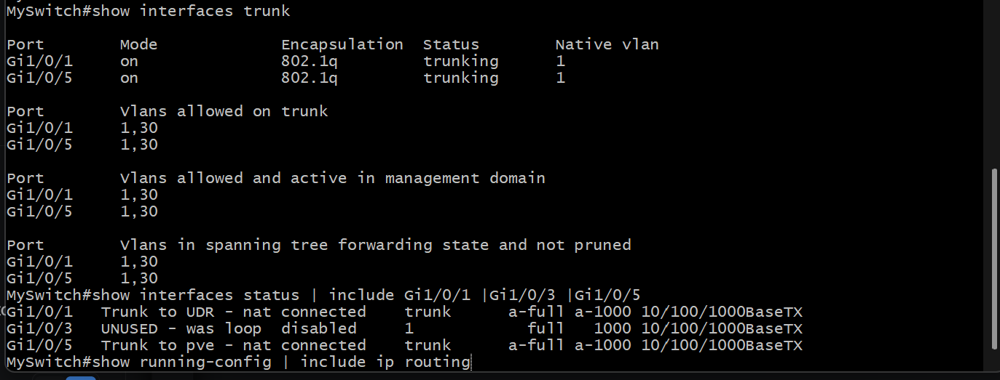
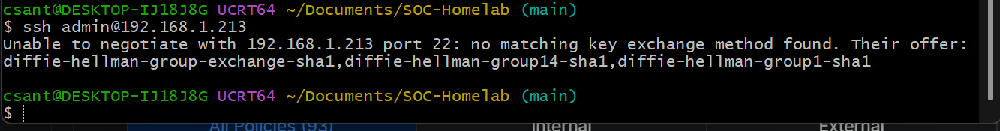
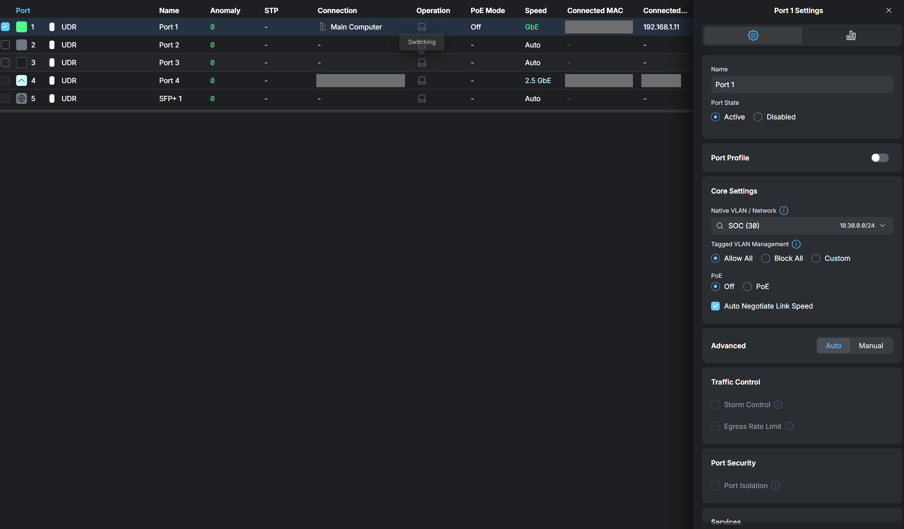
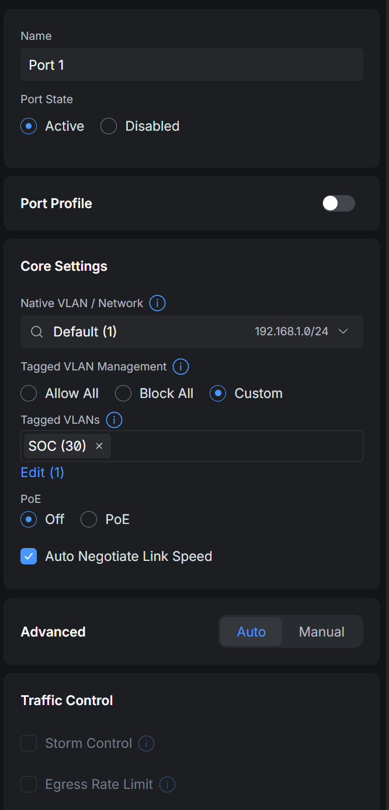
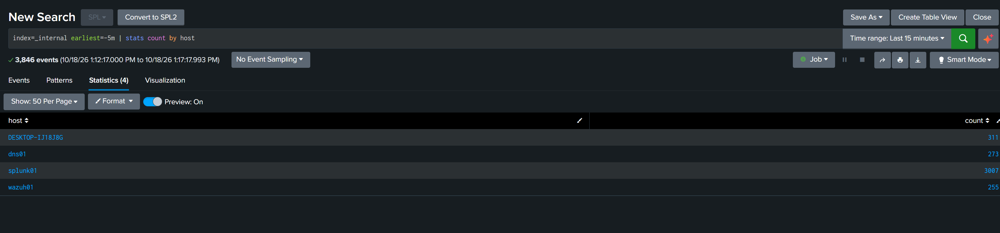

# 1.4 · Catalyst 3750-X: Recovery, Hardening and Trunking (Deep Dive)

The Catalyst sits between the UDR and the Proxmox server, so VLAN 30 has to cross it. Before I could configure it, I had to get back into it, and before I changed anything, I audited it.

## The switch

| Item | Value |
| --- | --- |
| Model | WS-C3750X-24T-E |
| IOS | 15.2(4)E10 (crypto image, final release for the platform) |
| Role | Layer 2 switch between the UDR and the wired hosts |
| Management | `Vlan1` SVI on the Main network |

I mapped every port by checking the MAC address tables on both the switch and the UDR, not by the port descriptions. That's how I found Gi1/0/3: its description said "Con to 2nd Computer", but it was actually a second cable to the router.

| Port | Connected to |
| --- | --- |
| Gi1/0/1 | UDR Port 1 |
| Gi1/0/3 | UDR Port 2 (the loop) |
| Gi1/0/5 | Proxmox host |
| Gi1/0/6–24 | Nothing, already shut |

## Getting back in

I'd set the switch up years ago and lost the enable secret. I recovered it over the console cable (9600 8N1) with Cisco's boot-loader procedure:

1. Held MODE at power-on to reach the `switch:` prompt
2. `flash_init`, then renamed `config.text` so the switch would boot without its startup config
3. Booted, skipped the setup dialog, renamed the file back and copied it into the running config, which restored my config with privileged access
4. Set a new hashed `enable secret`, removed the legacy `enable password`, and saved

SSH was refused afterwards, because the RSA host key is stored separately from `config.text`. I regenerated it:

```
hostname MySwitch
ip domain-name soc.lan
crypto key generate rsa modulus 2048
ip ssh version 2
line vty 0 15
 transport input ssh
 login local
```

Management is SSH-only now. The switch only supports SHA-1 key exchange, which modern OpenSSH turns off by default, so I connect with legacy flags. There's no newer IOS for this platform, so I'll limit who can reach management with a VTY `access-class` instead.

This also made it obvious how much physical access matters: anyone with the console port and the MODE button can do what I just did.

## The audit

### Layer 2 loop

Gi1/0/3 showed spanning-tree role **Backup**, state **BLK**, with no MAC addresses learned.



In Rapid PVST+, a port gets the Backup role when the switch receives its own BPDUs on it, which only happens if the port loops back to the same switch. Here the loop went out Gi1/0/1, through the UDR's internal switch, and back in Gi1/0/3. Spanning tree was blocking it, but any re-convergence (like converting Gi1/0/1 to a trunk) could have let it forward briefly. I shut Gi1/0/3, relabeled it and pulled the cable.

### Routing on the switch

`ip routing` was enabled. A Layer 3 switch with SVIs on multiple VLANs can route between them by itself:



That would have let traffic between Main and the SOC skip my zone firewall entirely. Only Vlan1 had an IP, and `ip default-gateway` was already set, so I turned routing off. Now every inter-VLAN packet goes through the UDR, where it's filtered and logged.

### VTP

The switch was a VTP server with a blank domain and revision 40. Connected to another VTP switch, it could overwrite that switch's VLANs or adopt foreign ones. I set it to transparent.

### Leftovers

Twelve VLANs from an old lab are still defined. They're harmless with the trunks restricted, and I'll clean them up later.

## The trunk change

| Port | Mode | Native | Allowed |
| --- | --- | --- | --- |
| Gi1/0/1 (UDR) | 802.1Q, DTP off | 1 | 1, 30 |
| Gi1/0/5 (pve) | 802.1Q, DTP off | 1 | 1, 30 |

I kept VLAN 1 native and untagged so Proxmox management and the rest of the Main network didn't change at all. I only added VLAN 30 as tagged. I set the allowed list explicitly because the default would carry every VLAN on the switch to the router and the hypervisor. `nonegotiate` turns off DTP, so nothing plugged in can talk a port into trunking.

My SSH session crossed Gi1/0/1, the port I was changing, so I scheduled a rollback first and pasted the change as a single block so it would finish even if SSH dropped mid-way:

```
reload in 10
conf t
interface Gi1/0/3
 description UNUSED - was loop to UDR port 2
 shutdown
exit
vtp mode transparent
vlan 30
 name SOC
interface Gi1/0/5
 description Trunk to pve - native Main + SOC
 switchport trunk encapsulation dot1q
 switchport trunk native vlan 1
 switchport trunk allowed vlan 1,30
 switchport mode trunk
 switchport nonegotiate
interface Gi1/0/1
 description Trunk to UDR - native Main + SOC
 switchport trunk encapsulation dot1q
 switchport trunk native vlan 1
 switchport trunk allowed vlan 1,30
 switchport mode trunk
 switchport nonegotiate
exit
no ip routing
end
```

Once I'd confirmed everything, I ran `reload cancel` and `write memory`.

## Verification

```
MySwitch#show interfaces trunk
Port        Mode   Encapsulation  Status     Native vlan
Gi1/0/1     on     802.1q         trunking   1
Gi1/0/5     on     802.1q         trunking   1

Port        Vlans allowed on trunk
Gi1/0/1     1,30
Gi1/0/5     1,30

Port        Vlans in spanning tree forwarding state and not pruned
Gi1/0/1     1,30
Gi1/0/5     1,30
```

Both trunks are up and forwarding only VLANs 1 and 30, Gi1/0/3 is shut, routing is off, and the Proxmox UI and internet still work from my workstation.

## Backlog

- VTY `access-class` limiting SSH to my workstation
- Remove the legacy VLANs
- Back up the config to the repo with secrets scrubbed
- SPAN session to the sensor NIC (step 2.7)

## Evidence

Screenshots are redacted: public IPs, MAC addresses, external domains and household devices are blacked out.

**Gi1/0/3 in STP Backup/BLK, the loop I found in the audit.**



**Gi1/0/1 and Gi1/0/5 trunking VLANs 1 and 30, Gi1/0/3 disabled.**



**The switch only offers SHA-1 key exchange, so modern SSH refuses it.**



**Port review after re-cabling: UDR Port 1 was set to native SOC with Allow All tagged.**



**UDR Port 1 corrected to native Default with only SOC (30) tagged.**



**All four forwarding hosts reporting to _internal after the change.**


