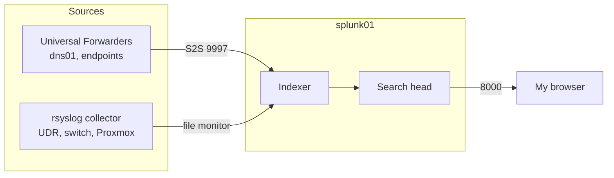

# 2.1 · Splunk Enterprise (Deep Dive)

**Host:** `splunk01`, 10.30.0.10 (Ubuntu 24.04, 4 vCPU / 6 GB / 100 GB)
**Version:** Splunk Enterprise 10.6.0.5

Splunk is where every log in this SOC ends up and where I do triage, hunting and detections. I needed it running as a service, with indexes for each data category and a listener for forwarders, before I onboarded the first data source.

## Architecture

A production Splunk deployment splits forwarders, indexers, search heads and a deployment server across machines. My volume is a few hundred MB a day at most, so I run one all-in-one instance that does indexing, search and receiving. Forwarders on the sources ship data in.



## Install

```bash
cd /tmp && wget -O splunk-10.6.0.5-86587d4e3b27-linux-amd64.deb "https://download.splunk.com/products/splunk/releases/10.6.0.5/linux/splunk-10.6.0.5-86587d4e3b27-linux-amd64.deb"
sudo dpkg -i /tmp/splunk-10.6.0.5-86587d4e3b27-linux-amd64.deb
rm /tmp/splunk-10.6.0.5-86587d4e3b27-linux-amd64.deb
```

I used the `.deb` so Splunk is registered with the package manager, which tracks the version and makes upgrades a single `dpkg -i`. It installs to `/opt/splunk`. The installer printed a `find: ... python3.7 ... No such file or directory` line, which is a leftover check for a Python version Splunk no longer ships. The install finished with `complete`.

## Admin account

Splunk has no default password. On first start, it creates the admin from `user-seed.conf` if the file exists, then deletes it. I wrote it before ever starting Splunk:

```bash
sudo tee /opt/splunk/etc/system/local/user-seed.conf >/dev/null <<'EOF2'
[user_info]
USERNAME = admin
PASSWORD = <redacted>
EOF2
```

`>/dev/null` keeps the password off my terminal, and the quoted heredoc keeps the shell from expanding anything in it.

## Service

```bash
sudo /opt/splunk/bin/splunk enable boot-start -user splunk -systemd-managed 1 --accept-license --answer-yes --no-prompt
sudo systemctl start Splunkd
```

Splunk is a large, network-facing application, and I didn't want it running as root. `-user splunk` runs it under its own account, and `-systemd-managed 1` gives me a real `Splunkd.service` with restart-on-failure and `journalctl` logging. From here on, I manage it with `systemctl`, not `splunk start`.

```
Systemd unit file installed at /etc/systemd/system/Splunkd.service.
● Splunkd.service ... Active: active (running)
```

## Transparent Huge Pages

Splunk recommends disabling THP because the kernel's background memory compaction causes latency spikes for its allocation pattern. Writing to `/sys` doesn't survive a reboot, so I made a small unit that runs before Splunk on every boot:

```bash
sudo tee /etc/systemd/system/disable-thp.service >/dev/null <<'EOF2'
[Unit]
Description=Disable Transparent Huge Pages
Before=Splunkd.service
[Service]
Type=oneshot
ExecStart=/bin/sh -c 'echo never > /sys/kernel/mm/transparent_hugepage/enabled; echo never > /sys/kernel/mm/transparent_hugepage/defrag'
[Install]
WantedBy=multi-user.target
EOF2
sudo systemctl daemon-reload && sudo systemctl enable --now disable-thp && sudo systemctl restart Splunkd
cat /sys/kernel/mm/transparent_hugepage/enabled
```

```
always madvise [never]
```

## Indexes

```bash
for i in os network dns wazuh intel; do sudo -u splunk /opt/splunk/bin/splunk add index $i; done
```

| Index | Holds | Source |
| --- | --- | --- |
| `os` | Windows and Linux logs, Sysmon | Universal Forwarders (2.4) |
| `network` | UDR, switch, Proxmox, Zeek, Suricata | Syslog collector, sensor (2.3, 2.7) |
| `dns` | Every DNS query | Pi-hole (2.2) |
| `wazuh` | Wazuh alerts, FIM, vulnerabilities | Wazuh (2.5) |
| `intel` | IOCs and matches | MISP (2.6) |

I kept everything out of `main` so each search only scans the data it needs, retention can differ per type (DNS is high-volume and short-lived), and roles can be scoped per index. I run the CLI as `splunk`, never root, so it doesn't create root-owned files under `/opt/splunk` that the service then can't read.

## Receiving

```bash
sudo -u splunk /opt/splunk/bin/splunk enable listen 9997
sudo ss -tlnp | grep -E '8000|8089|9997'
```

```
LISTEN 0.0.0.0:9997  users:(("splunkd",...))
LISTEN 0.0.0.0:8089  users:(("splunkd",...))
LISTEN 0.0.0.0:8000  users:(("splunkd",...))
```

| Port | Purpose |
| --- | --- |
| 8000 | Splunk Web |
| 8089 | Management API (CLI, apps, Shuffle later) |
| 9997 | Forwarder data |

Splunk listens on all interfaces. The UDR zone firewall controls who can reach VLAN 30, and only the Main network can start connections in.

In the web UI at `http://10.30.0.10:8000`, the five indexes are listed and receiving shows 9997.

## Password exposure

I exposed the admin password in two places during this step: in `~/.bash_history` from using `-auth admin:'...'` on the command line, and in command output I pasted elsewhere. I treated it as compromised and rotated it:

```bash
history -c
sudo -u splunk /opt/splunk/bin/splunk edit user admin -password '<new>' -auth admin:'<old>'
history -c
```

Since then, I authenticate with `splunk login` (interactive prompt) and redact output before sharing it anywhere.

## Known gaps

The CLI warns `Server Certificate Hostname Validation is disabled` because Splunk ships self-signed certificates, and Splunk Web is plain HTTP. Both are fine inside the isolated VLAN for now, and both are on the backlog.

A new install runs a 60-day Enterprise trial. After that it falls back to Splunk Free, which drops alerting, scheduled searches and authentication, so I applied for a developer license to install before the trial ends.

## Backlog

- Custom TLS certificates and hostname validation
- HTTPS on Splunk Web
- Install the developer license
- Per-index retention, with cold storage on the large array
- Non-admin analyst account for daily use
- Narrow Internal → SOC to 8000, 8089 and 9997
