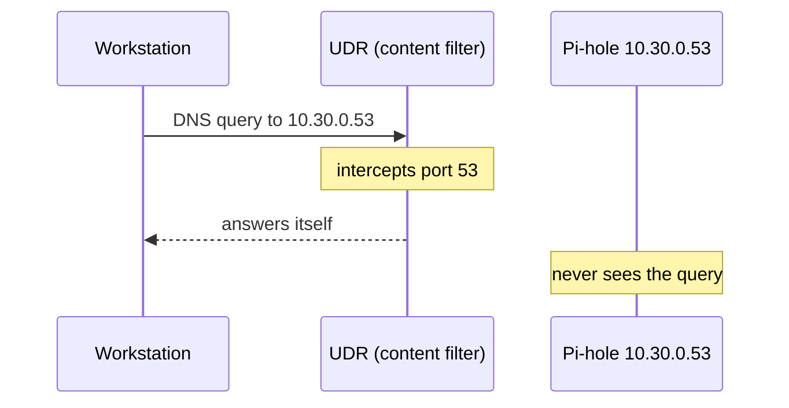
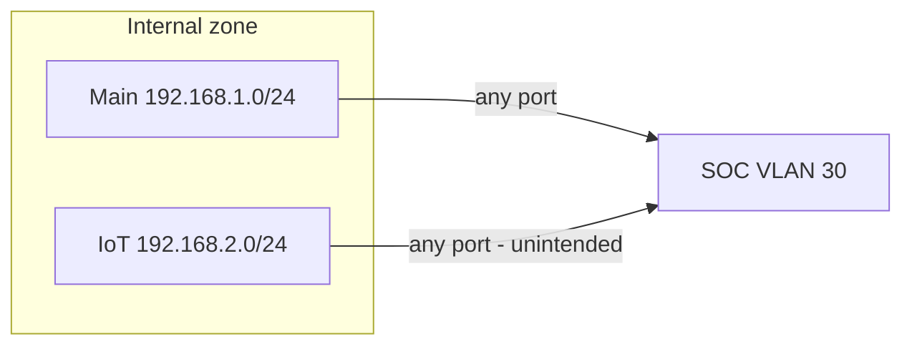
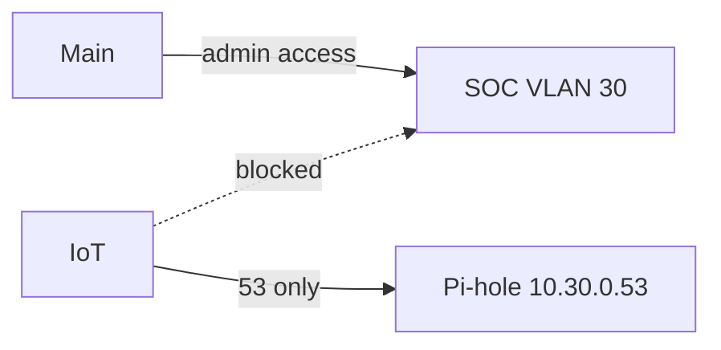
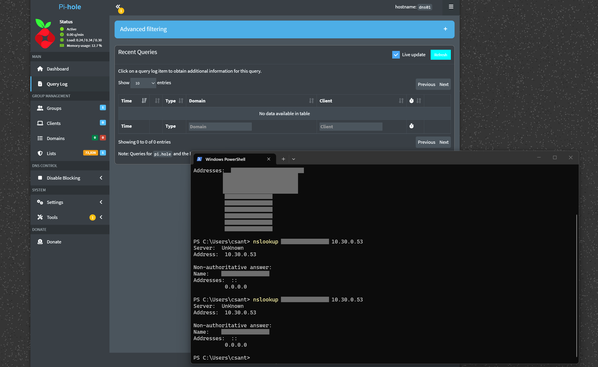
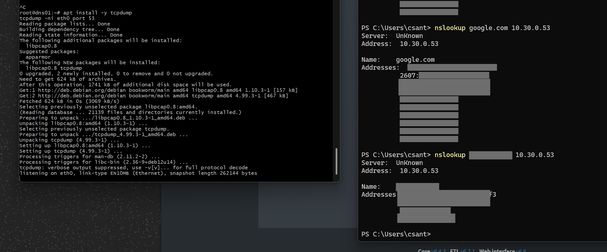
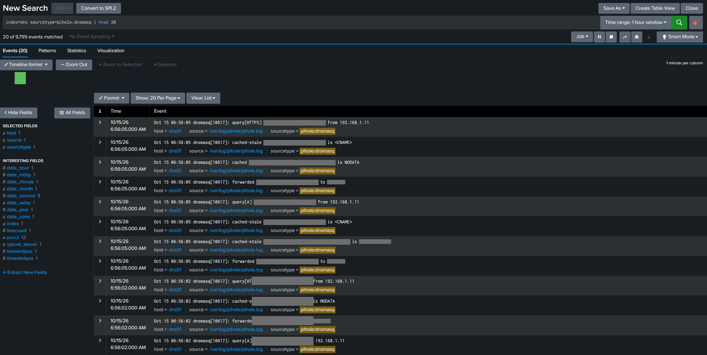
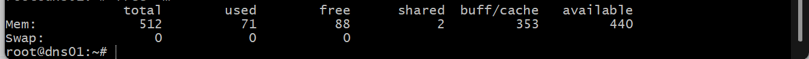

# 2.2 · Pi-hole DNS Sinkhole and DNS Logging (Deep Dive)

I started data collection with DNS. Almost every connection begins with a lookup, whether it's malware calling home, a phishing link, or exfiltration over DNS. A resolver that logs every query along with the client that made it gives me a view of the whole network without installing anything on the endpoints, and it runs in a 512 MB container.

## Pi-hole on dns01

`dns01` is the unprivileged Debian 12 container from step 1.7.

```bash
ssh root@10.30.0.53
apt update && apt install -y curl
curl -sSL https://install.pi-hole.net | bash
```

Core 6.4.3 / FTL 6.7.1 / Web 6.6.

| Choice | Value | Reason |
| --- | --- | --- |
| Upstream | Quad9 (9.9.9.9, 149.112.112.112) | Quad9 blocks malicious domains from its own threat feeds, a second filter behind Pi-hole |
| Blocklist | Default, ~72,500 domains | A starting point to tune later |
| Query logging | On | The reason I'm running it |
| Privacy level | 0 | I need the domain and the client IP |

I changed the installer's random web password straight away with `pihole setpassword`.

Pi-hole v6 only answers clients on its own subnet by default. My clients live on 192.168.1.0/24 and 192.168.2.0/24 and reach it through the UDR, so it was ignoring them:

```bash
pihole-FTL --config dns.listeningMode ALL
```

I'm comfortable with `ALL` because the UDR zone firewall decides who can reach port 53 on this container.

In UniFi, I set DHCP DNS for both the Default and IOT networks to `10.30.0.53`.

## Pi-hole saw nothing

`nslookup` from my workstation pointed straight at Pi-hole got answers, but Pi-hole's query log stayed empty. A capture on the container showed nothing arriving:

```bash
tcpdump -ni eth0 port 53
```

So something between my PC and Pi-hole was answering in its place. It was the UDR. I had a CyberSecure content filter (ad block) on the Default network, and to filter DNS, the UDR transparently intercepts all port 53 traffic and answers it itself, whatever server the client asked for.



I deleted the content filter. Pi-hole does that job now, with logs I control. As soon as the filter was gone, `tcpdump` showed queries arriving and the query log filled up.

## My workstation was bypassing it

`ipconfig /all` showed my NIC still using a static third-party DNS provider instead of the DHCP-assigned server, so its lookups went straight to the internet and skipped Pi-hole. I reset it from an elevated PowerShell:

```powershell
Set-DnsClientServerAddress -InterfaceAlias "Ethernet" -ResetServerAddresses
ipconfig /flushdns
nslookup pi.hole
```

A sinkhole only covers clients that use it. Static DNS, browser DNS-over-HTTPS and hard-coded resolvers on IoT devices all get around it, which is why I want a DNS bypass detection later.

## IoT could reach the whole SOC

Adding IoT as a Pi-hole client meant checking which UDR rule let IoT reach the SOC. My IoT network sits in the Internal zone, and my "Internal SOC Allow" policy was Internal zone → SOC, any port. So every IoT device could reach every port on every SOC system: Splunk, Wazuh, MISP, all of it.



| Policy | Before | After |
| --- | --- | --- |
| Internal SOC Allow | Internal zone → SOC, any | Network = Default only → SOC |
| IoT DNS to Pi-hole (new) | — | Network = IOT → 10.30.0.53, TCP/UDP 53 |



A zone rule applies to every network in the zone, so putting IoT in Internal had quietly given it everything Internal could do.

## Shipping the logs

I installed the Splunk Universal Forwarder on `dns01` and set it to run as its own user at boot:

```bash
dpkg -i splunkforwarder-*.deb
/opt/splunkforwarder/bin/splunk enable boot-start -systemd-managed 1 -user splunkfwd --accept-license
```

`/var/log/pihole/pihole.log` belongs to the `pihole` group. Rather than run the forwarder as root or loosen the file's permissions, I added `splunkfwd` to that group:

```bash
usermod -aG pihole splunkfwd
systemctl restart SplunkForwarder
sudo -u splunkfwd /opt/splunkforwarder/bin/splunk add forward-server 10.30.0.10:9997
sudo -u splunkfwd /opt/splunkforwarder/bin/splunk add monitor /var/log/pihole/pihole.log -index dns -sourcetype pihole:dnsmasq
sudo -u splunkfwd /opt/splunkforwarder/bin/splunk list forward-server
```

The data goes to `index=dns` with sourcetype `pihole:dnsmasq`, since the log is dnsmasq's format. My first search came back empty, but it had run two minutes before the forwarder connected. A minute later the events were there:

```
index=dns sourcetype=pihole:dnsmasq | head 20
```

Each query shows up as a set of lines: `query[A] <domain> from <client>`, `forwarded <domain> to 9.9.9.9`, then the reply or `gravity blocked`. The top domains on the network:

```
index=dns sourcetype=pihole:dnsmasq "query["
| rex "query\[(?<qtype>\w+)\] (?<domain>\S+) from (?<src_ip>\S+)"
| stats count by domain
| sort - count
| head 20
```

## SSH key rotation

Partway through this step, I couldn't remember the passphrase on my SOC SSH key. I generated a new key (`soc_ed25519_v2`), pushed it to every system through the Proxmox host (`pct exec` for the containers, the guest agent for the VMs), replaced `authorized_keys` everywhere so only the new key works, updated template 9000, and moved the old key out of use.

## Verification

Blocked domains return `0.0.0.0`, allowed ones resolve, queries from both Main and IoT clients appear in the Pi-hole log, and `index=dns` is receiving live events from `dns01`.

`free -m` on the container showed about 88 MB free but about 440 MB available. The rest is page cache the kernel hands back on demand, so 512 MB is enough.

The forwarder uses Splunk's default certificates without server verification. That's acceptable inside the isolated VLAN for now. Query logs contain household browsing, so they stay inside the SOC and any screenshots I publish are redacted.

## Backlog

- DNS bypass detection: port 53/853 or known DoH endpoints to anything other than 10.30.0.53, using the UDR logs
- Field extractions so `domain`, `src_ip` and `qtype` don't need `rex`
- Filter `.localdomain` and reverse-lookup noise
- TLS between forwarder and indexer
- Non-root admin user in the container
- Feed MISP indicators into the blocklist (step 2.6)

## Evidence

Screenshots are redacted: public IPs, MAC addresses, external domains and household devices are blacked out.

**Pi-hole answering on 10.30.0.53 and sinkholing a blocklisted domain to 0.0.0.0.**



**Watching port 53 on dns01 while testing lookups.**



**Pi-hole query logs searchable in index=dns.**



**dns01 running comfortably in 512 MB.**


