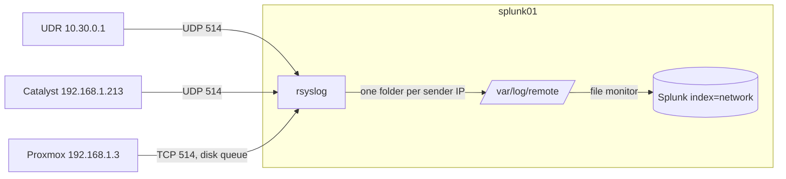
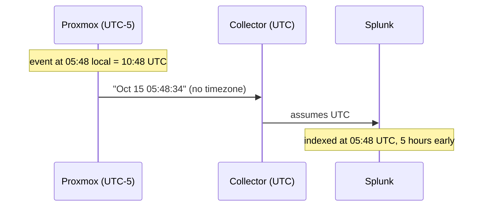
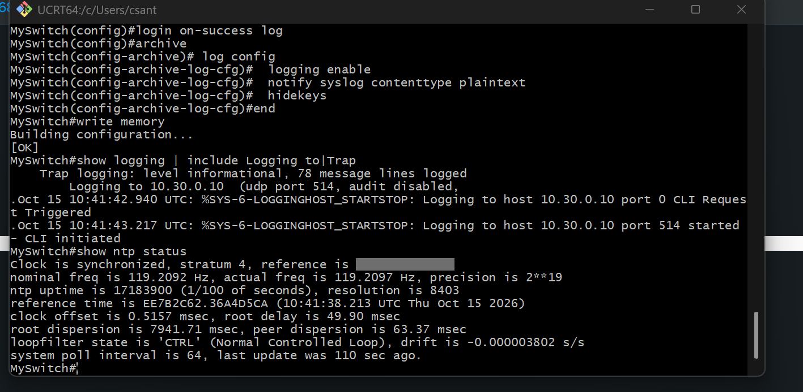
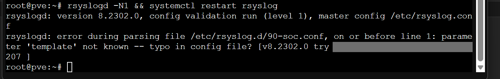
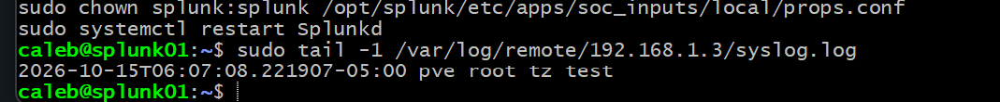
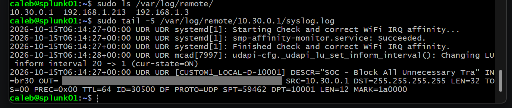
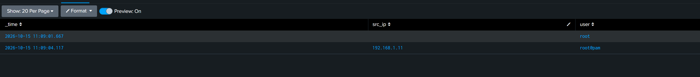
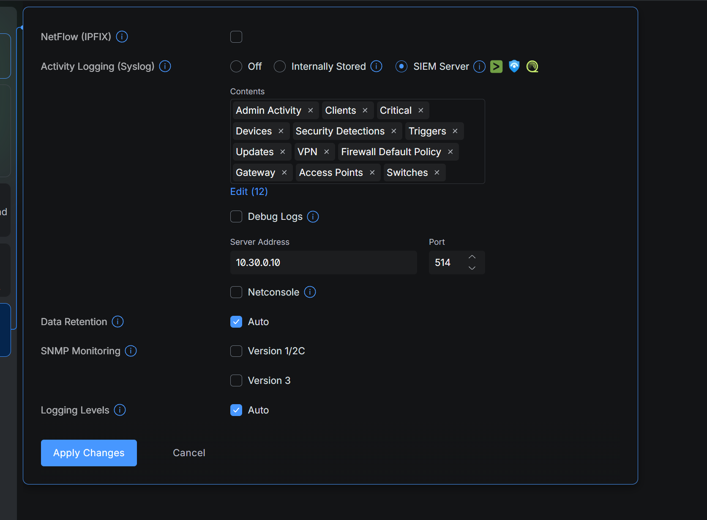
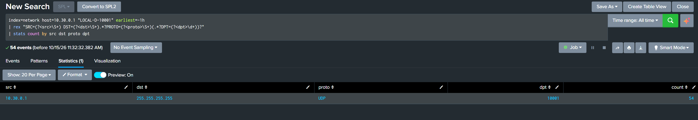

# 2.3 · Infrastructure Logs (Deep Dive)

The goal for this step was to get the network and hypervisor layer into Splunk: the UDR firewall and IPS, the Catalyst switch, and the Proxmox host. I wanted every event in `index=network` with a `host` and `_time` I could trust.



## Collector on splunk01

I put rsyslog in front of Splunk instead of having Splunk listen on 514 directly. Syslog is mostly UDP, so anything sent while Splunk restarts would be gone. rsyslog is always running, writes to disk, and Splunk catches up from the files.

`/etc/rsyslog.d/10-remote.conf`:

```
module(load="imudp")
module(load="imtcp")
template(name="RemoteFile" type="string" string="/var/log/remote/%fromhost-ip%/syslog.log")
template(name="RecvTimeFormat" type="string" string="%timegenerated:::date-rfc3339% %HOSTNAME% %syslogtag%%msg:::sp-if-no-1st-sp%%msg:::drop-last-lf%\n")
ruleset(name="remote") {
  if $fromhost-ip == "10.30.0.1" then {
    action(type="omfile" dynaFile="RemoteFile" template="RecvTimeFormat" dirCreateMode="0750" fileCreateMode="0640" dirGroup="adm" fileGroup="adm")
  } else {
    action(type="omfile" dynaFile="RemoteFile" template="RSYSLOG_FileFormat" dirCreateMode="0750" fileCreateMode="0640" dirGroup="adm" fileGroup="adm")
  }
  stop
}
input(type="imudp" port="514" ruleset="remote")
input(type="imtcp" port="514" ruleset="remote")
```

Each sender gets its own folder, named by the IP rsyslog sees the packet come from. The ruleset ends with `stop`, so remote logs stay out of splunk01's own syslog. Files are `0640`, group `adm`, and I added the `splunk` user to `adm` so it can read them and nothing else can.

```bash
sudo install -d -o syslog -g adm -m 0750 /var/log/remote
sudo usermod -aG adm splunk
sudo rsyslogd -N1 && sudo systemctl restart rsyslog
```

I keep 14 days on disk as a buffer with logrotate (`/etc/logrotate.d/remote`: daily, rotate 14, compress). Splunk holds the long-term copy.

Splunk side, in its own app at `/opt/splunk/etc/apps/soc_inputs/local/`. I put it in an app rather than `system/local` so the config is self-contained and easy to back up.

`inputs.conf`:
```
[monitor:///var/log/remote]
index = network
sourcetype = syslog
host_segment = 4
whitelist = \.log$
disabled = false
```

`props.conf`:
```
[source::/var/log/remote/*/syslog.log]
TRANSFORMS =
```

`host_segment = 4` takes the IP folder as `host`. The whitelist skips the rotated `.gz` files so nothing gets indexed twice. The `props.conf` override is explained under the host issue below.

`ufw` on splunk01 is inactive, so right now the UDR zone firewall is the only control on that port. Enabling host firewalls on the SOC servers is on my backlog.

## Catalyst 3750-X

```
clock timezone UTC 0 0
ntp server 162.159.200.1
service timestamps log datetime msec show-timezone
logging host 10.30.0.10
logging trap informational
logging source-interface Vlan1
logging origin-id hostname
login on-failure log
login on-success log
archive
 log config
  logging enable
  notify syslog contenttype plaintext
  hidekeys
end
write memory
```

I moved the switch to UTC and NTP so its events line up with every other system in Splunk. I log at informational, which includes logins and link changes. I always send from the management VLAN interface so the source IP never changes. Logging failed and successful logins gives me a brute-force signal on the switch. `archive log config` records every config command and who ran it, with `hidekeys` masking passwords.

```
Trap logging: level informational
Logging to 10.30.0.10 (udp port 514)
Clock is synchronized, stratum 4, reference is 162.159.200.1
clock offset is 0.5157 msec
```

The first two messages after the change had a leading dot (`.Oct 15 10:41:42`). IOS marks timestamps with a dot until NTP syncs, so I don't treat dotted timestamps as reliable.

## Proxmox

Proxmox 8 only logs to journald, so I installed rsyslog and forward everything:

```bash
apt install -y rsyslog
cat > /etc/rsyslog.d/90-soc.conf <<'CONF'
*.* action(type="omfwd" target="10.30.0.10" port="514" protocol="tcp" template="RSYSLOG_SyslogProtocol23Format" action.resumeRetryCount="-1" queue.type="LinkedList" queue.filename="soc_fwd" queue.maxDiskSpace="500m" queue.saveOnShutdown="on")
CONF
rsyslogd -N1 && systemctl restart rsyslog
```

I went with TCP and a disk-assisted queue for this one. The hypervisor's auth logs are the ones I'd least want to lose, and this way they wait out a collector reboot and get delivered afterwards.

## UDR

UniFi → Activity Logging (Syslog) → SIEM Server, pointed at `10.30.0.10:514`, with all 12 content categories enabled and debug logs off. The UDR sends from its SOC VLAN address, `10.30.0.1`.

I left SNMP off. It's performance polling, not security events, and v1/2c sends its community string in plain text. I also left NetFlow off for now, since Zeek on sensor01 will give me richer connection data.

Firewall events come through in iptables format:

```
[CUSTOM1_LOCAL-D-10001] DESCR="SOC - Block All Unnecessary Tra" IN=br30 OUT= SRC=10.30.0.1 DST=255.255.255.255 PROTO=UDP SPT=57583 DPT=10001
```

`LOCAL` is traffic to the gateway itself, `D` is drop, and `10001` is my SOC → Gateway Block policy ID.

## Issues

### Proxmox failed logins weren't showing up

I failed a Proxmox web login on purpose and searched `host=192.168.1.3`. Nothing. I traced it hop by hop:

| Hop | Check | Result |
| --- | --- | --- |
| Proxmox logged it | `journalctl \| grep "authentication failure"` | yes |
| Forwarding connected | `ss -tnp \| grep 10.30.0.10` | `ESTAB` to :514 |
| On the collector's disk | `grep -c` on `/var/log/remote/192.168.1.3/syslog.log` | 6 matches |
| In Splunk under the IP | search | 0 |

The events were in Splunk, just under `host=pve`.

```mermaid
flowchart LR
    M["Event from 192.168.1.3<br/>header says: pve"] --> R[rsyslog<br/>folder = 192.168.1.3]
    R --> I[Splunk input<br/>host = 192.168.1.3]
    I --> T[syslog sourcetype transform<br/>host = pve]
    T --> X["search host=192.168.1.3<br/>0 results"]
``` Splunk's default `syslog` sourcetype rewrites `host` from the hostname inside the message. I chose to keep the IP: the hostname in a syslog header is whatever the sender claims, while the source IP is what rsyslog actually observed. The `props.conf` override disables that rewrite for these files only.

### Events landing 5 hours in the past

```
Oct 15 05:48:34 pve pvedaemon...                    forwarded (RFC 3164, no timezone)
2026-10-15T05:48:34.220085-05:00 pve pvedaemon...   actual time, UTC-5
```



Proxmox runs on local time, and the classic syslog format drops the timezone. The collector runs on UTC, so 05:48 local became 05:48 UTC. That put events outside every short search window, and it would have done the same to alert windows.

For Proxmox, I switched the forwarder to RFC 5424 (`RSYSLOG_SyslogProtocol23Format`), which keeps the offset, and had the collector write full ISO timestamps:

```
2026-10-15T06:07:08.221907-05:00 pve root tz test
```

The UDR had the same problem, and UniFi has no option to change its format. For `10.30.0.1` only, I stamp events with the collector's receive time. splunk01 is NTP-synced UTC and the delay is milliseconds. I didn't apply receive time globally because Proxmox replays queued logs after an outage, and those need to keep their original time.

```
2026-10-15T11:23:35.231442+00:00 UDR UDR [CUSTOM1_LOCAL-D-10001] ...
```

While making the Proxmox change, I ran an insert-type `sed` twice, which duplicated the `template=` parameter. rsyslog rejected the config with a misleading "parameter not known" error. `rsyslogd -N1` caught it before the restart, and I fixed it by rewriting the one-line file whole.

## Closing the block-count question from 1.6

In step 1.6, an idle test VM racked up about 2,800 hits on the SOC → Gateway Block rule. My working theory was IPv6 neighbor discovery. I disabled IPv6 on the SOC VMs in 1.7, but never confirmed the cause. With UDR logs in Splunk, I checked:

```
index=network host=10.30.0.1 "LOCAL-D-10001" earliest=-1h
| rex "SRC=(?<src>\S+) DST=(?<dst>\S+).*?PROTO=(?<proto>\S+)(.*?DPT=(?<dpt>\d+))?"
| stats count by src dst proto dpt
```

| src | dst | proto | dpt | count |
| --- | --- | --- | --- | --- |
| 10.30.0.1 | 255.255.255.255 | UDP | 10001 | 54 |

One row. Every blocked packet is the UDR's own Ubiquiti discovery broadcast, sent about every 10.5 seconds on the SOC VLAN and dropped by the local-in rule. That's about 340 an hour, which accounts for the 1.6 count over roughly 8 hours. No SOC system is trying to reach the gateway.

I kept logging on the rule. Turning it off would hide a real SOC system probing the gateway, and adding a firewall exception would change policy just to quiet a counter. Instead, the gateway-contact alert I build in Phase 4 will exclude `src=10.30.0.1 dst=255.255.255.255 dpt=10001`, with this search as the justification.

## Failed Proxmox logins

```
index=network host=192.168.1.3 "authentication failure"
| rex "rhost=(::ffff:)?(?<src_ip>[\d\.]+)\s+user=(?<user>\S+)"
| table _time src_ip user
```

Each failed web login produces two lines: one from PAM and one from `pvedaemon`. The PAM line has two spaces before `user=`, so I match `\s+`. When I build the alert, I'll count only the `pvedaemon` line so one attempt counts once.

## Retiring the OpenVPN VM

I had an OpenVPN VM from when I was first learning Proxmox. Rather than onboard its logs, I removed it: destroyed the VM with `--purge`, deleted its port forward on the UDR (an orphaned forward is an open port nobody watches), and removed the unused `openvpn` bridge. I'll rebuild remote access on the UDR's built-in VPN server, whose events already come through the VPN syslog category.

## Verification

```
index=network earliest=-1h | stats count by host
```

| host | Source |
| --- | --- |
| 10.30.0.1 | UDR |
| 192.168.1.213 | Catalyst switch |
| 192.168.1.3 | Proxmox |

All three report with the correct host and time, and Proxmox failed logins are searchable with source IP and user.

## Backlog

- Host firewall on the SOC servers
- Field extractions and per-device sourcetypes, so I'm not relying on `rex` at search time
- TLS for syslog
- VTY `access-class` on the switch
- Rebuild the VPN on the UDR

## Evidence

Screenshots are redacted: public IPs, MAC addresses, external domains and household devices are blacked out.

**Catalyst logging to 10.30.0.10, config archive logging and NTP sync.**



**The rsyslog parse error caused by a duplicated template line.**



**pve logs arriving with RFC 5424 timestamps and the correct offset.**



**Per-host directories on the collector and a UDR firewall block event.**



**Failed Proxmox logins with source IP and user.**



**UDR activity logging sent to the SIEM server on 10.30.0.10:514.**



**The SOC block rule hits: UDR discovery broadcasts on UDP 10001.**


