# 2.4 · Endpoint Telemetry: Sysmon + Universal Forwarder (Deep Dive)

With the network and infrastructure logs in, the next gap was the endpoint itself. Windows' default logs say who logged in but not what ran, what it connected to, or what it changed. I wanted process, network, registry and DNS activity per program, shipped to Splunk and managed centrally.

## Sysmon

Sysmon is a Sysinternals service and driver that logs low-level activity to its own event channel. It needs a config to decide what to keep. I used **sysmon-modular** because it's actively maintained, tuned to cut routine noise, and tags each rule with its MITRE ATT&CK technique.

| Event ID | What it gives me |
| --- | --- |
| 1 | Process creation with full command line, hashes and parent |
| 3 | Network connections tied to the process that made them |
| 11 | File creation |
| 12 / 13 | Registry changes (Run keys and other persistence) |
| 22 | DNS queries per process. Pi-hole tells me which device asked; Sysmon tells me which program. |

The first config URL I tried returned 404. sysmon-modular now publishes its built configs as release assets rather than files in the repo, so I pull from:

```
https://github.com/olafhartong/sysmon-modular/releases/latest/download/sysmonconfig.xml
```

The first events Sysmon logged were about its own install: Event 29 (executable dropped on disk) and Event 11 (file created) as the installer extracted `Sysmon64.exe`.

I skipped Windows' own process-creation auditing (4688). Sysmon Event 1 covers the same thing with more detail, and logging both doubles the volume.

## Audit settings

- **PowerShell script block logging (4104)** records the code PowerShell actually runs, even when it was passed obfuscated or base64-encoded on the command line.
- **Logon auditing** set to success and failure, which gives me 4624/4625, the endpoint counterpart to the Proxmox failed-login data from 2.3.

## Universal Forwarder

The forwarder is a small Splunk agent that reads the event logs I list and ships them to splunk01 over 9997. It keeps checkpoints so it resumes where it left off after a reboot, and it queues data if splunk01 is down.

I installed it silently with `GENRANDOMPASSWORD=1`, so its local admin account gets a random password I never see. I manage it through config files and the deployment server, so I don't need that password, and a password that's never typed can't leak into shell history or screenshots.

## Deployment server

Rather than configure inputs on the PC, I made splunk01 a deployment server. Forwarders check in every 60 seconds and pull whatever apps their server class assigns them.

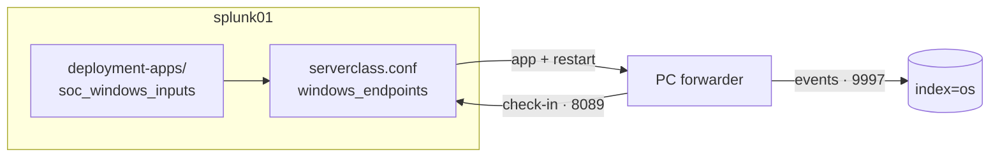

`/opt/splunk/etc/system/local/serverclass.conf`:

```
[global]

[serverClass:windows_endpoints]
machineTypesFilter = windows-x64
whitelist.0 = *

[serverClass:windows_endpoints:app:soc_windows_inputs]
restartSplunkd = true
stateOnClient = enabled
```

`deployment-apps/soc_windows_inputs/local/inputs.conf` (one stanza per channel; Security shown):

```
[WinEventLog://Security]
blacklist = 5379
index = os
renderXml = true
disabled = 0
```

The same stanza exists for System, Application, `Microsoft-Windows-Sysmon/Operational` and `Microsoft-Windows-PowerShell/Operational`. `renderXml = true` ships the raw XML, which keeps every field and is the format the Windows and Sysmon add-ons expect. Both files are versioned in this repo under `siem/splunk/`.

The forwarder checked in right away but stayed at "no applications". The app and server class didn't exist on splunk01 yet: part of a long terminal paste had been garbled. Once both files were in place, `splunk reload deploy-server` picked them up, the forwarder downloaded the app, restarted itself, and the status moved from Pending to OK.

## Sysmon access denied

Four of the five sources arrived. Sysmon didn't. The forwarder's log said why:

```
ERROR ExecProcessor ... splunk-winevtlog - WinEventLogChannel::init: Init failed,
unable to subscribe to Windows Event Log channel 'Microsoft-Windows-Sysmon/Operational': errorCode=5
```

Error 5 is access denied. The channel's permissions:

```
O:BAG:SYD:(A;;0xf0007;;;SY)(A;;0x7;;;BA)(A;;0x1;;;BO)(A;;0x1;;;SO)(A;;0x1;;;S-1-5-32-573)
```

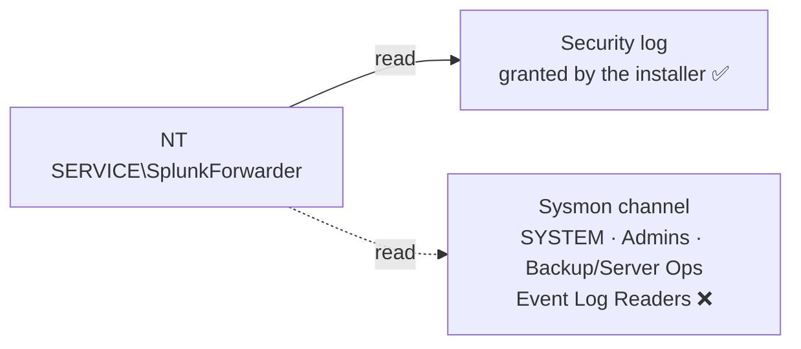

The forwarder runs as the virtual account `NT SERVICE\SplunkForwarder`, which is none of those. The installer had given it what it needs for the Security log, but the Sysmon channel has its own access list. I didn't want to run the forwarder as SYSTEM or edit Sysmon's permissions, so I added the account to **Event Log Readers** (`S-1-5-32-573`), which is read-only and exists for exactly this:

```powershell
Add-LocalGroupMember -SID S-1-5-32-573 -Member "NT SERVICE\SplunkForwarder"
Restart-Service SplunkForwarder
```

I used the SID instead of the group name so it works on non-English Windows. Sysmon events started flowing after the restart.

## Onboarding script

Everything above is in `scripts/deployment/windows/Install-SocEndpoint.ps1`:

1. Download Sysmon and the sysmon-modular config, check the config is valid, install or update Sysmon
2. Enable script block logging and logon auditing
3. With `-ForwarderMsi`: install the forwarder silently, point it at the deployment server, add it to Event Log Readers, restart it
4. Verify services, recent Sysmon events, audit policy and the connection to splunk01

Running it again on a configured machine is safe. It updates the Sysmon config and skips anything already in place.

## Add-ons on splunk01

| Add-on / app | Purpose |
| --- | --- |
| Splunk Add-on for Microsoft Windows | Field extraction and CIM mapping for Windows event logs |
| Splunk Add-on for Sysmon | Field extraction for Sysmon (`Image`, `CommandLine`, `DestinationIp`…) |
| Splunk Add-on for Unix and Linux | Parsing for the Linux sources (inputs left disabled) |
| Splunk Common Information Model | The shared field names detection content is written against |
| Splunk Security Essentials | MITRE-mapped detection library and data inventory |
| Splunk App for Lookup File Editing | Managing exception lists as lookups |

I copied them to splunk01 and extracted them into `/opt/splunk/etc/apps` in one pass, then fixed ownership so the `splunk` user could read them. Three came as `.spl` rather than `.tgz`. Same format, different extension.

With the add-ons in, this works without any `rex`:

```
index=os source="*Sysmon*" EventCode=3 earliest=-15m
| stats count by Image DestinationIp DestinationPort
| sort - count
```

The first results were a useful baseline: my own `ssh.exe` sessions to splunk01, an `<unknown process>` connection to the same host (a short-lived `scp` that exited before Sysmon resolved its name), Chrome and Steam doing mDNS discovery on 5353, and Defender reaching Microsoft on 443.

Security Essentials' data inventory found usable data for endpoint, DNS, network and authentication content. I dismissed its 21 "needs review" items, which were all Splunk's own `_internal` logs, and mapped the Pi-hole sourcetype to DNS by hand with 80% coverage. The SOC VLAN still resolves through the gateway rather than Pi-hole, and DoH or hard-coded resolvers can bypass it.

## Noise

```
index=os source="*WinEventLog:Security" | stats count by EventCode | sort - count
```

| EventCode | 24h count | Decision |
| --- | --- | --- |
| 5379 credential manager read | 4,060 (76%) | Dropped at the forwarder |
| 4624 logon | 543 | Keep |
| 4672 special privileges at logon | 539 | Keep |
| 4799 / 4798 group membership enumeration | 63 / 26 | Keep: cheap, and a recon signal |
| 4732 member added to a local group | 2 | Keep |

The 4732 events showed up the same day I added the forwarder to Event Log Readers. "Account added to a privileged group" is a standard detection, and this is the kind of benign, explainable hit it will need to handle.

I added `blacklist = 5379` to the Security stanza in the deployment app and reloaded the deployment server, which pushed it to the PC without touching the PC.

## Searching this data: SPL and what the add-ons change

Splunk searches are written in **SPL (Search Processing Language)**. This section is my reference for how SPL works and how searching changed once the Windows, Sysmon and CIM add-ons were installed.

### How a search is built

An SPL search is a pipeline. The first part finds events; each `|` passes the results to the next command, which reshapes them.


```
index=os EventCode=4625 | stats count by user | sort - count | head 10
```

Everything before the first pipe is the **search**. Everything after is **commands** that transform what the search returned.

### The search part

| Syntax | Meaning | Example |
| --- | --- | --- |
| `field=value` | Field equals a value | `EventCode=4625` |
| `field!=value` | Field doesn't equal a value | `user!=SYSTEM` |
| Space between terms | AND (implicit) | `index=os EventCode=1` |
| `OR` (uppercase) | Either | `EventCode=4624 OR EventCode=4625` |
| `NOT` (uppercase) | Exclude | `NOT DestinationPort=5353` |
| `*` | Wildcard | `Image="*powershell.exe"` |
| `"..."` | Exact phrase, or a value containing spaces or special characters | `"authentication failure"` |
| `field IN (...)` | Any of a list | `EventCode IN (4624, 4625, 4648)` |
| `earliest=` / `latest=` | Time range inside the search, overriding the time picker | `earliest=-15m`, `earliest=-24h@h` |

Field **names** are case-sensitive (`EventCode` works, `eventcode` doesn't). Values in the search part aren't (`user=caleb` matches `Caleb`).

One thing the Windows add-on changed: `source` values gained an `Xml` prefix (`WinEventLog:Security` became `XmlWinEventLog:Security`) and the sourcetype became `XmlWinEventLog`. Searches written with the exact old value stopped matching, so I use a leading wildcard: `source="*WinEventLog:Security"`.

Every event has these default fields:

| Field | What it is | In this lab |
| --- | --- | --- |
| `index` | Where the event is stored | `os`, `network`, `dns` |
| `sourcetype` | The format of the data, which decides how it's parsed | `XmlWinEventLog`, `pihole:dnsmasq`, `syslog` |
| `source` | Where it came from on the sending host | `XmlWinEventLog:Security`, `/var/log/remote/10.30.0.1/syslog.log` |
| `host` | The machine that sent it | `DESKTOP-…`, `192.168.1.3` |
| `_time` | The event's timestamp | |
| `_raw` | The original event text | |

Starting every search with `index=` (and `sourcetype=` or `source=` when I know it) makes it faster, because Splunk only reads the data it needs.

### Commands I use most

| Command | What it does | Example |
| --- | --- | --- |
| `stats` | Count, sum, group | `stats count by Image` |
| `stats ... values()` / `dc()` | List distinct values / count them | `stats dc(DestinationIp) as unique_dests by Image` |
| `table` | Show chosen fields as columns | `table _time host user CommandLine` |
| `sort` | Order rows (`-` for descending) | `sort - count` |
| `head` / `tail` | First / last N rows | `head 20` |
| `top` / `rare` | Most / least common values | `rare Image` |
| `timechart` | Counts over time, for graphs | `timechart span=1h count by source` |
| `where` | Filter with a comparison or function | `where count > 50` |
| `eval` | Create or change a field | `eval cmd_len=len(CommandLine)` |
| `rex` | Extract a field with a regular expression | `rex "user=(?<user>\S+)"` |
| `rename` | Rename fields | `rename DestinationIp as dest` |
| `dedup` | Drop duplicate values | `dedup Image` |
| `fields` | Keep or drop fields (speeds up later commands) | `fields _time Image CommandLine` |
| `lookup` / `inputlookup` | Enrich from, or read, a lookup table | `inputlookup known_good_processes.csv` |

`stats` is the one that matters most. Most investigative questions take the form "count X grouped by Y".

### What the add-ons change

Before the add-ons, a Windows event was one block of XML. Splunk knew `index`, `source`, `host` and `_time`, and little else. Everything else had to be cut out of `_raw` by hand with `rex`.

The add-ons work at **search time**. They don't change what's stored on disk; they tell Splunk how to read it each time I search. So events indexed *before* the add-ons were installed got the new fields too.

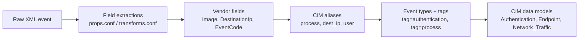

They add three layers:

**1. Vendor fields:** the names Windows and Sysmon use themselves.

| Source | Fields |
| --- | --- |
| Sysmon | `EventCode`, `Image`, `CommandLine`, `ParentImage`, `ParentCommandLine`, `User`, `Hashes`, `DestinationIp`, `DestinationPort`, `QueryName`, `TargetFilename`, `TargetObject` |
| Windows Security | `EventCode`, `Logon_Type`, `Account_Name`, `Workstation_Name`, `Source_Network_Address`, `Group_Name`, `signature` (the event description) |

**2. CIM fields:** the same values under vendor-neutral names. `Image` is also available as `process`, `DestinationIp` as `dest_ip`, a logon's account as `user`, its source address as `src`. A search written against CIM names works on any data source mapped to CIM: Windows today, Linux and the UDR once they're mapped.

**3. Tags and data models:** events get labeled by what they *are*. A 4625 gets `tag=authentication` and `action=failure`. A Sysmon Event 1 gets `tag=process`. CIM data models (Authentication, Endpoint, Network_Traffic, Network_Resolution) group tagged events into a standard structure that detection content is written against, including Security Essentials.

### Before and after

The same question asked three ways. Which programs connected where?

**Before the add-ons**, pulling fields out of XML by hand:

```
index=os source="*Sysmon*" "<EventID>3</EventID>"
| rex "<Data Name='Image'>(?<Image>[^<]+)<"
| rex "<Data Name='DestinationIp'>(?<DestinationIp>[^<]+)<"
| stats count by Image DestinationIp
```

**With vendor fields:**

```
index=os source="*Sysmon*" EventCode=3
| stats count by Image DestinationIp DestinationPort
```

**With CIM fields**, which would also cover any other mapped source of network connections:

```
index=os tag=network tag=communicate
| stats count by process dest_ip dest_port
```

Failed logons:

```
index=os EventCode=4625
| stats count by Account_Name Source_Network_Address
```

```
tag=authentication action=failure
| stats count by user src app
```

The first only covers Windows. The second covers anything mapped to the Authentication data model. When I ran it over 24 hours, it returned four failures and none of them were Windows:

| host | sourcetype | What it was |
| --- | --- | --- |
| splunk01 (×3) | `audittrail` | Failed logins to Splunk itself, including my mistyped admin password at `splunk login` |
| 192.168.1.3 | `syslog` | The deliberate failed Proxmox web login from step 2.3 |

The Proxmox event shows up because the Unix and Linux add-on maps syslog authentication messages into the CIM, and Splunk maps its own audit log. One search covered three different systems without me writing any parsing for them.

### Searches against my own data

What ran, with full command lines:

```
index=os source="*Sysmon*" EventCode=1 earliest=-1h
| table _time User ParentImage Image CommandLine
```

The rarest processes on the machine, a quick way to spot something new:

```
index=os source="*Sysmon*" EventCode=1 earliest=-7d
| rare limit=20 Image
```

Which program looked up which domain (Sysmon's side of what Pi-hole sees):

```
index=os source="*Sysmon*" EventCode=22 earliest=-1h
| stats count by Image QueryName
| sort - count
```

PowerShell launched with an encoded command:

```
index=os source="*Sysmon*" EventCode=1 Image="*powershell.exe"
    (CommandLine="*-enc*" OR CommandLine="*-EncodedCommand*")
| table _time User ParentImage CommandLine
```

Changes to local group membership, like the forwarder being added to Event Log Readers:

```
index=os EventCode=4732
| table _time Group_Name Account_Name MemberSid
```

Event volume per log over time:

```
index=os earliest=-24h
| timechart span=1h count by source
```

### Mistakes to avoid

| Mistake | What happens | Fix |
| --- | --- | --- |
| No `index=` | Splunk scans every index it can see; slow | Always start with `index=` |
| Lowercase `or` / `not` | Treated as search words, not operators | `OR`, `NOT` |
| Wrong field-name case | `eventcode=1` matches nothing | `EventCode=1` |
| Time picker left at "Last 24 hours" | `earliest=` in the search overrides it; without one, the picker decides | Check the picker, or set `earliest=` explicitly |
| `table` on a huge result set | Returns every event; slow and unreadable | `stats` first, then `table` |
| Filtering after a pipe when it could be before | Splunk pulls everything, then discards it | Put filters in the search part when possible |


## Backlog

- Point the SOC VLAN's DNS at Pi-hole
- Custom add-on (`TA-soc-homelab`) mapping Pi-hole, UDR and Catalyst data into the CIM
- TLS between the forwarder and splunk01 (`sslVerifyServerCert` is currently false)
- Turn on detections from Security Essentials after a baseline week

## Evidence

Screenshots are redacted: public IPs, MAC addresses, external domains and household devices are blacked out.

**First run of Install-SocEndpoint.ps1: Sysmon, audit policy, verification.**

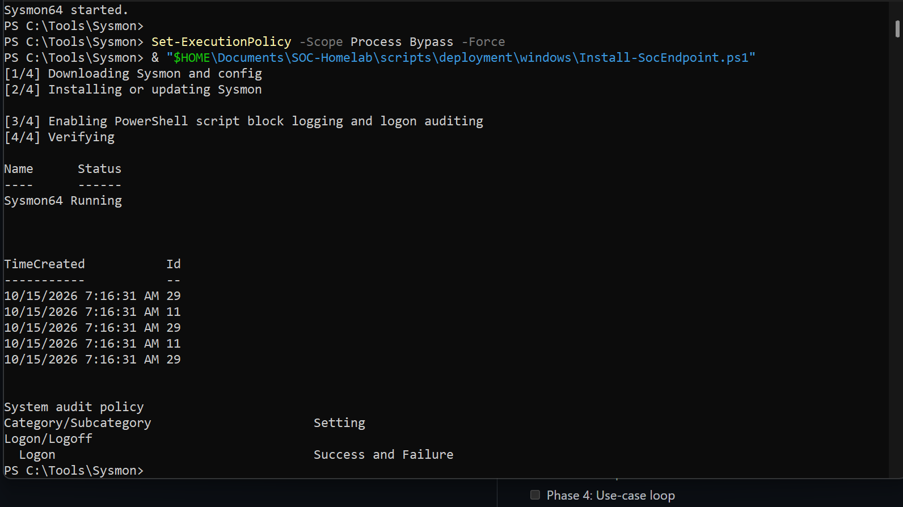

**SplunkForwarder and Sysmon64 running and the forwarder connected to 10.30.0.10:9997.**

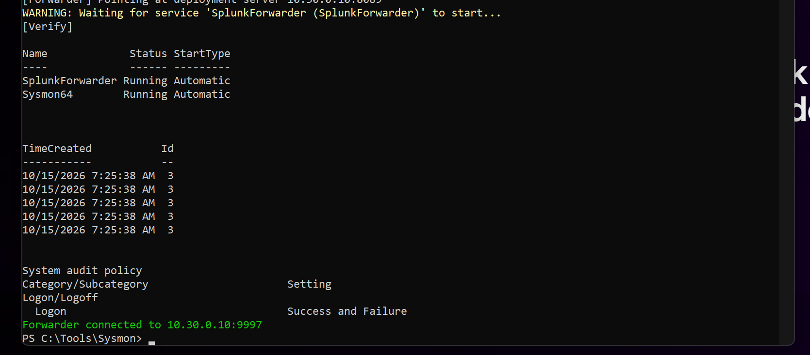

**The workstation checked in to the deployment server.**

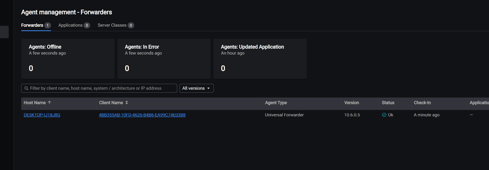

**errorCode=5: the forwarder could not read the Sysmon channel until I granted Event Log Readers.**

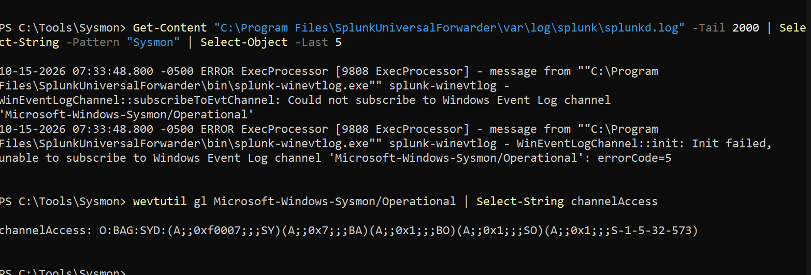

**Windows event logs landing in index=os.**

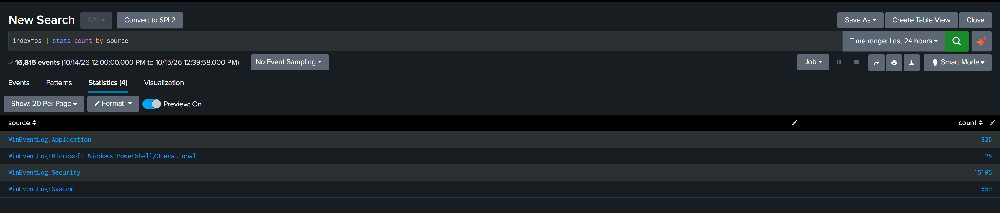

**Sysmon network connections by process and destination.**

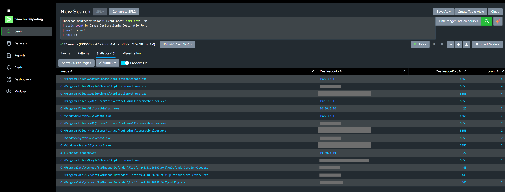

**Security event codes before filtering 5379.**

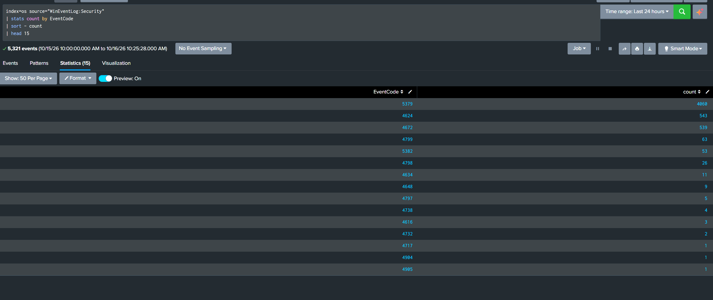

**CIM tags working: tag=network tag=communicate returns Sysmon events.**

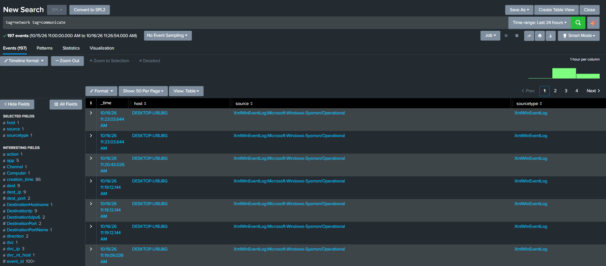

**Security Essentials data introspection completed.**

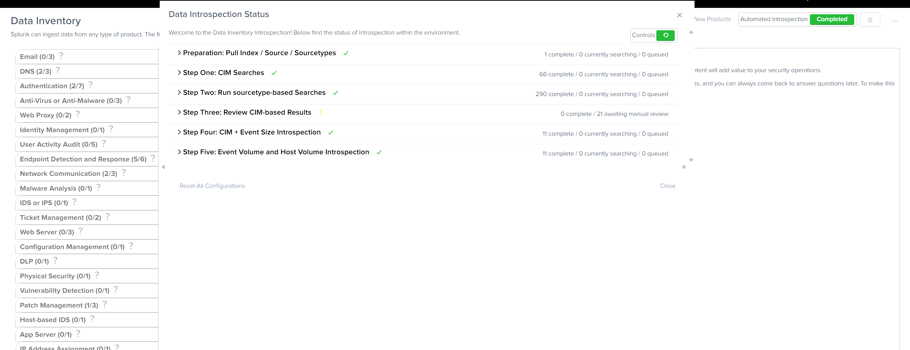
