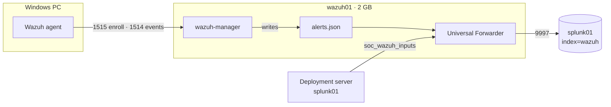
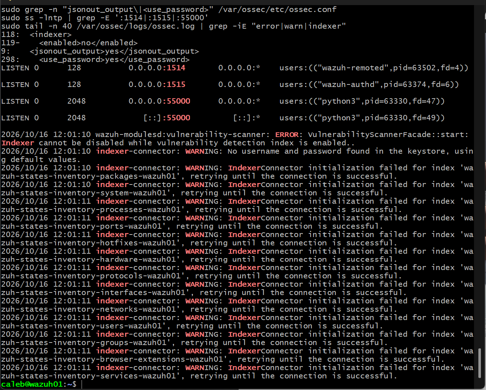
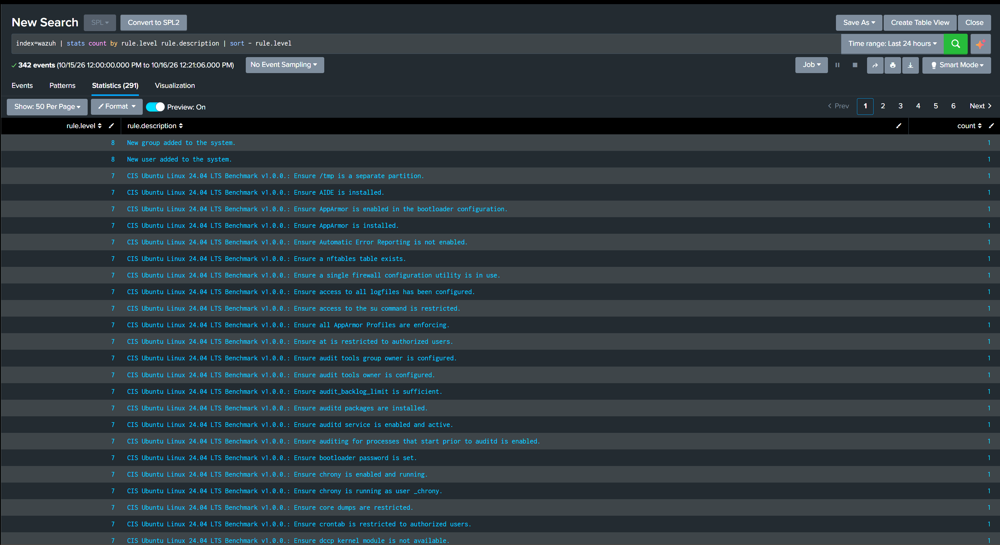
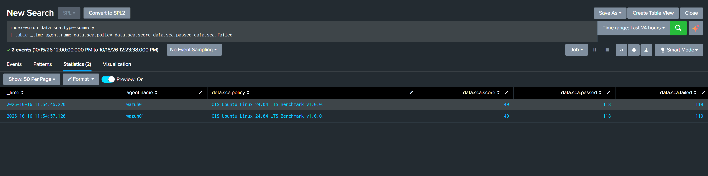
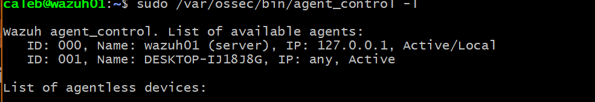
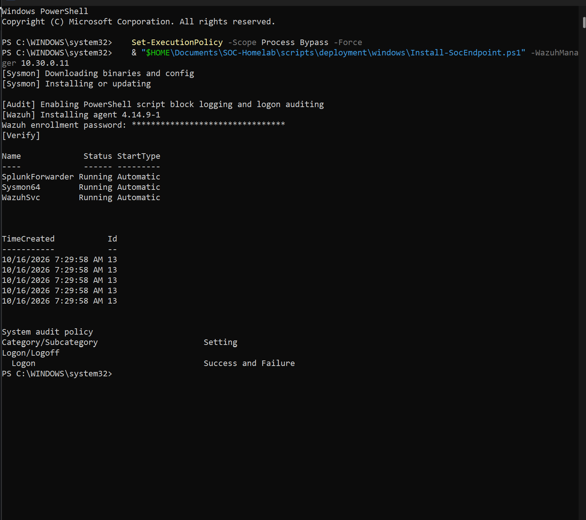

# 2.5 · Wazuh (Deep Dive)

Splunk stores and searches logs, but it doesn't generate security checks. I added Wazuh for four things my telemetry didn't give me yet:

| Capability | What it gives me |
| --- | --- |
| SCA (Security Configuration Assessment) | Each machine scored against a CIS benchmark: evidence for the GRC repo |
| FIM (File Integrity Monitoring) | Alerts when sensitive files and registry keys change |
| Vulnerability detection | Installed software matched against known CVEs |
| Rules engine | Thousands of built-in rules mapped to MITRE ATT&CK |

## Design: manager only



A full Wazuh deployment includes its own indexer and dashboard: effectively a second SIEM that needs 4–8 GB of RAM. wazuh01 has 2 GB, and Splunk is where I search everything else. So I installed only the manager. It receives agent data, runs the rules and writes alerts to a JSON file, and a forwarder ships that file to Splunk.

## Install

```bash
sudo apt-get update && sudo apt-get install -y gnupg apt-transport-https curl
curl -s https://packages.wazuh.com/key/GPG-KEY-WAZUH | sudo gpg --no-default-keyring --keyring gnupg-ring:/usr/share/keyrings/wazuh.gpg --import && sudo chmod 644 /usr/share/keyrings/wazuh.gpg
echo "deb [signed-by=/usr/share/keyrings/wazuh.gpg] https://packages.wazuh.com/4.x/apt/ stable main" | sudo tee /etc/apt/sources.list.d/wazuh.list
sudo apt-get update && sudo apt-get install -y wazuh-manager
sudo apt-mark hold wazuh-manager
sudo systemctl enable --now wazuh-manager
```

Wazuh 4.14.9. I put the package on hold because agents must never be newer than their manager. Upgrades happen deliberately (manager first, then agents), not whenever `apt upgrade` runs.

## Configuration

```bash
sudo sed -i '/<indexer>/,/<\/indexer>/ s#<enabled>yes</enabled>#<enabled>no</enabled>#' /var/ossec/etc/ossec.conf
sudo sed -i '/<vulnerability-detection>/,/<\/vulnerability-detection>/ s#<index-status>yes</index-status>#<index-status>no</index-status>#' /var/ossec/etc/ossec.conf
sudo sed -i 's#<use_password>no</use_password>#<use_password>yes</use_password>#' /var/ossec/etc/ossec.conf
openssl rand -hex 16 | sudo tee /var/ossec/etc/authd.pass >/dev/null
sudo chown root:wazuh /var/ossec/etc/authd.pass && sudo chmod 640 /var/ossec/etc/authd.pass
```

| Change | Why |
| --- | --- |
| Indexer `enabled` → `no` | There's no Wazuh indexer. The `sed` range limits the edit to the `<indexer>` block, because other blocks have their own `<enabled>` tags. |
| Vulnerability `index-status` → `no` | Lets the scanner run without an indexer (see Issues) |
| `use_password` → `yes` + random `authd.pass` | By default anything that can reach port 1515 can enroll as an agent. A rogue agent could feed fabricated events into my SOC. Now enrollment needs a 32-character secret that only root and the Wazuh service can read, and it never goes in the repo. |

`jsonout_output` was already `yes`, so alerts go to `/var/ossec/logs/alerts/alerts.json`. The manager listens on 1514 (agent events), 1515 (enrollment) and 55000 (API).

## Getting alerts into Splunk

### My own add-on: TA-soc-homelab

Wazuh writes one JSON object per line. Splunk needed to be told how to break lines, where the timestamp is, and to turn the JSON keys into fields. That went into a new app on splunk01, which will also hold my Pi-hole, UDR and Catalyst mappings later:

`/opt/splunk/etc/apps/TA-soc-homelab/default/props.conf`:

```
[wazuh:alerts]
SHOULD_LINEMERGE = false
LINE_BREAKER = ([\r\n]+)
TIME_PREFIX = "timestamp":"
TIME_FORMAT = %Y-%m-%dT%H:%M:%S.%3N%z
MAX_TIMESTAMP_LOOKAHEAD = 40
TRUNCATE = 50000
KV_MODE = json
```

The timestamp is taken from the alert itself, not from when Splunk received it, so a delayed forwarder can't shift events in time.

### Deployment app and server class

`deployment-apps/soc_wazuh_inputs/local/inputs.conf`:

```
[monitor:///var/ossec/logs/alerts/alerts.json]
index = wazuh
sourcetype = wazuh:alerts
disabled = 0
```

Added to `serverclass.conf` alongside the Windows class:

```
[serverClass:wazuh_manager]
whitelist.0 = wazuh01

[serverClass:wazuh_manager:app:soc_wazuh_inputs]
restartSplunkd = true
stateOnClient = enabled
```

### Forwarder on wazuh01

```bash
wget -O /tmp/splunkforwarder.deb "https://download.splunk.com/products/universalforwarder/releases/10.6.0.5/linux/splunkforwarder-10.6.0.5-86587d4e3b27-linux-amd64.deb"
sudo dpkg -i /tmp/splunkforwarder.deb
sudo usermod -aG wazuh splunkfwd
```

Then `deploymentclient.conf` pointing at `10.30.0.10:8089`, `outputs.conf` pointing at `10.30.0.10:9997`, and a `user-seed.conf` with a password from `openssl rand` that I never see, before enabling boot-start as `splunkfwd`.

`alerts.json` is readable only by the `wazuh` group, so the forwarder's account joined that group rather than running as root. That's the same least-privilege approach as Event Log Readers on Windows. I added the group before the forwarder started for the first time, since a process only picks up group memberships at start.

The forwarder connected to both 8089 and 9997, picked up `soc_wazuh_inputs`, and alerts started arriving.

## Windows agent

I added the agent to `Install-SocEndpoint.ps1` behind a `-WazuhManager` parameter:

```powershell
& "$HOME\Documents\SOC-Homelab\scripts\deployment\windows\Install-SocEndpoint.ps1" -WazuhManager 10.30.0.11
```

It downloads the agent matching the manager's version, prompts for the enrollment password with `Read-Host -AsSecureString` (nothing on screen, nothing in history), installs it silently, enrolls under the computer name and starts `WazuhSvc`. Sysmon logged the installer's registry writes (Event 13) as it ran.

```
ID: 000, Name: wazuh01 (server), IP: 127.0.0.1, Active/Local
ID: 001, Name: DESKTOP-IJ18J8G, IP: any, Active
```

`IP: any` means the agent is tied to its key, not an address, so a DHCP change doesn't break it.

## Issues

### Vulnerability scanner refused to start

```
wazuh-modulesd:vulnerability-scanner: ERROR: VulnerabilityScannerFacade::start:
Indexer cannot be disabled while vulnerability detection index is enabled.
```

Turning the indexer off wasn't enough. The vulnerability module has its own `index-status` setting that tells it to store results in the indexer. With that still on, it refused to run. Setting it to `no` fixed it:

```
wazuh-modulesd:vulnerability-scanner: INFO: Vulnerability scanner module started.
```

The trade-off: without the indexer there's no browsable per-machine CVE inventory. Alerts still come through when something changes (a new vulnerable package, a fix applied), and the first scan only records a baseline.

### Indexer-connector warnings that don't stop

```
indexer-connector: WARNING: IndexerConnector initialization failed for index 'wazuh-states-inventory-packages-wazuh01', retrying ...
```

One per inventory type: packages, processes, ports, users, services and more. The inventory feature tries to copy each agent's inventory to an indexer and keeps retrying. The inventory itself is still collected. Other people running manager-only 4.x setups report the same thing. I documented it and left it alone rather than patching around it.

### SCA results "missing"

My first SCA search over the last 24 hours returned nothing. Wazuh sends the full score when a policy is first scanned, then mostly reports changes, and both baselines were older than my window:

```
index=wazuh data.sca.type=summary
| dedup agent.name data.sca.policy
| table _time agent.name data.sca.policy data.sca.score data.sca.passed data.sca.failed
```

## Results

### Compliance baseline

| System | Benchmark | Score | Passed | Failed |
| --- | --- | --- | --- | --- |
| wazuh01 | CIS Ubuntu Linux 24.04 LTS Benchmark v1.0.0 | 49% | 118 | 119 |
| DESKTOP-IJ18J8G | CIS Microsoft Windows 11 Enterprise Benchmark v3.0.0 | 26% | 124 | 344 |

wazuh01 failed checks like a separate `/tmp` partition, AIDE not installed, AppArmor not enforcing and no bootloader password. The PC is scored against the Enterprise benchmark, which assumes a managed corporate machine, so some failures are expected on a home PC. Sorting out which failures are worth fixing and which are accepted risks is the first job in GRC-Homelab.

### First real alerts

| Level | Alert | Explanation |
| --- | --- | --- |
| 8 | New user added to the system | The `splunkfwd` account created by the forwarder install on wazuh01 |
| 8 | New group added to the system | Its `splunkfwd` group |
| 7 | CIS Ubuntu benchmark: failed checks | One alert per failed check |

New local accounts are a classic persistence technique, so this rule matters. It also means my own administration triggers it, which the Phase 4 detection will need a documented exception for.

## Backlog

- CIM mappings for Wazuh in `TA-soc-homelab` (`signature`, `severity`, `dest`, `user`, tags)
- Wazuh agents on the Linux SOC systems
- Review the CIS failures and decide fix vs. accept (GRC-Homelab)
- Upgrade procedure: manager first, then agents
- TLS between the forwarder and splunk01

## Evidence

Screenshots are redacted: public IPs, MAC addresses, external domains and household devices are blacked out.

**Manager-only config: indexer disabled, JSON output on, enrollment password required, ports listening.**



**Wazuh alerts in index=wazuh, led by CIS benchmark checks.**



**SCA summary: wazuh01 scores 49% on CIS Ubuntu 24.04.**



**The workstation agent active on the manager.**



**The onboarding script installing the Wazuh agent with a prompted enrollment password.**


