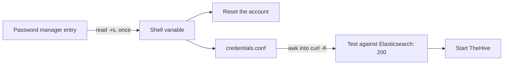
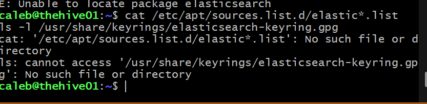
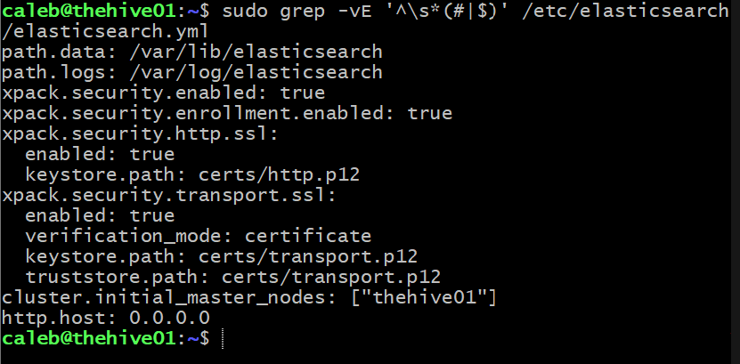
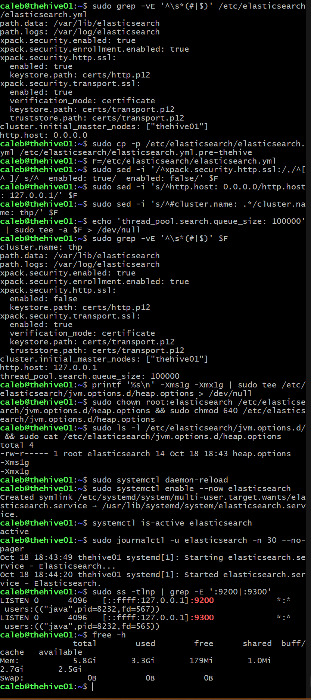
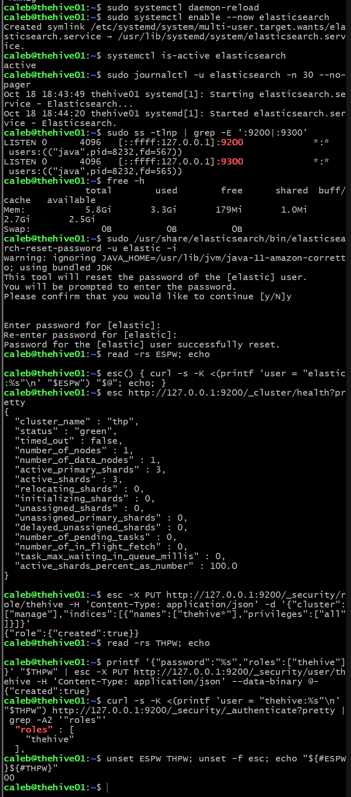
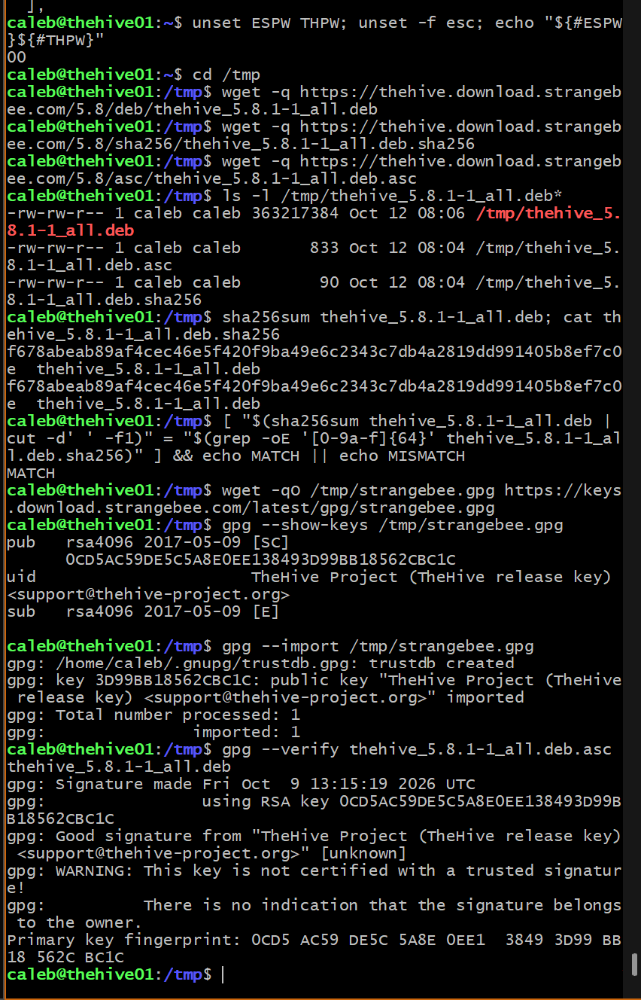
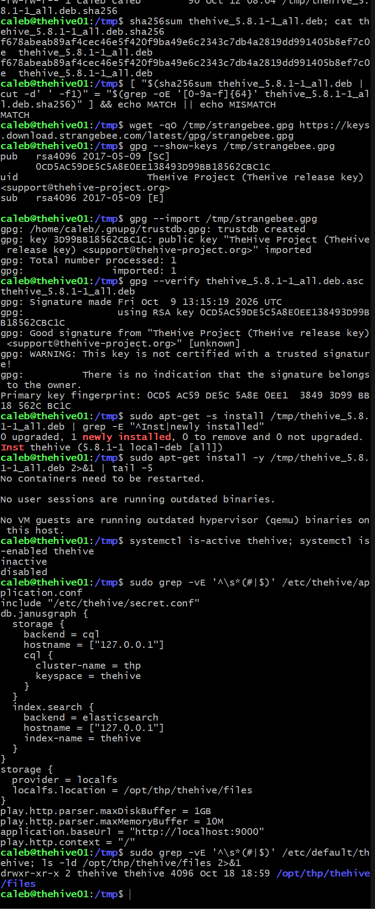
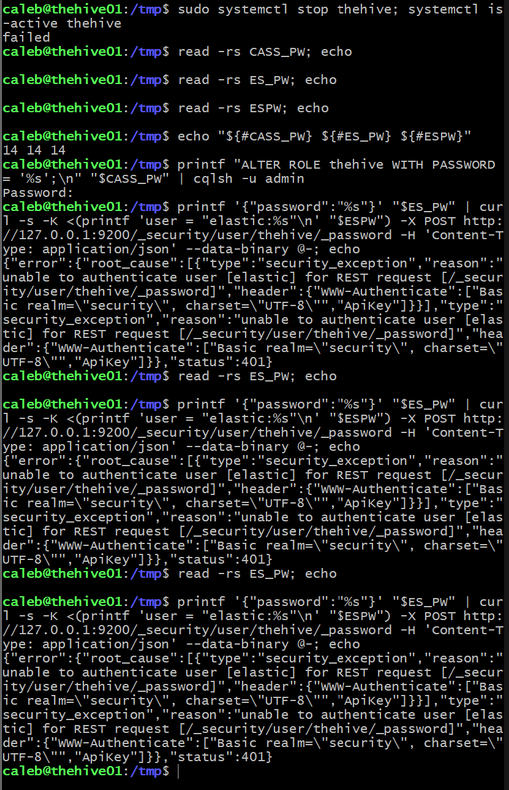
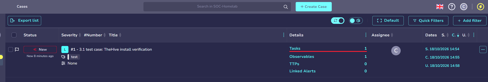
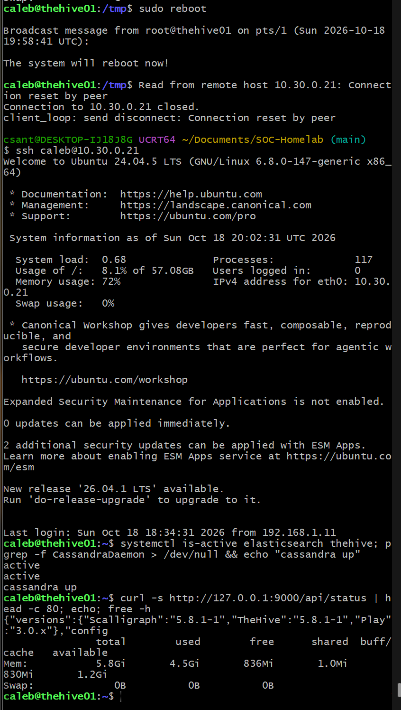

# 3.1 · TheHive (Deep Dive)

Phase 3 turns detections into cases. TheHive is the case management platform: Shuffle will create cases in it from Splunk alerts, with MISP and other enrichment attached. This entry covers sizing thehive01, Java, Cassandra, Elasticsearch, TheHive itself, first setup and a reboot test.

## Sizing

### What TheHive needs

TheHive 5 is three Java services on one box: TheHive itself, Apache Cassandra (the database that stores cases) and Elasticsearch (the search index). Each runs in its own JVM with its own heap. StrangeBee's current single-host table recommends, for under 10 concurrent users:

| Service | CPU | RAM |
| --- | --- | --- |
| TheHive | 3 cores | 4 GB |
| Cassandra | 3 cores | 4 GB |
| Elasticsearch | 3 cores | 4 GB |

That's 12 GB. Their Docker Compose testing profile is 8 GB, and older documentation listed 2 GB per service (6 GB). thehive01 had 4 GB, which is below every one of those figures.

Elasticsearch's guidance also rules out the fix I used on misp01 and sensor01: swapping degrades garbage collection and cluster communication, so swap should be disabled or the heap locked in RAM. A swapfile would hide an undersized VM, not fix it.

### Options

| Option | Result |
| --- | --- |
| Stay at 4 GB with tiny heaps | Below every vendor figure; likely OOM kills once Shuffle starts using the API |
| **6 GB, SOC budget to about 26 GB** | **Chosen.** Workable for one analyst with hand-set heaps |
| Full RAM rebalance first | Most headroom, but a detour before Phase 3 starts |

### Host check

On `pve`, I listed every VM and container with its memory and balloon setting:

```bash
for id in $(qm list | awk 'NR>1{print $1}'); do echo "$id $(qm config $id | grep -E '^(name|memory|balloon):' | tr '\n' ' ')"; done
for id in $(pct list | awk 'NR>1{print $1}'); do echo "$id $(pct config $id | grep -E '^(hostname|memory|swap):' | tr '\n' ' ')"; done
free -h
qm list
```

Every non-SOC VM was stopped, so host RAM was only in use by the SOC: 22 GB of VMs plus 1.5 GB of containers, with 11 GiB available on the 31 GiB host. The extra 2 GB for thehive01 brought the SOC to 25.5 GB and still left the host about 9 GiB.

The non-SOC VMs are each configured with far more RAM than the host can spare alongside the SOC. Starting one of them with its current setting while the SOC runs would overcommit the host. Sizing those down is part of the planned RAM rebalance.

### Snapshot and resize

```bash
qm shutdown 304 && qm status 304
qm snapshot 304 pre-thehive --description "Base Ubuntu before TheHive install, 4 GB"
qm listsnapshot 304
qm set 304 --memory 6144
qm config 304 | grep -E '^(memory|balloon):'
qm start 304
```

I took the snapshot with the VM off so it holds no memory state. A Proxmox snapshot includes the VM config, so rolling back to `pre-thehive` also returns the VM to 4 GB.

Inside thehive01:

```bash
free -h && swapon --show
```

5.8 GiB total, no swap.

### Heap budget

| Component | Heap |
| --- | --- |
| Cassandra | `-Xms1g -Xmx1536m -Xmn200m` |
| Elasticsearch | `-Xms1g -Xmx1g` |
| TheHive | `-Xms1g -Xmx1g`, metaspace and code cache capped at 400 MB each |
| Off-heap, metaspace, OS | the rest |

StrangeBee recommends at least 2 GB of heap for Cassandra. I went below that because the data set is one analyst's cases. If the VM starts hitting OOM kills, Cassandra's `-Xmx` drops to 1 GB first.

Measured available memory as each service came up:

| State | Available |
| --- | --- |
| Base OS | 5.4 GiB |
| + Cassandra | 3.9 GiB |
| + Elasticsearch | 2.5 GiB |
| + TheHive | 1.1 GiB |
| After a reboot, all three running | 1.2 GiB |

## OS and Java

```bash
sudo apt update && sudo apt -y full-upgrade
[ -f /var/run/reboot-required ] && echo REBOOT || echo OK
sudo apt install -y wget curl gnupg coreutils apt-transport-https git ca-certificates ca-certificates-java software-properties-common python3-pip lsb-release unzip
```

TheHive supports Java 11 only. I used Amazon Corretto, as StrangeBee recommends:

```bash
wget -qO- https://apt.corretto.aws/corretto.key | sudo gpg --dearmor -o /usr/share/keyrings/corretto.gpg
echo "deb [signed-by=/usr/share/keyrings/corretto.gpg] https://apt.corretto.aws stable main" | sudo tee /etc/apt/sources.list.d/corretto.sources.list > /dev/null
sudo apt update && sudo apt install -y java-common java-11-amazon-corretto-jdk
grep -q JAVA_HOME /etc/environment || echo 'JAVA_HOME="/usr/lib/jvm/java-11-amazon-corretto"' | sudo tee -a /etc/environment > /dev/null
export JAVA_HOME="/usr/lib/jvm/java-11-amazon-corretto"
java -version && grep JAVA_HOME /etc/environment
```

I used `tee` without `-a` for the repo file and a `grep -q` guard for `/etc/environment`, so re-running either line doesn't create duplicates. Result: Corretto 11.0.32.

## Cassandra

### Install

TheHive supports Cassandra 4.0 and 4.1, so I used the `41x` repository:

```bash
wget -qO- https://downloads.apache.org/cassandra/KEYS | sudo gpg --dearmor -o /usr/share/keyrings/cassandra-archive.gpg
echo "deb [signed-by=/usr/share/keyrings/cassandra-archive.gpg] https://debian.cassandra.apache.org 41x main" | sudo tee /etc/apt/sources.list.d/cassandra.sources.list > /dev/null
sudo apt update && apt-get install -s cassandra | grep '^Inst'
```

The Cassandra package accepts several Java runtimes. If apt hadn't counted Corretto as one, it would have pulled in a second JDK. The dry run listed only `cassandra (4.1.12)`, so I installed it:

```bash
sudo apt install -y cassandra
```

The install script set `vm.max_map_count = 1048575` and `net.ipv4.tcp_keepalive_time = 300`. That `max_map_count` also covers Elasticsearch's minimum.

The package starts Cassandra immediately with the default cluster name `Test Cluster`. Cassandra stores the cluster name on first start and refuses to start if the configured name changes later, so I stopped it and removed that first-start data before configuring anything:

```bash
sudo systemctl stop cassandra && sudo rm -rf /var/lib/cassandra/*
systemctl is-active cassandra
```

### Configuration

```bash
sudo cp /etc/cassandra/cassandra.yaml /etc/cassandra/cassandra.yaml.orig && sudo cp /etc/cassandra/jvm-server.options /etc/cassandra/jvm-server.options.orig
printf '%s\n' '-Xms1g' '-Xmx1536m' '-Xmn200m' | sudo tee -a /etc/cassandra/jvm-server.options > /dev/null
grep -nE '^-Xm[sxn]' /etc/cassandra/jvm-server.options
sudo sed -i -e "s/^cluster_name: .*/cluster_name: 'thp'/" -e 's/^authenticator: .*/authenticator: PasswordAuthenticator/' -e 's/^authorizer: .*/authorizer: CassandraAuthorizer/' /etc/cassandra/cassandra.yaml
grep -nE '^(cluster_name|authenticator|authorizer|listen_address|rpc_address):' /etc/cassandra/cassandra.yaml
```

Resulting settings:

```
cluster_name: 'thp'
authenticator: PasswordAuthenticator
authorizer: CassandraAuthorizer
listen_address: localhost
rpc_address: localhost
```

I left both addresses on `localhost`. TheHive runs on the same VM, so Cassandra never needs to be reachable from the SOC VLAN.

### Issue: `nodetool` refused right after the start

```bash
sudo systemctl enable --now cassandra
sudo nodetool status
```

systemd replied that `cassandra.service is not a native service, redirecting to systemd-sysv-install`, and two `nodetool status` runs in a row got `Connection refused` on 127.0.0.1:7199. Two separate things were going on:

- **The refusal was timing.** `nodetool` talks to Cassandra over JMX on port 7199, and Cassandra only opens that port once startup has finished, which takes a while on this VM. I ran `nodetool` seconds after the start.
- **The message was the SysV wrapper.** The Debian package ships an old-style init script (`/etc/init.d/cassandra`), and systemd generates a wrapper unit around it. That script backgrounds the JVM and exits, so the unit state on its own doesn't prove Java is running.

So I checked the unit and the Java process separately:

```bash
systemctl status cassandra --no-pager | head -5; pgrep -f CassandraDaemon || echo NOT RUNNING
```

A little later, `nodetool status` showed the node as `UN` (Up/Normal):

```
UN  127.0.0.1  104.35 KiB  16  100.0%  ...  rack1
```

From then on I used `pgrep -f CassandraDaemon` as the health check, not the unit state.

Verification of ports, heap and boot start:

```bash
ss -tlnp | grep -E ':9042|:7199' && ps -o args= -p $(pgrep -f CassandraDaemon) | grep -oE -- '-Xm[sxn][^ ]+' | sort -u && free -h
systemctl is-enabled cassandra
```

Both ports (9042 for CQL clients, 7199 for JMX) listened on 127.0.0.1 only, the JVM ran with exactly my three heap flags, the VM had 3.9 GiB available, and the service was `enabled`.

### Issue: cqlsh and Python 3.12

```
ModuleNotFoundError: No module named 'six.moves'
```

cqlsh doesn't use the system's Python packages. It loads a bundled Cassandra driver and an older `six` (a Python 2/3 compatibility library) from `/usr/share/cassandra/lib/`. That version of `six` registers `six.moves` through an import hook that Python 3.12 removed. Installing `python3-six` from apt wouldn't help, because cqlsh puts its bundled copy first on the import path.

StrangeBee documents the fix: run cqlsh on Python 3.9 through `CQLSH_PYTHON`. I installed 3.9 from the deadsnakes PPA alongside the system Python:

```bash
sudo add-apt-repository -y ppa:deadsnakes/ppa
apt-get install -s python3.9 | grep '^Inst'
sudo apt install -y python3.9 && python3.9 --version && python3 --version
CQLSH_PYTHON=/usr/bin/python3.9 cqlsh -u cassandra -p cassandra -e "SELECT release_version FROM system.local;"
grep -q CQLSH_PYTHON ~/.bashrc || echo 'export CQLSH_PYTHON=/usr/bin/python3.9' >> ~/.bashrc
```

The system Python stayed at 3.12.3, and cqlsh returned `4.1.12`. This only affects the command-line client. TheHive connects through a Java driver.

### Accounts, keyspace and role

I kept passwords off the screen and out of shell history. `read -rs` loads each one into a variable, and `printf`, a bash builtin that doesn't show up in `ps`, pipes the CQL into cqlsh's standard input. For admin logins, cqlsh prompts for the password.

```bash
read -rs ADMIN_PW && echo
read -rs HIVE_PW && echo
printf "CREATE ROLE admin WITH PASSWORD = '%s' AND LOGIN = true AND SUPERUSER = true;\n" "$ADMIN_PW" | cqlsh -u cassandra -p cassandra
printf "DROP ROLE cassandra;\nCREATE KEYSPACE thehive WITH replication = {'class': 'SimpleStrategy', 'replication_factor': 1};\nCREATE ROLE thehive WITH LOGIN = true AND PASSWORD = '%s';\nGRANT ALL PERMISSIONS ON KEYSPACE thehive TO thehive;\n" "$HIVE_PW" | cqlsh -u admin
```

A role can't drop itself, so I created `admin` while logged in as the default user and dropped `cassandra` from an `admin` session. I chose passwords without quote characters, because a `'` would end the CQL string literal early.

Verification:

```bash
cqlsh -u admin -e "LIST ROLES; DESCRIBE KEYSPACES;"
cqlsh -u cassandra -p cassandra -e "SELECT now() FROM system.local;"
cqlsh -u thehive -e "DESCRIBE KEYSPACE thehive;"
unset ADMIN_PW HIVE_PW && echo ${#ADMIN_PW}${#HIVE_PW}
```

- **Roles:** `admin` (superuser) and `thehive` (not a superuser), with no `cassandra`
- **Default login:** rejected with `Bad credentials`
- **`thehive` role:** logs in and sees its keyspace (`SimpleStrategy`, replication factor 1)
- **Variables:** cleared

The `thehive` password was reset later in this step; see [the credentials issue](#issue-three-passwords-that-didnt-match).

## Elasticsearch

### Issue: the repo wasn't there

I had the Elastic repo down as added, but the dry run said otherwise:

```bash
sudo apt install --dry-run elasticsearch | grep -E "^Inst|newly installed"
```
```
E: Unable to locate package elasticsearch
```

There was no list file in `/etc/apt/sources.list.d/` and no keyring in `/usr/share/keyrings/`, and nothing under any other name either:

```bash
grep -rn "elastic" /etc/apt/sources.list /etc/apt/sources.list.d/
ls -l /usr/share/keyrings/ /etc/apt/keyrings/ 2>/dev/null | grep -i elastic
```

So I added the key and the 8.x repo:

```bash
wget -qO- https://artifacts.elastic.co/GPG-KEY-elasticsearch | sudo gpg --dearmor -o /usr/share/keyrings/elasticsearch-keyring.gpg
echo "deb [signed-by=/usr/share/keyrings/elasticsearch-keyring.gpg] https://artifacts.elastic.co/packages/8.x/apt stable main" | sudo tee /etc/apt/sources.list.d/elastic-8.x.list > /dev/null
sudo apt-get update 2>&1 | grep -iE "elastic|err|warn"
apt-get -s install elasticsearch | grep -E "^Inst|newly installed"
```

The dry run showed only `elasticsearch (8.19.23)`. Elasticsearch bundles its own JDK, so nothing else was pulled in. TheHive 5.8.1 supports Elasticsearch 7.11 through 9.5.

### Install

The package prints a generated `elastic` superuser password during install, so I discarded the output and replaced that password later:

```bash
sudo apt install -y elasticsearch > /dev/null 2>&1; echo "exit=$?"
dpkg -l elasticsearch | tail -1
systemctl is-active elasticsearch
sudo ls -A /var/lib/elasticsearch | wc -l
```

`exit=0`, `inactive` and an empty data directory. Unlike Cassandra, the package doesn't start the service, so no default cluster name was stored.

### Configuration

The installer's security auto-configuration wrote this (comments stripped):

```yaml
path.data: /var/lib/elasticsearch
path.logs: /var/log/elasticsearch
xpack.security.enabled: true
xpack.security.enrollment.enabled: true
xpack.security.http.ssl:
  enabled: true
  keystore.path: certs/http.p12
xpack.security.transport.ssl:
  enabled: true
  verification_mode: certificate
  keystore.path: certs/transport.p12
  truststore.path: certs/transport.p12
cluster.initial_master_nodes: ["thehive01"]
http.host: 0.0.0.0
```

I made four changes:

```bash
sudo cp -p /etc/elasticsearch/elasticsearch.yml /etc/elasticsearch/elasticsearch.yml.pre-thehive
F=/etc/elasticsearch/elasticsearch.yml
sudo sed -i '/^xpack.security.http.ssl:/,/^[^ ]/ s/^  enabled: true/  enabled: false/' $F
sudo sed -i 's/^http.host: 0.0.0.0/http.host: 127.0.0.1/' $F
sudo sed -i 's/^#cluster.name: .*/cluster.name: thp/' $F
echo 'thread_pool.search.queue_size: 100000' | sudo tee -a $F > /dev/null
```

| Setting | Why |
| --- | --- |
| `http.host: 127.0.0.1` | Only TheHive on the same VM talks to it |
| HTTP TLS off | Traffic never leaves the loopback interface, and it keeps TheHive's connection config simple |
| Transport TLS left on | Required whenever security is on and the node isn't in single-node mode; costs nothing on one node |
| `cluster.name: thp` | Matches the Cassandra cluster name |
| `thread_pool.search.queue_size: 100000` | StrangeBee's value; TheHive sends bursts of searches |

`xpack.security.enabled` stays `true`. The first `sed` only edits the lines between `xpack.security.http.ssl:` and the next line starting in column 1, so the transport block keeps `enabled: true`. I didn't add `discovery.type: single-node`, because it conflicts with the auto-added `cluster.initial_master_nodes`.

Heap:

```bash
printf '%s\n' -Xms1g -Xmx1g | sudo tee /etc/elasticsearch/jvm.options.d/heap.options > /dev/null
sudo chown root:elasticsearch /etc/elasticsearch/jvm.options.d/heap.options && sudo chmod 640 /etc/elasticsearch/jvm.options.d/heap.options
```

StrangeBee's sample also sets `-Dlog4j2.formatMsgNoLookups=true`. That was a Log4Shell mitigation, and 8.x ships a patched Log4j, so I left it out.

### Start and verify

```bash
sudo systemctl daemon-reload
sudo systemctl enable --now elasticsearch
systemctl is-active elasticsearch
sudo ss -tlnp | grep -E ':9200|:9300'
```

It started in 31 seconds. This is a native systemd unit, so `active` does mean the JVM is up. Both ports listen on `[::ffff:127.0.0.1]`, which is the IPv4 loopback address on Java's dual-stack socket, so it's still localhost only.

### The elastic password, and TheHive's account

```bash
sudo /usr/share/elasticsearch/bin/elasticsearch-reset-password -u elastic -i
```

This replaces the generated password I never saw. The tool prints `warning: ignoring JAVA_HOME ... using bundled JDK`, which is expected.

For the API calls I used a small function that passes credentials to curl through a config file (`-K`) built by `printf`, so no password appears on the command line or in `ps`:

```bash
read -rs ESPW; echo
esc() { curl -s -K <(printf 'user = "elastic:%s"\n' "$ESPW") "$@"; echo; }
esc http://127.0.0.1:9200/_cluster/health?pretty
```

Cluster `thp`, status green, one node, no unassigned shards.

StrangeBee's guide gives TheHive's Elasticsearch account the `superuser` role. I gave it a role scoped to its own indices instead:

```bash
esc -X PUT http://127.0.0.1:9200/_security/role/thehive -H 'Content-Type: application/json' -d '{"cluster":["manage"],"indices":[{"names":["thehive*"],"privileges":["all"]}]}'
read -rs THPW; echo
printf '{"password":"%s","roles":["thehive"]}' "$THPW" | esc -X PUT http://127.0.0.1:9200/_security/user/thehive -H 'Content-Type: application/json' --data-binary @-
curl -s -K <(printf 'user = "thehive:%s"\n' "$THPW") http://127.0.0.1:9200/_security/_authenticate?pretty | grep -A2 '"roles"'
unset ESPW THPW; unset -f esc
```

`{"role":{"created":true}}`, `{"created":true}`, and the `thehive` user authenticated with only the `thehive` role.

## TheHive

### Download and verify

```bash
cd /tmp
wget -q https://thehive.download.strangebee.com/5.8/deb/thehive_5.8.1-1_all.deb
wget -q https://thehive.download.strangebee.com/5.8/sha256/thehive_5.8.1-1_all.deb.sha256
wget -q https://thehive.download.strangebee.com/5.8/asc/thehive_5.8.1-1_all.deb.asc
[ "$(sha256sum thehive_5.8.1-1_all.deb | cut -d' ' -f1)" = "$(grep -oE '[0-9a-f]{64}' thehive_5.8.1-1_all.deb.sha256)" ] && echo MATCH || echo MISMATCH
wget -qO /tmp/strangebee.gpg https://keys.download.strangebee.com/latest/gpg/strangebee.gpg
gpg --show-keys /tmp/strangebee.gpg
gpg --import /tmp/strangebee.gpg
gpg --verify thehive_5.8.1-1_all.deb.asc thehive_5.8.1-1_all.deb
```

The checksum file comes from the same server as the package, so it only proves the download is intact. The signature proves who built it:

| Check | Result |
| --- | --- |
| SHA256 | `f678abea…ef7c0e`, `MATCH` |
| Key fingerprint | `0CD5 AC59 DE5C 5A8E 0EE1 3849 3D99 BB18 562C BC1C`, "TheHive Project (TheHive release key)", matching StrangeBee's published fingerprint |
| Signature | `Good signature`, made 2026-10-09 |

gpg also printed `This key is not certified with a trusted signature`. That only means I haven't marked the key as trusted in my own keyring; the fingerprint comparison is the check that matters.

### Install

```bash
sudo apt-get -s install /tmp/thehive_5.8.1-1_all.deb | grep -E "^Inst|newly installed"
sudo apt-get install -y /tmp/thehive_5.8.1-1_all.deb 2>&1 | tail -5
systemctl is-active thehive; systemctl is-enabled thehive
```

The dry run showed only `thehive (5.8.1-1)`; apt counted Corretto as satisfying the Java dependency. After the install the service was `inactive` and `disabled`.

### Configuration

The packaged `application.conf` (comments stripped) already matched my Cassandra and Elasticsearch setup:

```hocon
include "/etc/thehive/secret.conf"
db.janusgraph {
  storage {
    backend = cql
    hostname = ["127.0.0.1"]
    cql {
      cluster-name = thp
      keyspace = thehive
    }
  }
  index.search {
    backend = elasticsearch
    hostname = ["127.0.0.1"]
    index-name = thehive
  }
}
storage {
  provider = localfs
  localfs.location = /opt/thp/thehive/files
}
play.http.parser.maxDiskBuffer = 1GB
play.http.parser.maxMemoryBuffer = 10M
application.baseUrl = "http://localhost:9000"
play.http.context = "/"
```

`secret.conf` holds the key TheHive signs sessions with, generated by the installer. I followed the same pattern for the service passwords: a second include file, readable only by root and the `thehive` group. HOCON merges nested blocks, so dotted keys in that file land inside the existing `db.janusgraph` block, and `application.conf` itself holds no secrets.

```bash
sudo cp -p /etc/thehive/application.conf /etc/thehive/application.conf.orig
read -rs CASS_PW; echo
read -rs ES_PW; echo
printf 'db.janusgraph.storage.username = "thehive"\ndb.janusgraph.storage.password = "%s"\ndb.janusgraph.index.search.elasticsearch.http.auth.type = basic\ndb.janusgraph.index.search.elasticsearch.http.auth.basic.username = "thehive"\ndb.janusgraph.index.search.elasticsearch.http.auth.basic.password = "%s"\n' "$CASS_PW" "$ES_PW" | sudo tee /etc/thehive/credentials.conf > /dev/null
sudo chown root:thehive /etc/thehive/credentials.conf && sudo chmod 640 /etc/thehive/credentials.conf; unset CASS_PW ES_PW
sudo awk -F'"' '{print $1, (/password/ ? "<" length($2) " chars>" : $2)}' /etc/thehive/credentials.conf
sudo sed -i 's#^include "/etc/thehive/secret.conf"#&\ninclude "/etc/thehive/credentials.conf"#' /etc/thehive/application.conf
sudo sed -i 's#^application.baseUrl = "http://localhost:9000"#application.baseUrl = "http://10.30.0.21:9000"#' /etc/thehive/application.conf
```

The `awk` line shows each password only as its length, which is enough to catch an empty `read`. `baseUrl` is the address TheHive puts in links it generates, so it has to be the VM's address, not `localhost`.

Heap, in the file the unit reads through `EnvironmentFile=-/etc/default/thehive`:

```bash
echo 'JAVA_OPTS="-Xms1g -Xmx1g -XX:MaxMetaspaceSize=400m -XX:ReservedCodeCacheSize=400m"' | sudo tee -a /etc/default/thehive > /dev/null
```

The metaspace and code cache values are caps that match StrangeBee's example, not reservations.

### Issue: three passwords that didn't match

```bash
sudo systemctl enable --now thehive
curl -s http://127.0.0.1:9000/api/status | head -c 300; echo
```

The status page stayed empty, and each failure was a different login:

| Start | What the log showed | Cause |
| --- | --- | --- |
| 19:08 | `Provided username thehive and/or password are incorrect` from Cassandra, then `retrying (n/10)` until TheHive gave up | The Cassandra password in the file wasn't the role's password |
| 19:15 | Cassandra connected. Then `Unable to determine Elasticsearch server version` and `401 Unauthorized` on `GET /_cluster/health` | Elasticsearch rejected the `thehive` login |
| Fixing it | `unable to authenticate user [elastic]` on the password reset call | The `elastic` password I had stored didn't match the one set at install |

The `Caused by:` lines held the real reason each time; the top-level error (`Could not instantiate implementation: ...ElasticSearchIndex`) only said which stage failed:

```bash
sudo grep "Caused by" /var/log/thehive/application.log | tail -4 | cut -c1-240
```

Testing each password directly showed the pattern. `cqlsh -u thehive` failed with one password manager entry and worked with another, and the Elasticsearch `thehive` password returned `200` from curl even though TheHive got `401` with a file of the same length. Several entries had been mixed up between pastes, and I couldn't be sure which value had gone where. So I stopped guessing and reset everything from one source:

1. Reset `elastic` with `elasticsearch-reset-password -i`, pasting from a new password manager entry, and confirmed it with curl (`200`) before going on.
2. Loaded the new `thehive` passwords into shell variables once, and used those same variables for the Cassandra `ALTER ROLE`, the Elasticsearch `_password` call and the credentials file:

```bash
printf "ALTER ROLE thehive WITH PASSWORD = '%s';\n" "$CASS_PW" | cqlsh -u admin
printf '{"password":"%s"}' "$ES_PW" | curl -s -K <(printf 'user = "elastic:%s"\n' "$ESPW") -X POST http://127.0.0.1:9200/_security/user/thehive/_password -H 'Content-Type: application/json' --data-binary @-
```

3. Before starting TheHive, tested the Elasticsearch password exactly as stored in the file:

```bash
curl -s -o /dev/null -w "%{http_code}\n" -K <(sudo awk -F'"' '/basic.password/{printf "user = \"thehive:%s\"\n",$2}' /etc/thehive/credentials.conf) http://127.0.0.1:9200/
```

That returned `200`, and the next start came up cleanly:

```json
{"versions":{"Scalligraph":"5.8.1-1","TheHive":"5.8.1-1","Play":"3.0.x"},"config":{"protectDownloadsWith":"malware","authType":["key","session","basic","local"],...}}
```



TheHive listens on `*:9000`, the one port on this VM meant for the network.

## First setup

In the browser from my PC, at `http://10.30.0.21:9000`:

- **License:** a fresh install runs a 14-day Platinum trial (up to 2 organisations and 5 users). After that TheHive goes read-only without a license; the free Community license is requested through StrangeBee's portal and activated with a challenge/key exchange under **Platform management → License**.
- **Organisation:** SOC-Homelab, the same name as in MISP. The built-in `admin` organisation is only for platform administration and can't hold cases.
- **My account:** `caleb@soc.lan` with the **analyst** profile. It can work cases, tasks and observables but can't change the organisation's settings or users. Shuffle gets its own service account in step 3.2.
- **Test case #1:** "3.1 test case: TheHive install verification", severity Low, tag `test`, one task, and one observable (`ip` 1.1.1.1, the destination of my Suricata test rule).

## Reboot test

```bash
sudo reboot
systemctl is-active elasticsearch thehive; pgrep -f CassandraDaemon > /dev/null && echo "cassandra up"
curl -s http://127.0.0.1:9000/api/status | head -c 80; echo; free -h
```

All three came back on their own (`active`, `active`, `cassandra up`), the status page answered with 5.8.1-1, 1.2 GiB was available, and test case #1 was still there with its task and observable.

## Evidence

**Host RAM before the resize: every non-SOC VM stopped, SOC VMs with ballooning off, 11 GiB available on the host.**


**thehive01 shut down, snapshot pre-thehive taken, memory set to 6144 MB with ballooning off, VM started.**


**Inside thehive01: 5.8 GiB and no swap.**


**Corretto 11.0.32 and JAVA_HOME set once.**


**The dry run shows only Cassandra 4.1.12, then the install, first-start data removed, and Java unchanged.**


**Heap flags, cluster name, authentication and localhost binding; nodetool refused while Cassandra was still starting.**


**Cassandra up and normal on 127.0.0.1.**


**Ports on localhost only, the three heap flags in the running JVM, and the cqlsh six.moves error on Python 3.12.**


**cqlsh working on Python 3.9 with the system Python still 3.12.**


**Roles admin and thehive, the default account rejected, the thehive keyspace, cleared variables and boot start enabled.**


**No Elastic repo file or keyring on the VM, the reason apt couldn't find the package.**



**The security block Elasticsearch's installer generated, before my changes.**



**Config after my four changes, the 1 GB heap file, a clean start, both ports on loopback, and 2.5 GiB available.**



**elastic password reset, cluster thp green, the scoped thehive role and user, and cleared variables.**



**TheHive 5.8.1 download: SHA256 match, StrangeBee's key fingerprint and a good signature.**



**Dry run with only thehive, the service left inactive, and the packaged application.conf.**



**The elastic superuser rejected during the password fix, which showed the stored elastic password was also wrong.**



**Test case #1 in the SOC-Homelab organisation with one task and one observable.**



**After a reboot: Elasticsearch and TheHive active, Cassandra running, TheHive answering, 1.2 GiB available.**



## Backlog

- Activate the Community license before the Platinum trial ends (about 2026-11-01), or TheHive goes read-only
- Size down the non-SOC VMs as part of the RAM rebalance, so any of them can run alongside the SOC
- Revisit the heaps after a baseline week with real cases (Cassandra is below StrangeBee's 2 GB floor, and the VM has about 1.1 GiB spare)
- Commit TheHive's `application.conf` and the Elasticsearch and Cassandra settings to the repo (none of them hold secrets)
- Cassandra, Elasticsearch and TheHive file-store backups (StrangeBee documents cold and hot procedures)
- Ship Cassandra, Elasticsearch and TheHive logs to Splunk
- A host firewall on thehive01 that allows only port 9000 from the Default network and Shuffle
- HTTPS in front of TheHive's web UI
- Remove the leftover `/tmp/thehive_5.8.1-1_all.deb*` files on thehive01
