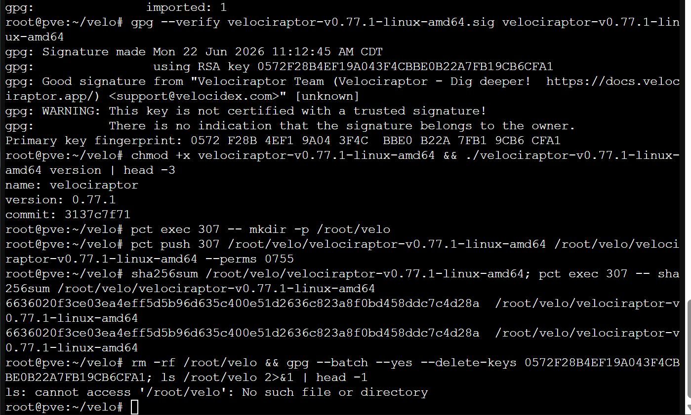
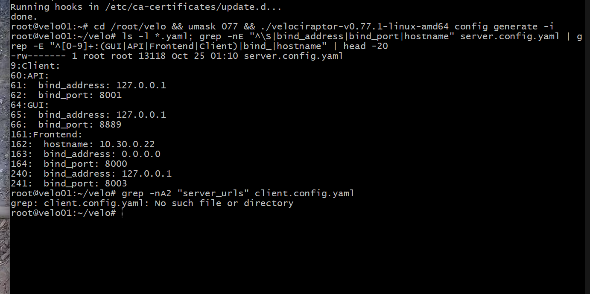
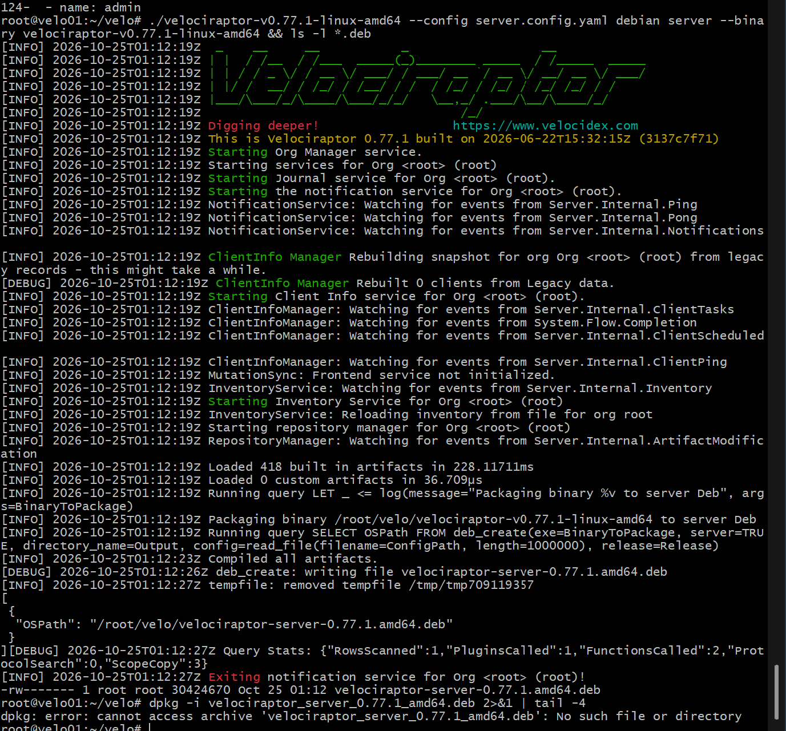
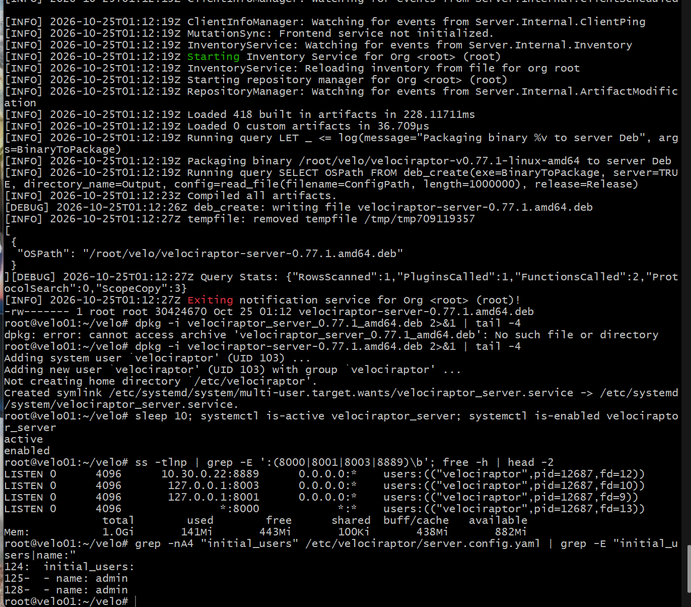
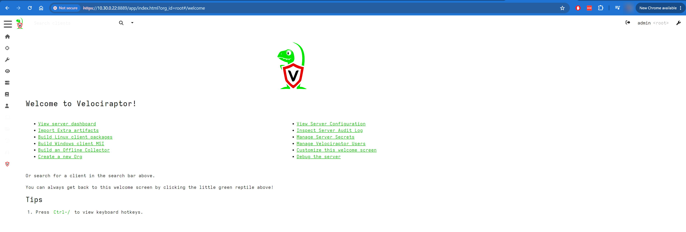
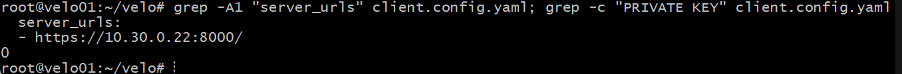
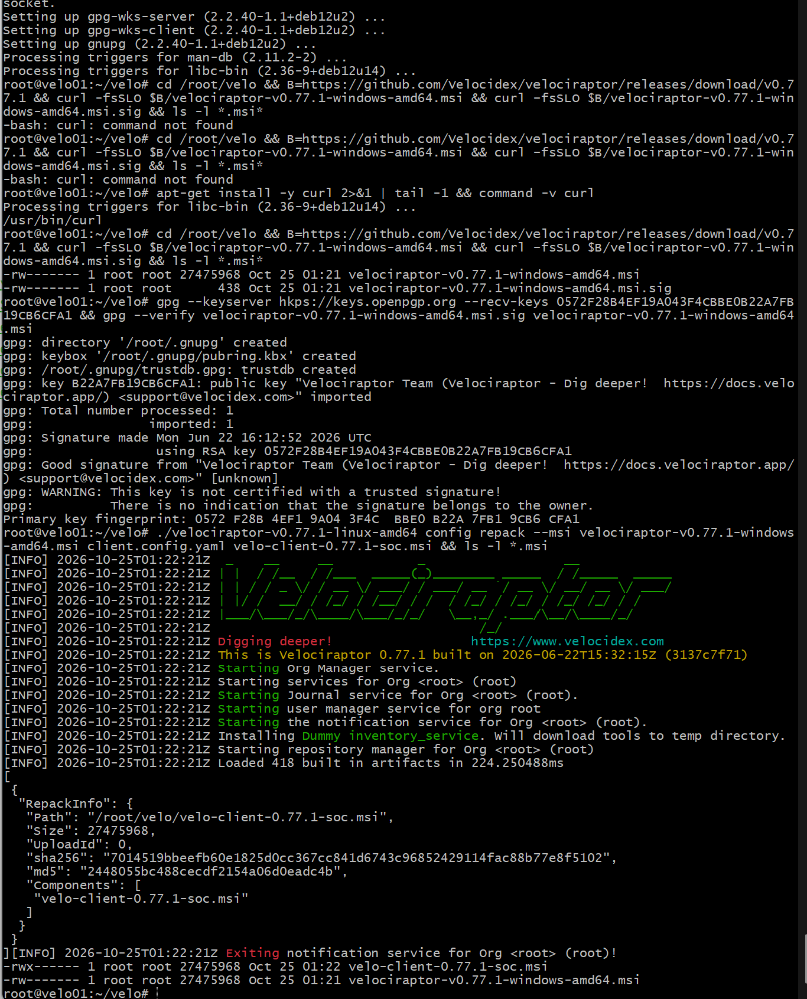
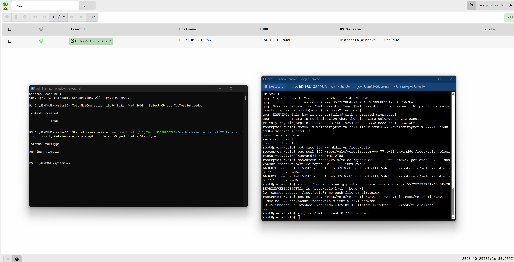
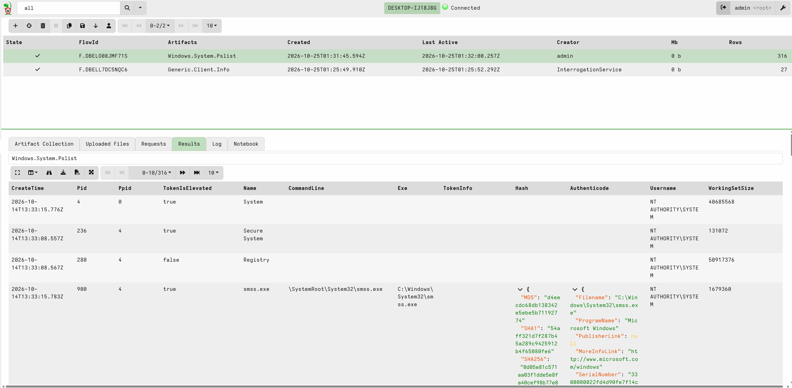

# 3.3 · Velociraptor (Deep Dive)

Velociraptor is a DFIR (digital forensics and incident response) platform. An agent on each endpoint runs **artifacts**, saved queries written in VQL (Velociraptor Query Language), and returns the results to the server. In this SOC it's the step after a TheHive alert: when an alert needs evidence from an endpoint, I collect it with Velociraptor instead of logging in to the machine. This entry covers the server on velo01, the Windows client on my PC, and the first collection.

## Host

velo01 is container 307: an unprivileged Debian 12 LXC with 1 vCPU, 1 GB of RAM and 50 GB of disk at 10.30.0.22, built in 1.7. Velociraptor's server is a single Go binary with a file-based datastore and no separate database, so 1 GB was enough to start with.

## Getting the binary

### Issue: the first steps ran on pve

I ran the first five steps in the pve shell instead of velo01's. Both prompts end in `~#`, and I didn't check the hostname. That did three things on pve:

- `apt update && apt upgrade` applied 4 Debian security updates to the Proxmox host. I kept them; they were pending updates from Debian's repo.
- The Velociraptor binary and its signature were downloaded to `/root/velo`.
- Velocidex's GPG key was imported into root's keyring.

Signature check on pve:

```bash
gpg --keyserver hkps://keys.openpgp.org --recv-keys 0572F28B4EF19A043F4CBBE0B22A7FB19CB6CFA1
gpg --verify velociraptor-v0.77.1-linux-amd64.sig velociraptor-v0.77.1-linux-amd64
chmod +x velociraptor-v0.77.1-linux-amd64 && ./velociraptor-v0.77.1-linux-amd64 version | head -3
```

Result: `Good signature from "Velociraptor Team"` with primary key fingerprint `0572 F28B 4EF1 9A04 3F4C BBE0 B22A 7FB1 9CB6 CFA1`, and version 0.77.1, commit `3137c7f71`. The "key is not certified with a trusted signature" warning means only that I haven't signed the key myself; the check that matters is the fingerprint.

Since the binary was already verified, I moved it into the container rather than downloading it again, then cleaned up pve:

```bash
pct exec 307 -- mkdir -p /root/velo
pct push 307 /root/velo/velociraptor-v0.77.1-linux-amd64 /root/velo/velociraptor-v0.77.1-linux-amd64 --perms 0755
sha256sum /root/velo/velociraptor-v0.77.1-linux-amd64; pct exec 307 -- sha256sum /root/velo/velociraptor-v0.77.1-linux-amd64
rm -rf /root/velo && gpg --batch --yes --delete-keys 0572F28B4EF19A043F4CBBE0B22A7FB19CB6CFA1
```

Both hashes were `6636020f3ce03ea4eff5d5b96d635c400e51d2636c823a8f0bd458ddc7c4d28a`. `pct push` copies a file from the Proxmox host into a container's filesystem; `pct exec` runs a command inside it.

## Server configuration

On velo01:

```bash
cd /root/velo && umask 077 && ./velociraptor-v0.77.1-linux-amd64 config generate -i
```

`umask 077` makes every file the wizard writes readable by root only. The server config holds the deployment's CA private key, and anyone who has it can impersonate the server to every client.

| Wizard question | Answer |
| --- | --- |
| Deployment type | Self-signed SSL |
| DNS | None; the frontend hostname is the IP, 10.30.0.22 |
| Frontend (client) port | 8000 |
| GUI port | 8889 |
| GUI user | `admin` |

Result: `server.config.yaml`, 13118 bytes, `-rw-------`.

| Block | Bind | Purpose |
| --- | --- | --- |
| `Frontend` | 0.0.0.0:8000 | Client connections |
| `GUI` | 127.0.0.1:8889 (wizard default) | Web interface |
| `API` | 127.0.0.1:8001 | gRPC API for tools and scripts |
| Monitoring | 127.0.0.1:8003 | Prometheus metrics |

### Issue: no client config

The wizard wrote no `client.config.yaml`. In 0.77 the client config is derived from the server config:

```bash
./velociraptor-v0.77.1-linux-amd64 --config server.config.yaml config client > client.config.yaml
grep -A1 "server_urls" client.config.yaml; grep -c "PRIVATE KEY" client.config.yaml
```

Result: `- https://10.30.0.22:8000/` and `0`. The client config carries the CA **certificate**, which the client uses to pin the server, and no private key.

### Issue: the GUI on localhost

With the GUI on 127.0.0.1, my PC's browser couldn't reach it. I changed only the `GUI:` block:

```bash
cp -p server.config.yaml server.config.yaml.orig
sed -i '/^GUI:/,/bind_port/s/bind_address: 127.0.0.1/bind_address: 10.30.0.22/' server.config.yaml
grep -nA2 "^GUI:" server.config.yaml
```

The sed range runs from `GUI:` to the next `bind_port`, so the API and monitoring blocks, which also bind to 127.0.0.1, were left as they were.

## Server package

```bash
./velociraptor-v0.77.1-linux-amd64 --config server.config.yaml debian server --binary velociraptor-v0.77.1-linux-amd64 && ls -l *.deb
```

This bundles the binary, the config and a systemd unit into one package. Result: `velociraptor-server-0.77.1.amd64.deb`, 30424670 bytes.

### Issue: the package name

`dpkg -i velociraptor_server_0.77.1_amd64.deb` failed with "No such file or directory". I had assumed Debian's `name_version_arch.deb` pattern; Velociraptor uses hyphens and dots. Using the name from `ls`:

```bash
dpkg -i velociraptor-server-0.77.1.amd64.deb 2>&1 | tail -4
sleep 10; systemctl is-active velociraptor_server; systemctl is-enabled velociraptor_server
ss -tlnp | grep -E ':(8000|8001|8003|8889)\b'; free -h | head -2
grep -nA4 "initial_users" /etc/velociraptor/server.config.yaml | grep -E "initial_users|name:"
```

| Check | Result |
| --- | --- |
| Install | Created the `velociraptor` system user (UID 103) and enabled `velociraptor_server.service` |
| Service | `active`, `enabled` |
| Listeners | `10.30.0.22:8889`, `127.0.0.1:8003`, `127.0.0.1:8001`, `*:8000`, all owned by `velociraptor` |
| Memory | 141 MiB used, 882 MiB available |
| Users | `admin` listed twice under `initial_users` |

The duplicate `admin` came from repeating the entry in the wizard. `initial_users` only seeds accounts on first start, and the server created one `admin` account.

## GUI

`https://10.30.0.22:8889` from my PC showed a certificate warning, expected for the self-signed CA, and then the welcome page, logged in as `admin` in the root org.

## Windows client

### Issue: curl missing

On velo01:

```bash
command -v gpg || apt-get install -y gnupg
```

gnupg installed, which also showed velo01 had outbound access. The MSI download then failed with `curl: command not found`: the minimal Debian 12 LXC template ships without curl. The `&&` chain stopped at the first failure, so nothing partial was written.

```bash
apt-get install -y curl 2>&1 | tail -1 && command -v curl
```

### Download, verify, repack

```bash
cd /root/velo && B=https://github.com/Velocidex/velociraptor/releases/download/v0.77.1 && curl -fsSLO $B/velociraptor-v0.77.1-windows-amd64.msi && curl -fsSLO $B/velociraptor-v0.77.1-windows-amd64.msi.sig && ls -l *.msi*
gpg --keyserver hkps://keys.openpgp.org --recv-keys 0572F28B4EF19A043F4CBBE0B22A7FB19CB6CFA1 && gpg --verify velociraptor-v0.77.1-windows-amd64.msi.sig velociraptor-v0.77.1-windows-amd64.msi
./velociraptor-v0.77.1-linux-amd64 config repack --msi velociraptor-v0.77.1-windows-amd64.msi client.config.yaml velo-client-0.77.1-soc.msi && ls -l *.msi
```

| Check | Result |
| --- | --- |
| MSI | 27475968 bytes; signature 438 bytes |
| Signature | `Good signature`, same fingerprint as the Linux binary |
| Repacked MSI | `velo-client-0.77.1-soc.msi`, 27475968 bytes, SHA256 `7014519bbeefb60e1825d0cc367cc841d6743c96852429114fac88b77e8f5102` |

**Repacking** writes the client config into a slot reserved inside the MSI, which is why the size didn't change. It also changes the file's contents, so the MSI's Authenticode signature no longer validates and Windows shows an unknown publisher. That's why I verified the original first. The `Velociraptor.exe` inside it keeps its own signature.

### Transfer and install

On pve:

```bash
pct pull 307 /root/velo/velo-client-0.77.1-soc.msi /root/velo-client-0.77.1-soc.msi && sha256sum /root/velo-client-0.77.1-soc.msi
```

The hash matched `7014519b…f5102`. I copied the MSI to my PC with `scp` and deleted the copy on pve. On my PC, in an elevated PowerShell:

```powershell
Test-NetConnection 10.30.0.22 -Port 8000 | Select-Object TcpTestSucceeded
Start-Process msiexec -ArgumentList '/i',"$env:USERPROFILE\Downloads\velo-client-0.77.1-soc.msi",'/qn' -Wait; Get-Service Velociraptor | Select-Object Status,StartType
```

Result: `True`, then `Running` / `Automatic`. The existing UDM rules already allowed my PC's network to reach the SOC VLAN on 8000.

### Enrollment

The client appeared in the GUI as `C.1d6e61262784870b`, hostname `DESKTOP-IJ18J8G`, Microsoft Windows 11 Pro 25H2, online. On enrollment the server ran `Generic.Client.Info` automatically (creator `InterrogationService`, 27 rows); that's where the hostname and OS came from.

## First collection

I launched `Windows.System.Pslist` from the client's Collected tab. It finished in about 15 seconds with 316 rows: PID, parent PID, name, command line, executable, token elevation, user, working set, file hashes, and the executable's Authenticode result.

I triaged the export by signature, then path, then user:

| Authenticode | Count | What they were |
| --- | --- | --- |
| `trusted` | 298 | Signed binaries, including `C:\Program Files\Velociraptor\Velociraptor.exe` running as SYSTEM |
| `untrusted` | 12 | Explained below |
| None | 6 | Kernel pseudo-processes with no file (System, Secure System, Registry, Memory Compression, vmmem) and a chrome.exe that had already exited |

| Untrusted | Path | Verdict |
| --- | --- | --- |
| `bash.exe` ×4, `mintty.exe`, `ssh-agent.exe` ×2 | `C:\Program Files\Git\usr\bin` | Git for Windows; its MSYS binaries ship unsigned. The two `ssh-agent` processes were left over from Git Bash sessions |
| `WidgetService.exe`, `MicrosoftStartFeedProvider.exe` | `C:\Program Files\WindowsApps` | Store packages, signed at the package level rather than inside each exe |
| `MRCapture.exe`, `zMLogs.exe` | `AppData\Local\MangoApps\Mango Recorder` | Installed software of mine; unsigned and in a user-writable path, the pattern I'd check first on an unknown machine |
| `RiotClientCrashHandler.exe` | `C:\Riot Games\Riot Client` | Installed software of mine |

Nothing was unexplained. I kept the JSON export out of the repo because it contains my username, paths and command lines.

## Evidence

**The Linux binary's good signature, pushed from pve into velo01 with matching SHA256 on both sides, and pve cleaned up.**



**The wizard's binds: GUI and API on 127.0.0.1, the frontend on 0.0.0.0:8000 with hostname 10.30.0.22, and no client config written.**



**The server package built as velociraptor-server-0.77.1.amd64.deb, and dpkg failing on the name I assumed.**



**The package installed, the service active and enabled under the velociraptor user, the four listeners, 141 MiB used, and the initial users.**



**Logged in to the GUI at 10.30.0.22:8889 as admin.**



**The client config pointing at https://10.30.0.22:8000/ with no private key.**



**curl missing, then installed; the MSI downloaded, its good signature, and the repack with its SHA256.**



**Port 8000 reachable from my PC, the service running and automatic, the MSI's hash after the pull, and the client online in the GUI.**



**Windows.System.Pslist finished with 316 rows, next to the automatic Generic.Client.Info collection.**



## Backlog

- Reduce copies of the CA private key on velo01: `/root/velo/server.config.yaml`, its `.orig`, and the server `.deb` all contain it alongside `/etc/velociraptor/server.config.yaml`. Keep one offline backup and remove the rest
- Remove the duplicate `admin` entry from `initial_users`
- Delete the MSI and the leftover working files from my PC's Downloads and `/root/velo`
- A host-level allow list on velo01: 8889 from the Default network only, 8000 from client networks
- Back up the server's datastore and config
- Ship Velociraptor's server and audit logs to Splunk
- Clients on the Linux SOC systems
- Client event monitoring (for example `Windows.Events.ProcessCreation`) once the baseline week shows the load
- Link Velociraptor to TheHive and Shuffle, so an alert can trigger a collection on its endpoint
- A trusted certificate for the GUI
- Non-root admin user inside the LXC (existing backlog item)
- Revisit velo01's 1 GB after hunts across several clients
