# 4.1 · Failed Proxmox Logins (Deep Dive)

The first Phase 4 use case: detect password guessing and username guessing against the Proxmox web UI, the most privileged system in the lab. Each use case follows the same loop: generate the activity, find it in Splunk, build and test the detection, tune it, and work the alert as a case.

## The data

Proxmox already sent its syslog to splunk01 (step 2.3), so failed logins were in `index=network host=192.168.1.3`. I generated failures in a private browser window at `https://192.168.1.3:8006` and searched for them:

```
index=network host=192.168.1.3 "authentication failure"
```

| Attempt | Lines written | `msg` |
| --- | --- | --- |
| `root`, wrong password, realm Linux PAM | `IPCC.xs ... pam_unix(proxmox-ve-auth:auth): authentication failure ... rhost=::ffff:192.168.1.11 user=root` and `pvedaemon[...] authentication failure; rhost=::ffff:192.168.1.11 user=root@pam msg=Authentication failure` | `Authentication failure` |
| `notarealuser`, realm Linux PAM | `pvedaemon[...] authentication failure; rhost=::ffff:192.168.1.11 user=notarealuser@pam msg=no such user ('notarealuser@pam')` | `no such user (...)` |
| `notaarealuser`, realm Proxmox VE | Same line with `@pve` | `no such user (...)` |

- A PAM login writes two lines per attempt. Only the `pvedaemon` line is written for every realm, so the detection counts that one.
- Proxmox listens on IPv6 and IPv4, so an IPv4 client appears as `::ffff:192.168.1.11`. Left in, that prefix stops the IP matching every other log source.
- `msg` separates a wrong password on a real account from a guessed username, which is a different attacker behaviour.
- Proxmox writes its own timestamp in local time (`-06:00` after DST ended); Splunk read the offset and stored the events in UTC.

### Extraction

```
index=network host=192.168.1.3 "pvedaemon" "authentication failure"
| rex "rhost=(::ffff:)?(?<src_ip>\S+) user=(?<user>[^@\s]+)@(?<realm>\S+) msg=(?<reason>.+)$"
| table _time src_ip user realm reason
```

`(::ffff:)?` matches the IPv6 prefix if it's there and leaves it out of the capture; `\S+` takes the address up to the next space; `[^@\s]+` takes the user name up to the `@`; the realm follows the `@`; and `.+$` takes the rest of the line as the reason.

## Normal

```
index=network host=192.168.1.3 "pvedaemon" "authentication failure" earliest=-30d
| rex "rhost=(::ffff:)?(?<src_ip>\S+) user=(?<user>[^@\s]+)@(?<realm>\S+) msg=(?<reason>.+)$"
| bin _time span=15m
| stats count as failures dc(user) as users values(user) as user_list values(reason) as reasons by _time src_ip
| sort - failures
```

| What | Result |
| --- | --- |
| Failures outside my tests | 2 in 30 days (10/15 and 10/19), one `root` typo each |
| Most failures in one 15-minute bin | 1 normally, 4 in my tests |
| Sources | Only 192.168.1.11, the admin PC |
| Unknown usernames | Only my tests |

## Detection

```
index=network host=192.168.1.3 "pvedaemon" "authentication failure" earliest=-15m@m latest=@m
| rex "rhost=(::ffff:)?(?<src_ip>\S+) user=(?<user>[^@\s]+)@(?<realm>\S+) msg=(?<reason>.+)$"
| stats count as failures dc(user) as users values(user) as user_list values(realm) as realms count(eval(like(reason,"no such user%"))) as unknown_user_failures min(_time) as first max(_time) as last by src_ip
| where failures>=5 OR users>=3 OR src_ip!="192.168.1.11"
| eval first=strftime(first,"%F %T"), last=strftime(last,"%F %T")
| table src_ip failures users user_list realms unknown_user_failures first last
```

- The window is the last 15 whole minutes (`@m` snaps to the minute, so consecutive runs line up).
- `stats ... by src_ip` gives one row per source. `count(eval(like(reason,"no such user%")))` counts only the guessed-username failures.
- The `where` line is the detection: any one of three conditions keeps the row.

| Condition | Catches | Threshold reason |
| --- | --- | --- |
| `failures>=5` | Password guessing (T1110.001) | Normal is one typo |
| `users>=3` | Username guessing | I only log in as `root` |
| `src_ip!="192.168.1.11"` | Any failure from another machine | The UI has only been used from the admin PC |

Saved as `SOC - 4.1 Proxmox failed logins` (search app, shared in app): cron `*/5 * * * *`, trigger when results > 0, for each result, throttle 30 minutes on `src_ip`, Add to Triggered Alerts, severity 4 (High), expires after 7 days. The definition is in [`detections/splunk/soc_4_1_proxmox_failed_logins.conf`](../../detections/splunk/soc_4_1_proxmox_failed_logins.conf).

Running every 5 minutes over 15 means a burst is in three consecutive runs; the 30-minute throttle per `src_ip` turns that into one alert per attacker, while a second source still alerts on its own.

### Issue: the history bins and the alert disagreed

Run by hand before saving, the alert search returned a row I didn't expect: `users=3` (`notaarealuser`, `notarealuser`, `root`) from 04:13 to 04:28. The 30-day history had shown at most 2 users per bin because `bin _time span=15m` cut my tests at 04:15 into two bins. The alert's window slides with each run, so it can't split a burst at a fixed boundary. The search was right and my expectation was wrong.

My own typo `notaarealuser` counted as a third username. An admin mistyping three different usernames within 15 minutes is rare enough to accept.

### Issue: trigger and throttle saved differently from the form

Reading the alert back over REST:

```
| rest /servicesNS/-/-/saved/searches splunk_server=local | search title="SOC - 4.1 Proxmox failed logins" | table search cron_schedule alert_type alert_comparator alert_threshold alert.digest_mode alert.suppress alert.suppress.fields alert.suppress.period alert.severity alert.expires
```

showed `alert.digest_mode=1` (Once) and an empty `alert.suppress.fields`. With Once, a run produces one alert whatever the number of sources; with no throttle field, the 30-minute suppression covers the whole alert, so a second source during that half hour would be missed. The throttle field only appears in the form after choosing For each result. I changed both through Edit Alert and read them back: `alert.digest_mode=0`, `alert.suppress.fields=src_ip`, `alert.suppress.period=30m`, with the search unchanged (`earliest=-15m@m`, `src_ip!="192.168.1.11"`). Severity read back as 4, which is High in Splunk's 1–5 scale (5 is Critical).

## Tests

| Test | How | Result |
| --- | --- | --- |
| Password burst | 6 `root` failures in a private window, 23:04:42–23:05:04 UTC | Row with `failures=6`; the scheduled run fired once |
| Username guessing | `root`, `notarealuser`, `notaarealuser` within 15 minutes | Row with `users=3` |
| Unknown source, positive | `stats count as failures by src_ip \| where src_ip!="192.168.1.99"` over 60 minutes | Row for 192.168.1.11 |
| Unknown source, negative | Same with `src_ip!="192.168.1.11"` | No results |

Firing history, from the audit log rather than the scheduler (which only says the search ran):

```
index=_audit action=alert_fired ss_name="SOC - 4.1 Proxmox failed logins" | table _time ss_name severity sid
```

One `alert_fired` at 23:10:01. The 23:05 run looked at events up to 23:05:00, before the whole burst had been indexed; the 23:10 run counted all six. The overlapping windows exist for exactly that edge.

### Issue: a test that couldn't fail

My first test of the unknown-source condition changed `src_ip!="192.168.1.11"` to `"192.168.1.99"` in the full search and got a row. That row also had `failures=6`, so `failures>=5` would have returned it whatever the IP check did. To test one condition joined by `OR`, I removed the others and ran it both ways: a positive case that must fire and a negative case that must not.

### Issue: testing in a tab opened from the alert

That first test ran in a search tab titled `SOC - 4.1 Proxmox failed logins` with an active Save button. A tab opened from a saved search writes back into it on Save; pressing it would have put the test values into the live alert, which is how the baseline report was overwritten in 3.4. I closed the tab without saving and ran all later tests from New Search.

## Case #2

TheHive case `4.1 Proxmox failed logins: 6 root failures from 192.168.1.11`: severity Medium, TLP and PAP Amber, tags `proxmox`, `T1110.001`, `splunk-alert`.

| Observable | Type | Is IOC | Sighted | Reason |
| --- | --- | --- | --- | --- |
| `192.168.1.11` | ip | No | Yes | Source of the failures; marking my admin PC as an IOC would taint every later alert from it |
| `root@pam` | other | No | No | Target account, not an actor |

Three mandatory tasks, so none could close without a logged answer.

### Scope: did the source get in, and did it try anything else?

```
index=network host=192.168.1.3 "pvedaemon" earliest="11/12/2026:22:45:00" latest="11/12/2026:23:45:00" ("authentication failure" OR "successful auth")
| rex "(rhost=(::ffff:)?(?<src_ip>\S+) )?user[= ]'?(?<user>[^@'\s]+)@(?<realm>[^'\s]+)"
| eval outcome=if(searchmatch("successful auth"),"success","failure")
| table _time outcome src_ip user realm _raw
| sort _time
```

6 failures, no success. Before trusting the zero I checked that the success pattern exists at all: `index=network host=192.168.1.3 "pvedaemon" "successful auth"` over 30 days found 1,124 events from 10/15 to 11/04 04:32. The last one being on 11/04 also matched my own use: I hadn't logged in since.

```
index=zeek sourcetype=zeek:conn id.orig_h=192.168.1.11 id.resp_h=192.168.1.3 earliest="11/12/2026:22:45:00" latest="11/12/2026:23:45:00"
| stats count as connections by id.resp_p proto
```

39 connections, all `8006/tcp`. No SSH, VNC or other ports. Zeek is independent of Proxmox's own logs, so this would still hold if the host's logs had been tampered with.

### Source: who is 192.168.1.11?

```
index=zeek sourcetype=zeek:dhcp assigned_addr=192.168.1.11 OR client_addr=192.168.1.11
| stats latest(_time) as last_seen values(host_name) as hostname values(mac) as mac by assigned_addr
```

`DESKTOP-IJ18J8G`, the admin PC. To tie the connections to a process I searched Sysmon network connections on the PC:

```
index=os host=DESKTOP-IJ18J8G source="*Sysmon*" EventCode=3 DestinationIp=192.168.1.3 DestinationPort=8006 earliest="11/12/2026:23:00:00" latest="11/12/2026:23:10:00"
| stats count values(Image) as process values(User) as user by SourceIp
```

No results, so I checked what Chrome's logged connections look like:

```
index=os host=DESKTOP-IJ18J8G source="*Sysmon*" EventCode=3 Image="*\\chrome.exe"
| eval dest_type=if(cidrmatch("192.168.0.0/16",DestinationIp) OR cidrmatch("10.0.0.0/8",DestinationIp),"internal","external")
| stats count by dest_type DestinationPort
```

| Port | Events in 7 days |
| --- | --- |
| 5353 (mDNS) | 16,547 |
| 443 | 3 |
| 8006 | 0 |

sysmon-modular keeps Chrome's mDNS traffic (multicast name resolution, abused for poisoning, T1557.001) and drops almost all of its web connections. A browser-based attack from this PC would leave no Sysmon network trace; the Proxmox and Zeek logs are what cover it. The "external" 5353 row is the mDNS multicast group `224.0.0.251`, which sits outside the private ranges in my `cidrmatch` but never leaves the LAN.

### Verdict

True positive, authorised test, no impact. The rule fired on what it claims to detect, six failures in 22 seconds from one IP. A false positive would mean the condition didn't really happen, for example if both log lines per attempt had been counted. Who caused it is the verdict: my own planned test, with no successful login and only web UI traffic. Case closed as True Positive, No Impact.

## Evidence

**Proxmox failure lines: two per PAM attempt, IPv4-mapped source.**

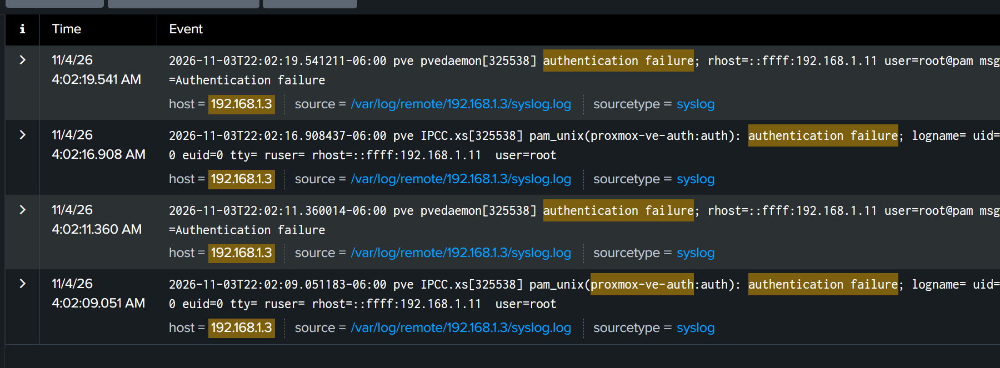

**Fields extracted from the pvedaemon line.**

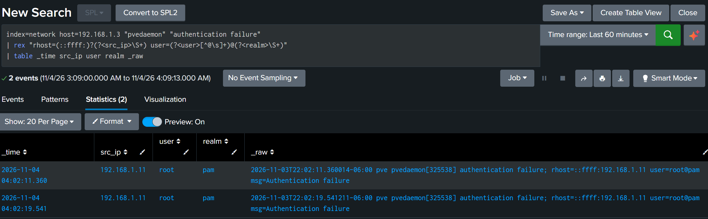

**A guessed username: msg=no such user.**

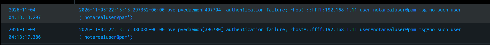

**Both realms and both reasons.**

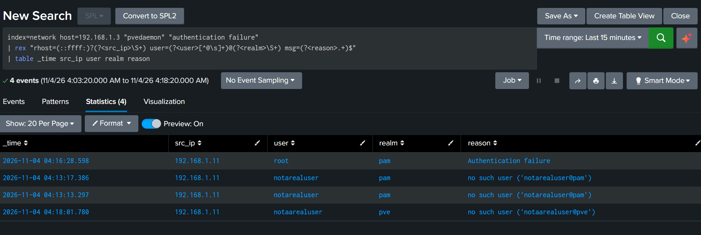

**30 days of failures in 15-minute bins.**

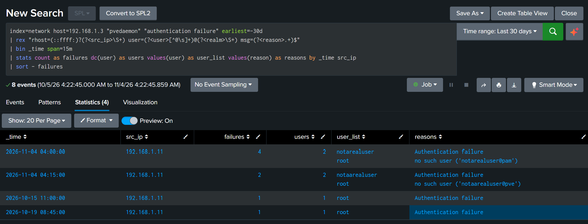

**The sliding window catching three usernames the bins had split.**

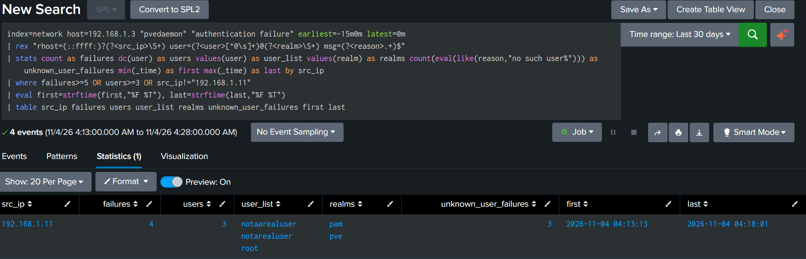

**The saved alert.**

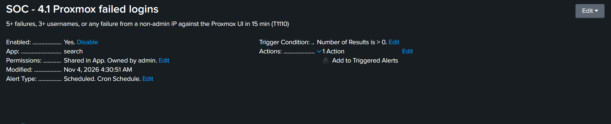

**Its first scheduled run.**

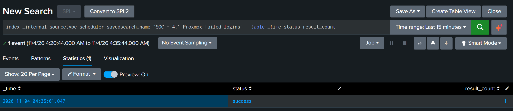

**REST read-back: digest mode 1 and no throttle field.**

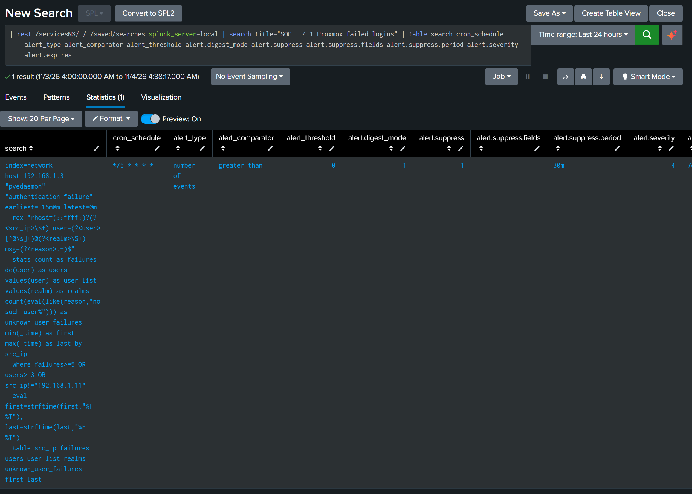

**The 6-failure burst in the alert's window.**

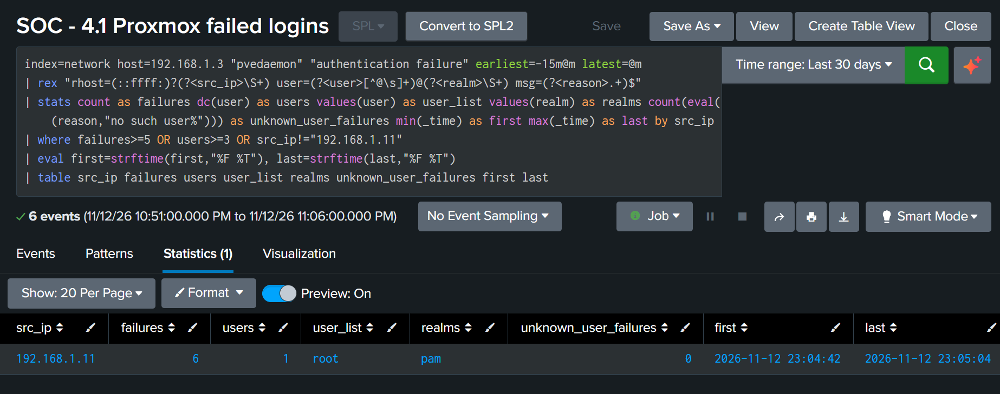

**A test that couldn't fail: the row also matched failures>=5.**

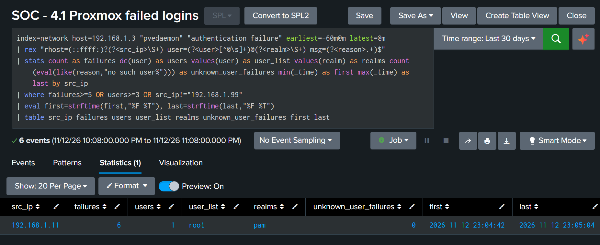

**Unknown-source condition alone: positive case.**

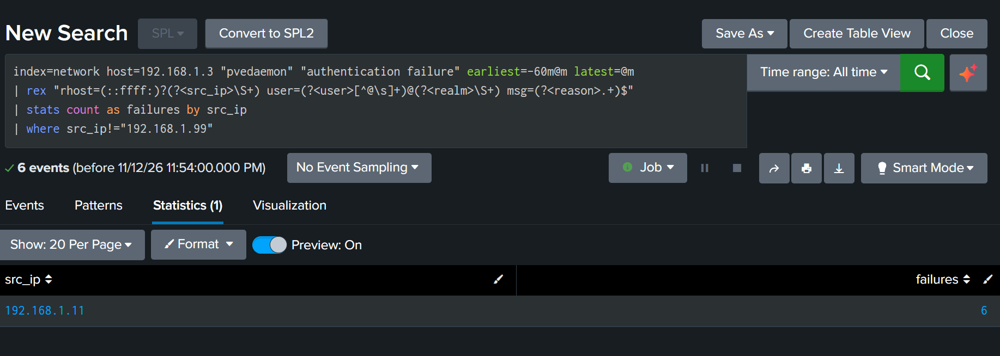

**Unknown-source condition alone: negative case.**

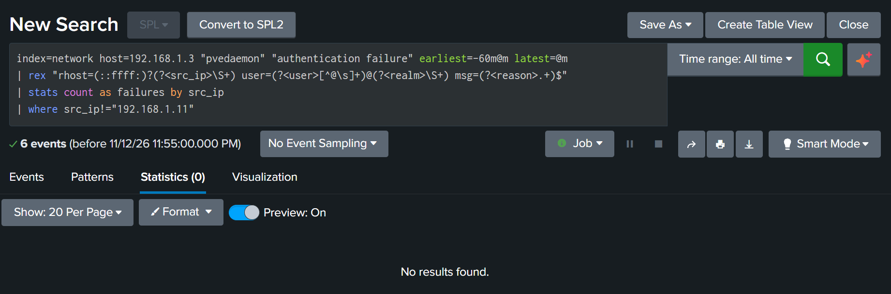

**One alert_fired for the burst.**

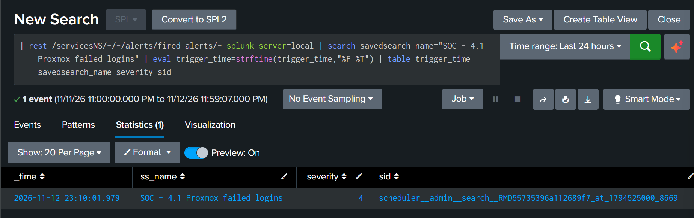

**Case #2 created.**

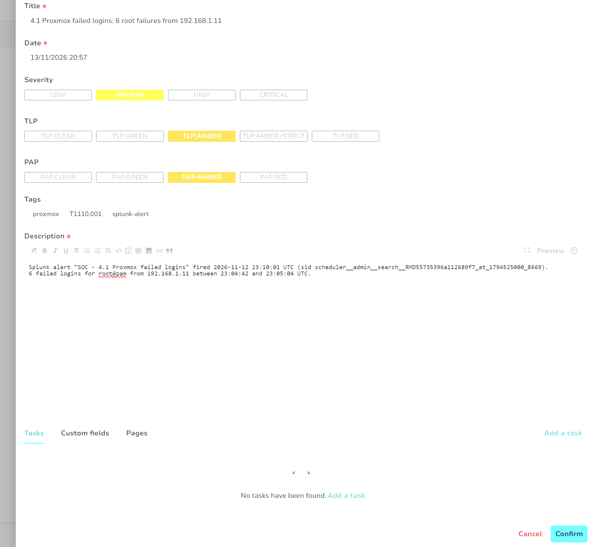

**Its three mandatory tasks.**

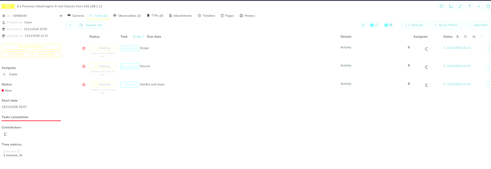

**Scope: six failures, no success.**

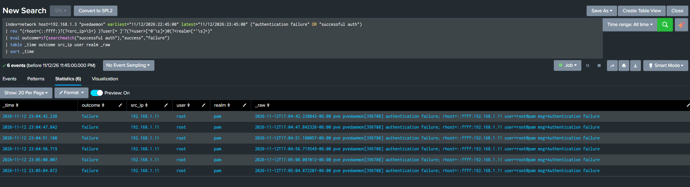

**Scope: only port 8006 in Zeek.**

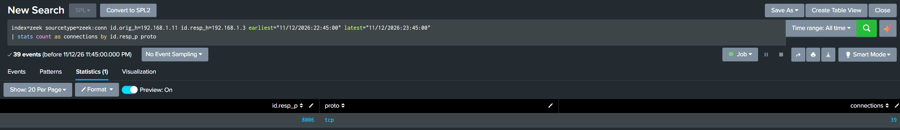

**The success pattern exists: 1,124 events in 30 days.**

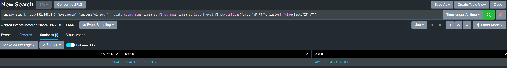

**Source: DHCP ties the IP to DESKTOP-IJ18J8G (MAC redacted).**

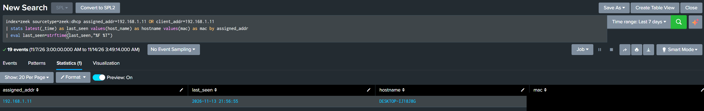

**No Sysmon record of the browser's connections.**

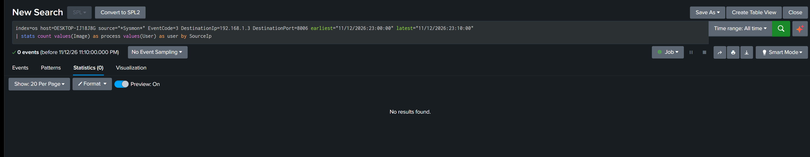

**What Sysmon does record for Chrome: mDNS, almost no web traffic.**

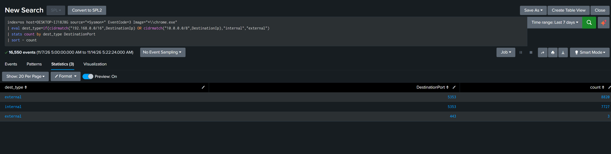

**Case #2 closed as True Positive.**

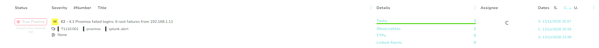

**REST read-back after the fix: for each result, throttled on src_ip, search unchanged.**

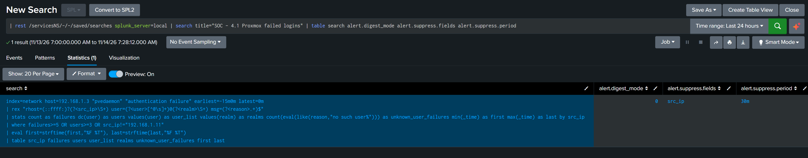

## Backlog

- Send this alert to TheHive automatically through a general Shuffle workflow (tier ②)
- Investigation search catalog with the case searches above as macros (tier ②, b11)
- Sysmon: log connections from browsers and terminals to internal admin ports (8006, 22)
- Detect a successful login after a run of failures from the same IP
- Cover SSH logins to pve (`sshd` lines), which this rule doesn't
- Keep the allowed admin IP in a lookup instead of the search text
- Add T1110.001 on the case's TTPs tab; TheHive closure codes have no "benign true positive", so the summary carries it
- Proxmox VE 8 support ended 2026-08-31 (seen on the pve banner during this step): handle in 4.3
