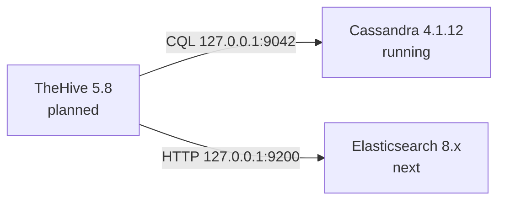

# 3.1 · TheHive: Case Management (in progress)

**Status:** 🚧 In progress. thehive01 is resized to 6 GB, patched, and running Java 11 and Cassandra 4.1.12 with authentication, a dedicated `thehive` keyspace and role, and the default superuser removed. Elasticsearch and TheHive itself come next.

## What I built so far
- **A RAM decision based on the vendor's current numbers:** TheHive runs three JVMs (TheHive, Cassandra, Elasticsearch). The current requirements call for 4 GB per service on one host, which is far above the 4 GB the whole VM had. I raised thehive01 to 6 GB and the SOC budget from 24 GB to about 26 GB.
- **A clean rollback point:** a `pre-thehive` snapshot taken with the VM powered off, before the resize
- **Java 11 (Amazon Corretto)**, the only Java version TheHive supports
- **Cassandra 4.1.12** as a single node: explicit heap, cluster name `thp`, password authentication and role-based authorization, bound to localhost only
- **Cassandra accounts:** a new `admin` superuser, the default `cassandra` account dropped, and a non-superuser `thehive` role limited to its own keyspace

## Issues I ran into
| Issue | Cause | What I did |
| --- | --- | --- |
| The VM was too small for TheHive | Three JVMs on one host; the vendor's single-host table adds up to 12 GB | Sized thehive01 to 6 GB with hand-set heaps and no swap |
| `nodetool` refused connections right after `systemctl enable --now cassandra` | The package ships a SysV init script, so systemd wraps it and hands `enable` to `systemd-sysv-install` | Checked the service state and the Java process separately, then confirmed `UN 127.0.0.1` |
| `cqlsh` crashed with `No module named 'six.moves'` | cqlsh loads its own bundled, older `six`, which relies on an import hook Python 3.12 removed | Installed Python 3.9 alongside the system Python and pointed cqlsh at it with `CQLSH_PYTHON` |

## Decisions
- **6 GB, not 4 GB or a full rebalance now:** 4 GB was below every vendor figure, and a full rebalance would have delayed Phase 3. Every non-SOC VM was powered off, so the extra 2 GB came out of free host RAM.
- **No swap on this VM:** Elasticsearch's guidance is to disable swap or lock its heap in RAM, so I broke from the swapfile pattern I used on misp01 and sensor01.
- **Everything on localhost:** Cassandra (and later Elasticsearch) only listen on 127.0.0.1, so only TheHive's web port needs to be reachable from the network.
- **Dry-run every install:** I simulated each package install first to make sure nothing pulled in a second JDK.

**Skills:** capacity planning · JVM heap sizing · Proxmox snapshots and resizing · Apache Cassandra · CQL roles and permissions · SysV vs systemd · Python dependency troubleshooting

➡️ [Deep dive](deep-dives/15-thehive.md)
