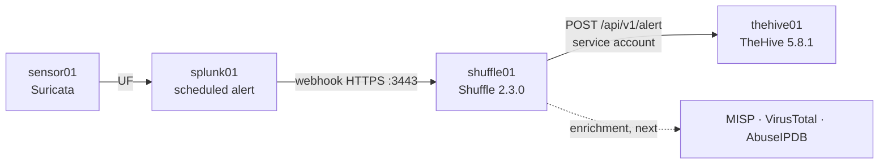

# 3.2 · Shuffle: SOAR (in progress)

**Status:** 🚧 In progress. Shuffle 2.3.0 runs in Docker on shuffle01. A Suricata detection now travels end to end: Splunk's scheduled alert posts to a Shuffle webhook, and the workflow creates a TheHive alert with the IPs as observables, through a dedicated service account. Enrichment (MISP, VirusTotal, AbuseIPDB) comes next.

## What I built so far
- **A 6 GB VM:** Shuffle's compose file gives OpenSearch a fixed 3 GB heap, which can't fit in 4 GB alongside the backend and the workflow containers. I raised shuffle01 to 6 GB and the SOC budget to about 28 GB, with OpenSearch at a 2 GB heap.
- **Docker Engine 29.9 and Compose v5.6** from Docker's signed apt repo, used through `sudo` (no `docker` group)
- **Shuffle pinned to release 2.3.0** instead of `main` and `:latest` images, so the build is repeatable
- **Only the web UI exposed:** OpenSearch, the backend API and the shuffle-security service bound to localhost; ports 3001/3443 are the only ones reachable from the network
- **Secrets replaced before first start:** a generated OpenSearch admin password instead of the one published in the repo, and an encryption key for stored app credentials
- **A TheHive service account** (`shuffle@soc.lan`, analyst, API key only) and a test workflow that created an alert in TheHive
- **A Splunk alert on my Suricata test rule** with a webhook action, and a Shuffle workflow that turns its payload into a TheHive alert with IP observables

## Issues I ran into
| Issue | Cause | What I did |
| --- | --- | --- |
| The pull would have failed on one image | `shuffle-security` has no `2.3.0` tag, and my pinning `sed` changed every image | Put that one image back on `:latest` and recorded its digest |
| `vm.max_map_count` dropped from 1048576 to 262144 | Ubuntu 24.04 already ships a higher value; my `99-` sysctl file loaded last and lowered it to OpenSearch's minimum | Removed my file and kept the system default |
| The first workflow run would never have reached TheHive | New workflows start at a placeholder node that wasn't connected to the TheHive node | Deleted the placeholder so the TheHive node became the start node |
| TheHive returned `400 Invalid json: Unrecognized token '$'` | The app's body template leaves unquoted placeholders like `${flag}` and `${tlp}` as literal text when their fields are empty | Replaced the template with a fixed JSON body; the run returned 201 |
| Shuffle reported `"success": true` on the failed call | Shuffle's flag means the HTTP request completed, not that TheHive accepted it | Check `status` (201) and TheHive's own log instead |
| Starting the webhook did nothing (`uninitialized`, then `{"success": false}`) | It was the only node in an unsaved workflow | Added and connected the TheHive node, saved, then started it |
| A new TheHive node asked for a case ID | New nodes default to the app's first action, GET Get case timeline | Switched it to POST Create alert |
| TheHive returned `400 Mismatch ... body as application/json` | Switching actions reset the node's headers, so the body went out without a JSON content type | Set `Content-Type=application/json` and `Accept=application/json` on the node |
| Test posts returned `success: true` but created nothing | I had re-added the webhook to the first test workflow, whose body has a fixed `sourceRef` that TheHive already had | Removed it, used the original webhook on the right workflow, and now check the title before editing |
| TheHive returned `400 Invalid json: Unexpected character ('s')` | A dot right after a variable (`$exec.search_name.`) made Shuffle insert the whole `$exec` object, quotes included | Rewrote the description so no variable is followed by a dot; the run returned 201 |
| Splunk said "Webhook URL is invalid" | The allow list was off (`enable_allowlist = false`); the form rejected the `http://` URL | Used Shuffle's HTTPS port, 3443; Splunk posted with HTTP 200 |
| Each 5-minute run re-sent the same detection | The 15-minute search window overlaps three runs, and throttling wasn't ticked | Throttle the alert for 15 minutes (in progress) |

## Decisions
- **6 GB with a 2 GB OpenSearch heap**, rather than 4 GB with a 1 GB heap or a RAM rebalance first
- **Pin the release:** `main` was a nightly merge, and `:latest` images change under you
- **Bind internal ports to 127.0.0.1 in the compose file:** Docker writes its own iptables rules, so a host firewall would never see published ports
- **A service account for Shuffle**, so every automated alert is attributed to `shuffle@soc.lan`, never to my own account
- **Alerts, not cases:** detections arrive as TheHive alerts for triage; only real ones get promoted to cases
- **Splunk's job ID as TheHive's reference:** it's unique per run, so TheHive's duplicate check can't silently drop a real alert
- **No external lookups for private IPs:** enrichment will send only public addresses to VirusTotal and AbuseIPDB

**Skills:** Splunk alerting and webhooks · Docker and Compose · container port exposure · release pinning · OpenSearch sizing · secrets handling · SOAR workflow design · REST API integration · service accounts and API keys · troubleshooting from both ends of an API call

➡️ [Deep dive](deep-dives/16-shuffle.md)
