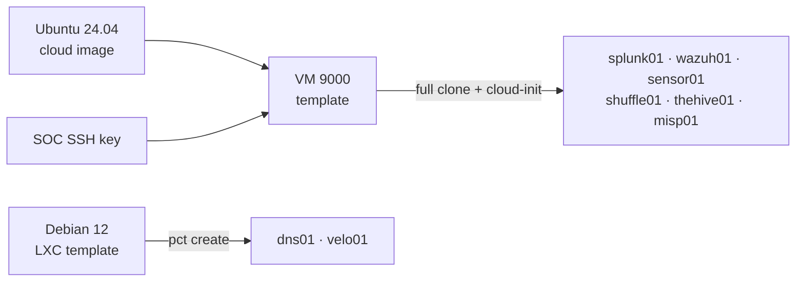

# 1.2 · VM and Container Templates (Deep Dive)

I didn't want to hand-install eight servers. I built one Ubuntu 24.04 cloud-init template for the VMs and pulled a Debian 12 LXC template for the lightweight services. Every SOC system is a clone of one of the two.



| Template | Systems |
| --- | --- |
| Ubuntu 24.04 cloud image → VM 9000 | splunk01, wazuh01, sensor01, shuffle01, thehive01, misp01 |
| Debian 12 standard (LXC) | dns01, velo01 |

## Storage

| Storage | Use |
| --- | --- |
| `isostore` (`/mnt/isostore`) | Cloud image, LXC template, cloud-init snippets |
| `local-lvm` (LVM-thin, ~10.8 TiB) | Every SOC disk |
| `local` (root disk) | Not used. It was 77% full, and filling it can take Proxmox down. |

## Base images

```bash
pvesh create /nodes/pve/storage/isostore/download-url --content iso --filename noble-server-cloudimg-amd64.img --url https://cloud-images.ubuntu.com/noble/current/noble-server-cloudimg-amd64.img
pveam update
pveam download isostore debian-12-standard_12.12-1_amd64.tar.zst
```

## SSH key

I made a dedicated Ed25519 key for the SOC so I can revoke it without touching my other keys. It's passphrase-protected, and only the public key left my workstation:

```bash
ssh-keygen -t ed25519 -C "soc-homelab" -f ~/.ssh/soc_ed25519
cat ~/.ssh/soc_ed25519.pub | ssh root@<pve-ip> "cat > /root/soc.pub"
```

I piped it over SSH instead of pasting into the web console, because the console can wrap long lines and corrupt the key. (I later rotated this key to `soc_ed25519_v2`. See step 2.2.)

## Template VM 9000

```bash
qm create 9000 --name ubuntu-2404-tpl --memory 2048 --cores 2 --cpu host --net0 virtio,bridge=vmbr0 --scsihw virtio-scsi-single --ostype l26 --agent 1 --serial0 socket --vga serial0
qm set 9000 --scsi0 local-lvm:0,import-from=/mnt/isostore/template/iso/noble-server-cloudimg-amd64.img --boot order=scsi0 --ide2 local-lvm:cloudinit
qm set 9000 --ciuser caleb --sshkeys /root/soc.pub --ipconfig0 ip=dhcp
qm template 9000
```

I used `--cpu host` to pass the Xeon's real CPU features through, since Splunk and Suricata use them. Disk and NIC are virtio for performance. The guest agent is enabled so Proxmox can see each VM's IP and shut it down cleanly. The serial console is there because Ubuntu cloud images expect one. The cloud-init drive injects the user, key and network config at first boot.

## Decisions

I left the VLAN tag off the template. VLAN 30 didn't exist yet, and a baked-in tag would have left every clone without a network. I set the tag per clone instead.

I never boot the template. Booting runs cloud-init and stamps the image with a machine ID, and every clone would inherit it.

The template disk is about 3.5 GB. Each clone gets resized to its role with `qm disk resize`.

Pi-hole and Velociraptor run as containers rather than VMs. That saves about 1.5 GB of RAM and keeps the SOC inside its 24 GB budget.

## Verification

```bash
qm config 9000
pveam list isostore
```

`template: 1`, the boot disk is `base-9000-disk-0` on `local-lvm`, `ide2` is the cloud-init drive, and the Debian template is listed in `isostore`.
