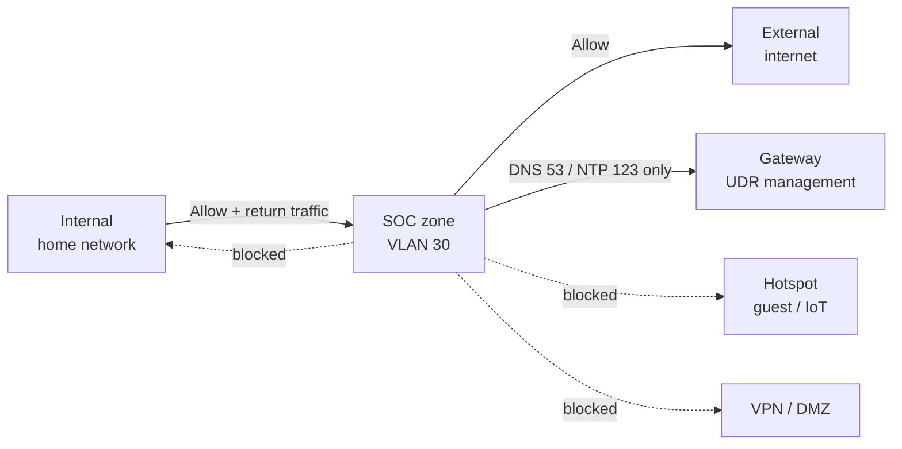
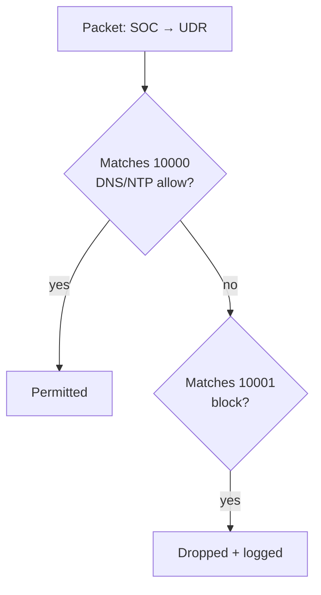

# 1.3 · SOC VLAN and Zone Firewall (Deep Dive)

I wanted a segment for the SOC tooling that can see the home network without being able to reach into it. SOC systems parse untrusted data constantly (threat feeds, raw packets, logs from every device) and hold logs and integration credentials for the whole network. If one is compromised, I want the damage contained to the SOC.

## The network

| Setting | Value | Reason |
| --- | --- | --- |
| VLAN | 30 | Separates SOC traffic at Layer 2 |
| Subnet | 10.30.0.0/24 | VLAN number matches the third octet, which keeps logs readable |
| Gateway | 10.30.0.1 (UDR) | |
| DHCP | Off | Every SOC system is static, so log sources keep stable addresses and a rogue device gets nothing |

## Zone policy

UniFi groups networks into zones and applies policies between zones. I put the SOC network in its own zone, then built this:

| From → To | Result |
| --- | --- |
| Internal → SOC | Allow (admin access, log forwarding) |
| SOC → Internal | Return traffic only |
| SOC → External | Allow (updates, packages, threat feeds) |
| SOC → Gateway | DNS and NTP only; everything else blocked and logged |
| SOC ↔ Hotspot, VPN, DMZ | Blocked (UniFi defaults) |

Custom policies:

| ID | Name | Source → Destination | Action | Ports | Logging |
| --- | --- | --- | --- | --- | --- |
| 10000 | Internal SOC Allow | Internal → SOC | Allow + auto return | Any | Off |
| 10000 | SOC to Gateway | SOC → Gateway | Allow | `DNS-NTP` (53, 123) | Off |
| 10001 | SOC → Gateway Block | SOC → Gateway | Block | Any | On |

## Decisions

### Rules are written from the side that starts the connection

My workstation starts connections into the SOC (SSH, Splunk web, log forwarding), so the allow is Internal → SOC, and replies come back through auto-return. My first draft had the SOC as the source, which would have let the SOC open connections into the home network. I caught it before saving, and now I read every rule as a sentence before I apply it.

### The SOC can't reach the router's management

The Gateway zone is the UDR itself: admin UI, SSH, API. By default, SOC → Gateway was Allow All, so a compromised SOC VM could have gone straight at the router. The SOC only needs two things from the UDR, DNS and NTP (consistent time matters for log correlation). So I allow those two and block everything else.

### Allow before block

UniFi checks rules top to bottom and stops at the first match:

If the order were reversed, DNS would be blocked and every SOC VM would fail name resolution. The policy list in the UI sorts by name, not evaluation order. The ID column (10000, 10001) is the real order.

### Log the block, not the allow

Allowed DNS and NTP are thousands of routine events a day. A hit on the block means something in the SOC tried to reach router management, which should never happen, so that's the only rule I log. Once Splunk is up, it becomes a detection.

### Port list

I defined DNS and NTP as a named port list (`DNS-NTP`) rather than one rule per port, so I can reuse the same pattern when I narrow Internal → SOC to specific service ports later.

## Verification

Checked in the zone matrix: SOC → Internal, Hotspot, VPN and DMZ show blocked, SOC → External shows allowed, and the allow (10000) is evaluated before the block (10001). The live tests ran in step 1.6 once the VLAN reached Proxmox.

## Changes since

In step 2.2, I found that my IoT network also sits in the Internal zone, which meant this allow covered IoT devices too. I narrowed it to the Main network only and gave IoT a DNS-only rule to Pi-hole.

## Backlog

- Narrow Internal → SOC to specific ports (Splunk, Wazuh, syslog, SSH)
