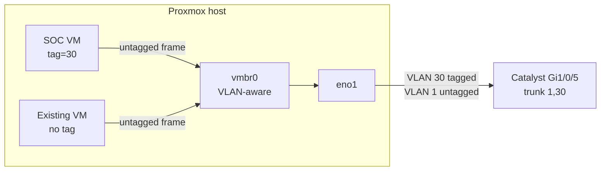

# 1.5 · VLAN-Aware Proxmox Bridge (Deep Dive)

With VLAN 30 trunked to the host, the last piece was letting VMs join it without touching the host's management network or any existing VM.

## Approach

I had two options: a sub-interface and a separate bridge per VLAN (`eno1.30` → `vmbr30`), or one VLAN-aware bridge with per-VM tags. I chose the VLAN-aware bridge. It's a one-time change, and after that adding a VLAN is just a tag on a VM's NIC. Every edit to the host's network file is a chance to lose remote access, so I wanted as few of them as possible.

With VLAN awareness on, each VM NIC behaves like an access port and `eno1` like a trunk. The bridge adds the 802.1Q tag on the way out and strips it on the way in, so the guest OS doesn't need any VLAN config.



## Starting state

| Item | Value |
| --- | --- |
| Bridge | `vmbr0`, static management IP on Main |
| Uplink | `eno1` → Catalyst Gi1/0/5 (trunk 1, 30) |
| Spare NICs | `eno2`–`eno4`, no link |
| Other bridges | `openvpn`, internal only (left alone) |
| Network stack | `ifupdown2`, which reloads live |

## The change

I backed up the network config first:

```bash
cp /etc/network/interfaces /root/interfaces.bak-$(date +%F)
```

Then I enabled VLAN awareness through the GUI (System → Network → vmbr0 → VLAN aware) instead of editing the file by hand. The GUI validates the file and shows a diff before applying. The only lines it added:

```
bridge-vlan-aware yes
bridge-vids 2-4094
```

`ifupdown2` applied it live: no reboot, no outage.

I made the change from the LAN. My VPN VM ran on this host at the time, so a failed reload would have taken the VPN down with it. My rollback from the physical console was ready:

```bash
cp /root/interfaces.bak-<date> /etc/network/interfaces && ifreload -a
```

Untagged NICs default to VLAN 1, which matches the switch's native VLAN, so no existing VM moved.

## Where security actually lives

`bridge-vids 2-4094` lets the host uplink carry any VLAN, but the Catalyst trunk only allows 1 and 30, and the UDR zone firewall decides what VLAN 30 can reach. A VM tagged 30 and an untagged VM on the same bridge can't talk to each other directly. Their traffic has to go through the UDR, where SOC → Internal is blocked.

## Verification

```bash
grep -A8 "iface vmbr0" /etc/network/interfaces
bridge vlan show dev eno1
ping -c 3 <gateway>
ip -br link show | grep eno
```

`vmbr0` has the two new lines, `eno1` carries VLAN 1 as PVID plus 2–4094, the gateway ping shows 0% loss, and the Proxmox UI, VPN and existing VMs were all still reachable. `eno2`–`eno4` are confirmed unused, so `eno2` will be the sensor's dedicated capture NIC in step 2.7.
