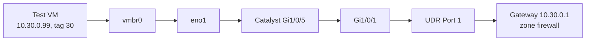
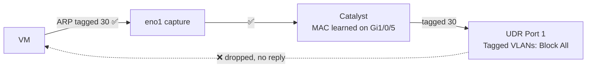

# 1.6 · End-to-End Smoke Test (Deep Dive)

Before building eight systems on VLAN 30, I wanted proof that the whole path worked and that every firewall policy did what I intended. I used a throwaway VM.



```bash
qm clone 9000 999 --name smoke-test
qm set 999 --net0 virtio,bridge=vmbr0,tag=30 --ipconfig0 ip=10.30.0.99/24,gw=10.30.0.1 --nameserver 10.30.0.1
qm start 999
```

The address is static because the SOC VLAN has no DHCP.

## No connectivity

On first boot, cloud-init couldn't reach the Ubuntu mirrors, and SSH from my workstation timed out.

I didn't want to start changing settings blind across five hops, so I captured on the host uplink:

```bash
tcpdump -eni eno1 -c 10 vlan 30
```

```
bc:24:11:ca:81:59 > ff:ff:ff:ff:ff:ff, 802.1Q vlan 30, ARP, Request who-has 10.30.0.1 tell 10.30.0.99
78:da:6e:cd:db:05 > 01:00:0c:cc:cc:cd, 802.1Q vlan 30, STP 802.1w (Rapid PVST), bridge-id 801e.78:da:6e:cd:db:00
bc:24:11:ca:81:59 > ff:ff:ff:ff:ff:ff, 802.1Q vlan 30, ARP, Request who-has 10.30.0.1 tell 10.30.0.99
```

The VM's ARP requests were leaving tagged 30, so the VM, its tag and the bridge were fine. VLAN 30 BPDUs were arriving from the Catalyst, so the switch knew the VLAN and was forwarding it. No ARP reply ever came back.

The switch's MAC table agreed. In VLAN 30, it had only learned the VM, on the Proxmox port, and nothing from the UDR side:

```
MySwitch#show mac address-table vlan 30
  30    bc24.11ca.8159    DYNAMIC     Gi1/0/5
```



The SOC network itself was configured correctly on the UDR, which left the switch-facing port. UDR Port 1 had **Tagged VLAN Management = Block All**. The Catalyst was sending VLAN 30 tagged, and the UDR was discarding it.

| UDR Port 1 | Before | After |
| --- | --- | --- |
| Native VLAN | Default | Default |
| Tagged VLANs | Block All | Custom → SOC |
| PoE | On | Off (the switch has its own power) |

The reply showed up immediately:

```
bc:24:11:ca:81:59 > 1e:0b:8b:48:f4:e7, vlan 30, ARP, Request who-has 10.30.0.1 tell 10.30.0.99
1e:0b:8b:48:f4:e7 > bc:24:11:ca:81:59, vlan 30, ARP, Reply 10.30.0.1 is-at 1e:0b:8b:48:f4:e7
```

SSH worked without a reboot. I'd configured my end of the trunk on the switch but hadn't checked that the far end accepted the same VLANs.

## Tests

| # | Test | Expected | Result | What it proves |
| --- | --- | --- | --- | --- |
| 1 | SSH from workstation → 10.30.0.99 | Connects | ✅ | Internal → SOC allow, both trunks, the bridge |
| 2 | `ping -c 3 1.1.1.1` | Replies | ✅ | SOC → internet |
| 3 | `getent hosts google.com` | Resolves | ✅ | DNS allow to the gateway |
| 4 | `curl -k -m 5 https://10.30.0.1` | Times out | ✅ | Router management blocked |
| 5 | `curl -k -m 5 https://<proxmox-host>:8006` | Times out | ✅ | SOC → home network blocked |

Hit counters in UniFi:

| Policy | Hits |
| --- | --- |
| Internal SOC Allow | 19 (my SSH sessions) |
| SOC to Gateway (DNS-NTP) | 24 (DNS lookups) |
| SOC → Gateway Block | ~2,800 |

I destroyed the VM afterwards (`qm stop 999 && qm destroy 999`).

## The block count

2,800 blocks from one idle VM was far more than test 4 could explain. My working theory was IPv6 neighbor discovery and router solicitations, since the SOC VLAN has no IPv6 subnet. I didn't want to add an allow rule just to quiet the counter, so I disabled IPv6 in the template's first-boot config in step 1.7 and left the question open.

**Resolved in step 2.3:** once the UDR's firewall logs were in Splunk, every one of those blocks turned out to be the UDR's own Ubiquiti discovery broadcast (UDP 10001). It wasn't IPv6.

## Gate

The SOC VLAN works end to end. The SOC reaches the internet and the gateway's DNS, can't reach the home network or router management, and admin access from home works. Nothing I already had running was affected.
