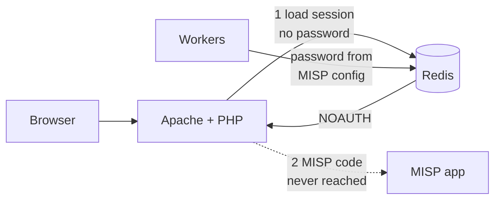
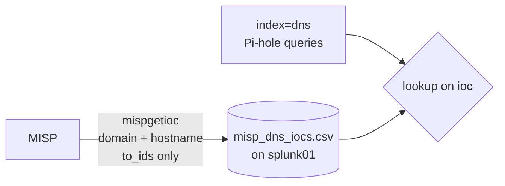

# 2.6 · MISP (Deep Dive)

My SOC collected DNS, firewall, endpoint and Wazuh data, but nothing told it which domains, IPs, URLs or hashes are known to be malicious. MISP is the platform that collects those indicators (IOCs) from public feeds, stores them with context, and serves them to other tools. Splunk will compare my logs against it, and later Suricata and Pi-hole can block from it.

## Sizing: does MISP fit in 3 GB?

misp01 was built in step 1.7 with 2 vCPU, 3 GB RAM and 60 GB of disk, and the SOC is at 23.5 of its 24 GB RAM cap, so raising it wasn't an option.

| Option | Components | Verdict |
| --- | --- | --- |
| Native install | Apache, PHP 8.3, MariaDB, Redis, background workers | Fits, with swap as a safety net |
| misp-docker | The same plus the Docker engine and separate containers | Too heavy for 3 GB |

The VM came from a cloud-init template, which ships without swap. Without swap, a memory spike during a feed import gets MariaDB killed by the OOM killer instead of just slowing down. I added a 2 GB swapfile and kept swappiness low so it's only used under real pressure:

```bash
sudo fallocate -l 2G /swapfile && sudo chmod 600 /swapfile
sudo mkswap /swapfile && sudo swapon /swapfile
echo '/swapfile none swap sw 0 0' | sudo tee -a /etc/fstab
echo 'vm.swappiness=10' | sudo tee /etc/sysctl.d/99-swap.conf
sudo sysctl --system
```

The `chmod 600` comes before `swapon` because memory pages written to swap can contain secrets, and a world-readable swapfile would expose them.

Then I took a Proxmox snapshot, `pre-misp`.

## Reading the installer before running it

MISP publishes an official install script for Ubuntu 24.04. It runs as root and changes a lot, so I downloaded it and read its settings before running anything:

```bash
cd /tmp && wget --no-cache -O INSTALL.sh https://raw.githubusercontent.com/MISP/MISP/2.5/INSTALL/INSTALL.ubuntu2404.sh
grep -nE '^[A-Z_]+=' INSTALL.sh | head -40
grep -niE 'innodb|buffer_pool|baseurl|memory_limit|max_execution' INSTALL.sh
sed -n '15,60p' INSTALL.sh
sed -n '237,252p' INSTALL.sh
```

| Finding | Decision |
| --- | --- |
| `MISP_DOMAIN` defaults to `misp.local`, and the base URL is built from it | Override with `10.30.0.30`. Nothing on my network resolves `misp.local`, so every link MISP generated would break. |
| Settings use `: "${VAR:=default}"`, so environment values override them | I can pass `MISP_DOMAIN` in at run time |
| The InnoDB buffer pool is 50% of cgroup `memory.high`, or of `MemTotal` when that doesn't exist | On a VM there's no `memory.high` (`No such file or directory`), so it would take about 1.45 GB. That logic doesn't use the override pattern, so I fixed it after the install. |
| PHP `memory_limit` 2048M | Kept. It's a per-request ceiling, not a reservation, and large feed imports can need it. |
| Admin, database, Supervisor and GPG passwords are generated randomly and printed at the end | Capture the output to a private log, save the credentials, then shred the log |

## Install

I ran it inside tmux so an SSH drop couldn't kill it halfway, and logged the output to a file only I could read:

```bash
sudo apt -y install tmux
tmux new -s misp
install -m 600 /dev/null ~/misp-install.log
cd /tmp && sudo env MISP_DOMAIN=10.30.0.30 bash INSTALL.sh 2>&1 | tee ~/misp-install.log
```

`sudo env VAR=value` matters here. Plain `sudo` resets the environment, so a variable exported in my shell would never reach the script.

After saving the credentials to my password manager:

```bash
shred -u ~/misp-install.log
```

## Post-install checks and tuning

```bash
systemctl is-active apache2 mariadb redis-server supervisor
sudo supervisorctl status
```

All four services were active and every `misp-workers:*` process was `RUNNING`.

```bash
sudo sed -i 's/^innodb_buffer_pool_size.*/innodb_buffer_pool_size = 768M/' /etc/mysql/mariadb.conf.d/z-misp.cnf
sudo systemctl restart mariadb
sudo mysql -e "SELECT @@innodb_buffer_pool_size/1024/1024 AS MB;"
```

```
| 768.00000000 |
```

I checked the live value rather than trusting the file, because the file does nothing until MariaDB restarts. With MariaDB, Apache, Redis and the workers all running, the VM used 856 MB with 2.1 GB available.

## Hardening from MISP's diagnostics

**Administration → Server Settings & Maintenance → Diagnostics** runs MISP's own security audit.

| Finding | Verdict |
| --- | --- |
| `config.php`, `database.php`, `email.php` readable by any user | Fixed |
| Redis password not set | Fixed |
| Encryption key, suspicious-login alerts, browser cache | Fixed |
| `.git/ORIG_HEAD` not found | Benign. Git only creates it after a pull or reset. |
| Schema deltas on `cake_sessions.id` and `galaxies.distribution` | Benign. MariaDB reports column defaults differently from MySQL. Database version 159/159, 0 failed migrations. |
| Attachment scanning, email encryption (informational) | Not applicable. No ClamAV (RAM) and no mail server. |
| Module system "not enabled" | Deferred. misp-modules is a separate enrichment service that needs 300–500 MB. |

### Config files

```bash
sudo chmod o-rwx /var/www/MISP/app/Config/{config,database,email}.php
```

I removed only the "other" permissions instead of setting `640`. MISP rewrites `config.php` every time a setting changes in the web UI, and `o-rwx` leaves owner and group access exactly as the installer set it.

```
-rw-r----- 1 www-data www-data 8065 ... config.php
-rw-r----- 1 www-data www-data 2893 ... database.php
-rw-r----- 1 www-data www-data 3002 ... email.php
```

### Redis password

Redis only listens on localhost, but without a password any account on the box can read or change MISP's cache and job queue.

```bash
RP=$(openssl rand -hex 24)
sudo sed -i "s/^# *requirepass .*/requirepass $RP/" /etc/redis/redis.conf
CAKE=/var/www/MISP/app/Console/cake
sudo -u www-data $CAKE Admin setSetting MISP.redis_password "$RP" > /dev/null
sudo -u www-data $CAKE Admin setSetting SimpleBackgroundJobs.redis_password "$RP" > /dev/null
sudo systemctl restart redis-server
sudo supervisorctl restart all > /dev/null
redis-cli ping
redis-cli --no-auth-warning -a "$RP" ping
unset RP
```

```
(error) NOAUTH Authentication required.
PONG
```

The password is held in a variable, so the shell history records `$RP`, not the value. MISP stores it in two settings: one for the web app's cache and one for the worker queue. My first attempt didn't have the `> /dev/null`, and `setSetting` printed the new password back, so I rotated it.

### Remaining security settings

```bash
sudo -u www-data $CAKE Admin setSetting Security.encryption_key "$(openssl rand -hex 32)" > /dev/null
sudo -u www-data $CAKE Admin setSetting Security.disable_browser_cache true
sudo -u www-data $CAKE Admin setSetting Security.alert_on_suspicious_logins true
```

The encryption key protects secrets MISP stores in its database, such as feed or API credentials. I set it before adding any of those, and it must not change later: anything encrypted with the old key would become unreadable.

I also changed the admin password at first login and renamed the local organisation from the installer's placeholder `ORGNAME` to `SOC-Homelab`, since every event MISP creates is labelled with it.

## Issue: HTTP 500 after the Redis password

A few minutes after setting the Redis password, every page returned HTTP 500.



I checked the likely causes in order:

```bash
systemctl is-active apache2 mariadb redis-server
RPW=$(sudo awk '/^requirepass/{print $2}' /etc/redis/redis.conf)
sudo grep -c "$RPW" /var/www/MISP/app/Config/config.php
unset RPW
```

All three services were active, and the password appeared twice in MISP's config, so MISP itself had the right password. The newest stack trace in MISP's log only showed the error handler failing, so I filtered for the header lines of each error:

```bash
sudo grep -E 'Error: |Fatal' /var/www/MISP/app/tmp/logs/error.log | tail -n 6
```

```
Error: Fatal Error (256): [RedisException] NOAUTH Authentication required.
```

MISP wasn't the only thing talking to Redis. The installer had configured PHP to store login sessions there:

```bash
sudo grep -rn "^session.save" /etc/php/8.3/apache2/
```

```
php.ini:1355:session.save_handler = redis
php.ini:1356:session.save_path = 'tcp://localhost:6379'
```

PHP loads the session before MISP's code runs, so every page failed there. The workers kept running because they use MISP's own config and don't use sessions. The fix:

```bash
RPW=$(sudo awk '/^requirepass/{print $2}' /etc/redis/redis.conf)
sudo sed -i "s|^session.save_path.*|session.save_path = \"tcp://127.0.0.1:6379?auth=$RPW\"|" /etc/php/8.3/apache2/php.ini
unset RPW
sudo chown root:www-data /etc/php/8.3/apache2/php.ini && sudo chmod 640 /etc/php/8.3/apache2/php.ini
sudo systemctl restart apache2
```

`php.ini` now contains a secret, so it got the same permissions as MISP's config files. The CLI has its own `php.ini`, which is why `cake` commands and workers were never affected. My earlier check only searched `config.php`, which is why it missed this. Since then I search for every place a secret is used before rotating it.

After the fix I retook the Proxmox snapshot as `misp-hardened`, so a rollback can't bring the broken session config back.

## Feeds

**Sync Actions → Feeds → Load default feed metadata** lists about 80 feeds MISP knows about, all disabled. I enabled five:

| Feed | Format | Contents |
| --- | --- | --- |
| CIRCL OSINT Feed | MISP | Curated events from CIRCL (Luxembourg's national CERT) |
| The Botvrij.eu Data | MISP | IOCs from published threat reports |
| abuse.ch URLhaus | Freetext | Active malware download URLs |
| abuse.ch ThreatFox | Freetext | IOCs linked to malware families |
| abuse.ch Feodo IP Blocklist | Freetext | Active botnet C2 servers |

I used **Fetch and store** with caching off. Caching copies whole feeds into Redis, which is RAM. Storing them as events puts them on disk, where Splunk can query them through the API. No abuse.ch Auth-Key was needed.

Memory during the first import:

```
              total   used   free   shared  buff/cache  available
Mem:          2.9Gi   1.5Gi  90Mi   24Mi    1.6Gi       1.4Gi
Swap:         2.0Gi   1.0Mi  2.0Gi
/dev/sda1     58G     8.2G   49G    15%
```

`free` looks low because Linux fills idle RAM with page cache. `available` is the real headroom, and swap was barely touched.

### Verifying the import

```bash
sudo mysql misp -e "SELECT o.name AS creator_org, COUNT(*) AS events, SUM(e.attribute_count) AS attrs FROM events e JOIN organisations o ON o.id = e.orgc_id GROUP BY o.name ORDER BY attrs DESC;"
```

```
| CthulhuSPRL.be | 204 | 85238 |
| ORGNAME        |   3 | 41160 |
| CIRCL          | 201 | 36774 |
| CUDESO         | 415 | 26754 |
| ICS-CSIRT.io   |  10 |   970 |
| ESET           |   8 |   719 |
| ...            |     |       |
```

MISP-format feeds keep each event's original author, so CIRCL and Botvrij data shows up under CthulhuSPRL.be, CUDESO, ESET and others. Freetext feeds create one event each under my own org, which still had its placeholder name at that point. My first query tried to match feeds to events by org and returned zero for everything for exactly that reason.

```bash
sudo mysql misp -e "SELECT e.id, LEFT(e.info,55) AS info, e.attribute_count AS attrs FROM events e ORDER BY attrs DESC LIMIT 10;"
```

```
|   5 | URLHaus Malware URLs feed                  | 33431 |
| 643 | OSINT Fidelis Threat Advisory #1018 ...    | 13352 |
|   2 | threatfox indicators of compromise feed    |  7724 |
| ... |                                            |       |
```

Feodo contributes about 5 IPs. It only lists currently active C2 servers, and takedowns of Emotet and QakBot infrastructure have shrunk it. URLhaus is about 40% of all attributes and very short-lived, which I'll account for when alerting on it.

### Scheduled refresh

```bash
echo '17 */6 * * * www-data /var/www/MISP/app/Console/cake Server fetchFeed 1 all > /dev/null 2>&1' | sudo tee /etc/cron.d/misp-feeds
sudo chmod 644 /etc/cron.d/misp-feeds
```

| Choice | Reason |
| --- | --- |
| Minute 17 | Off the top of the hour, when feed servers and other scheduled jobs are busiest |
| `www-data` | Files the job creates stay owned by the account the web UI runs as |
| `644` | Cron silently ignores `/etc/cron.d` files that are group- or world-writable |
| Output to `/dev/null` | There's no mail server for cron to send output to. Results still appear under Administration → Jobs. |

### After the first import finished

I counted again once all the fetch jobs had completed:

```bash
sudo mysql misp -e "SELECT published, COUNT(*) AS events, SUM(attribute_count) AS attrs FROM events GROUP BY published;"
```

```
| 0 |    3 |  41160 |
| 1 | 2112 | 615056 |
```

CIRCL's full history is much larger than the first count suggested: 1,056 CIRCL events plus 286 from Krawczyk Industries Limited (about 294,000 attributes), another original author redistributed through the OSINT feeds. About 650,000 attributes is heavy for a 3 GB VM, and it shows in API response times.

### Publishing the abuse.ch events

The three unpublished events were the abuse.ch ones (IDs 1, 2 and 5). Freetext feeds create their events unpublished, and Splunk only reads published events, so 41,000 of the freshest indicators were invisible to it.

| Feed setting | Value | Reason |
| --- | --- | --- |
| Auto Publish | On | Each fetch publishes the event |
| Creator organisation | SOC-Homelab | The form defaulted to another org from the imported data |
| Default Tag | `tlp:clear` | abuse.ch data is public; the tag travels with each indicator into Splunk (`misp_tag`) |
| Disable correlation | On (unchanged) | Correlating tens of thousands of short-lived URLs costs CPU and RAM for little value |
| Delta Merge | On (unchanged) | Indicators that drop off the feed are removed |

I enabled the `tlp` taxonomy first (Event Actions → List Taxonomies), then published the three existing events once with **Publish (no email)**. There's no mail server, and a normal publish would queue notification emails.

I applied the tag only to the abuse.ch feeds. CIRCL and Botvrij events carry their authors' own tags, and a blanket default tag could mislabel events shared under a stricter TLP.

### Duplicate URLhaus feed

The feed list showed six enabled feeds. URLhaus was on twice: the CSV feed I configured (ID 41, one event updated in place) and a MISP-format feed (ID 65, a new event every day). I disabled 65. No `abuse.ch` creator org appeared in the event counts, so it hadn't imported anything yet, and only the CSV event exists:

```bash
sudo mysql misp -e "SELECT COUNT(*) AS urlhaus_events FROM events WHERE info LIKE '%urlhaus%';"
```

I kept the CSV version because it stays current with delta merge and doesn't grow every day.

## API access for Splunk

Splunk only needs to read indicators, so it got its own identity with the minimum access:

| Layer | Setting |
| --- | --- |
| Role | `API Read Only`: permission level Read Only plus **Auth key access**, nothing else |
| User | `splunk@soc.lan` in SOC-Homelab, no password set, no email alerts |
| Auth key | Allowed IPs `10.30.0.10/32`, read-only flag set |

The built-in Read Only role doesn't include Auth key access, which is why the user never appeared in the auth key form. I confirmed the role in the database:

```bash
sudo mysql misp -e "SELECT u.id, u.email, r.name AS role, r.perm_auth FROM users u JOIN roles r ON r.id = u.role_id;"
```

```
| 1 | admin@admin.test | admin         | 1 |
| 2 | splunk@soc.lan   | API Read Only | 1 |
```

The dropdown still didn't list the user, so I opened the form for that user ID directly at `/auth_keys/add/2`.

### Testing the key

I loaded the key without echoing it, then tested from splunk01:

```bash
read -rs MK
curl -sk -H "Authorization: $MK" -H "Accept: application/json" https://10.30.0.30/servers/getVersion; echo
curl -sk -o /dev/null -w "%{http_code}\n" -H "Authorization: $MK" -H "Accept: application/json" -X POST https://10.30.0.30/events/add -d '{"info":"write test"}'
unset MK
```

| Test | From | Result |
| --- | --- | --- |
| Read version | splunk01 | `"version": "2.5.50"`, with `perm_sync`, `perm_sighting` and the other permissions all `false` |
| Create an event | splunk01 | `403` |
| Read version | misp01 | `It is not possible to use this Auth key from your IP address` |

The key works, can't write, and can't be used from anywhere except splunk01. `-k` skips certificate checks because MISP's certificate is self-signed; a trusted certificate is on the backlog.

## misp42splunk on splunk01

misp42splunk adds search commands that query MISP's API from Splunk. I took a Proxmox snapshot of splunk01 (`pre-misp42splunk`) first, since the add-on runs its own Python inside Splunk.

I installed version 6.1.0 from Splunkbase through **Apps → Manage Apps → Install app from file**, then restarted Splunk through systemd:

```bash
sudo systemctl restart Splunkd
systemctl is-active Splunkd
```

Splunk runs as a systemd service under the `splunk` user. Restarting it with `sudo /opt/splunk/bin/splunk restart` could start it as root, outside systemd, and leave root-owned files behind.

### Instance configuration

| Field | Value |
| --- | --- |
| Name | `misp01` |
| URL | `https://10.30.0.30` |
| Auth key | The `splunk@soc.lan` read-only key |
| Check MISP certificate | Off (self-signed certificate) |

misp42splunk stores the key in Splunk's encrypted credential store, and its `local/` folder stays out of this repo.

### Troubleshooting the first searches

```
| mispgetioc misp_instance=misp01 last=7d limit=20
```

The first run failed with `MISP instance not found: misp01` because I hadn't saved the instance yet. After adding it, the same search and an `eventid=5` search returned nothing.


I split the path in two and tested the MISP side on its own with the same key from splunk01:

```bash
read -rs MK
curl -sk -H "Authorization: $MK" -H "Accept: application/json" -H "Content-Type: application/json" -X POST https://10.30.0.30/attributes/restSearch -d '{"eventid":643,"limit":3}' | head -c 800; echo
unset MK
```

The response took a long time but returned attributes from event 643, for example `007vlad.ddns.net` (`hostname`, `to_ids: true`). The key, role, IP restriction and event visibility were all fine. The response also showed `publish_timestamp` 1792310705 (17 Oct 2026): MISP stamps feed events with the date they were imported, so publish date wasn't the reason `last=7d` came back empty.

Rerunning the search in Splunk then returned 40 indicators:

```
| mispgetioc misp_instance=misp01 eventid=643 limit=20
```

The fields come back prefixed `misp_`, with the value in a field named after its type (`misp_hostname` here). `_time` is each attribute's own timestamp (2015 for this event), so the time picker doesn't filter results; the command's options do. The earlier empty results lined up with MISP being slow while it was still importing, and event 5 being one of the unpublished abuse.ch events.

## Indicators as a Splunk lookup

Live `mispgetioc` calls are too slow to run against every log event, so I export MISP's DNS indicators into a lookup that Splunk matches locally.



```
| mispgetioc misp_instance=misp01 last=3650d type="domain,hostname" to_ids=true limit=5000
| eval ioc=lower(coalesce(misp_domain, misp_hostname))
| where isnotnull(ioc)
| stats values(misp_event_id) as misp_event_id values(misp_event_info) as misp_event_info values(misp_tag) as misp_tag first(misp_type) as misp_type by ioc
| outputlookup misp_dns_iocs.csv
```

| Choice | Reason |
| --- | --- |
| `to_ids=true` | Only indicators their authors marked as fit for detection; the rest is report context |
| Warning lists on (default) | Drops well-known benign values such as major cloud and CDN domains |
| `last=3650d` | `mispgetioc` requires a time argument. `last` filters on publish time, and feed events keep their import date, so a narrow window would slowly drop unchanged CIRCL events |
| `limit=5000` | Page size per API call; the default of 1,000 means more round trips to a slow MISP |
| `lower()` and `stats ... by ioc` | DNS names are case-insensitive, and the same domain appears in several reports; one row per domain keeps every event ID and tag |

The first run failed twice. The time picker was on a real-time window (`This command is not supported in a real-time search`), and then the add-on returned `Missing "date", "eventid", "json_request", "last", "publish_timestamp" or "timestamp" argument`. With a historical range and `last=3650d` it returned 135,676 attributes, which collapsed to **132,571 unique domains and hostnames**.

## DNS fields for Pi-hole

Pi-hole events had no DNS fields in Splunk, only the raw line:

```
dnsmasq[...]: query[A] example.com from 192.168.1.11
```

I tested a pattern with `rex`, then made it permanent in `TA-soc-homelab` using CIM Network Resolution names:

`/opt/splunk/etc/apps/TA-soc-homelab/default/props.conf`:

```
[pihole:dnsmasq]
EXTRACT-dns_query = query\[(?<record_type>[^\]]+)\]\s+(?<query>\S+)\s+from\s+(?<src>\S+)
```

`btool` confirmed Splunk loaded it, but the fields still didn't appear in Search & Reporting. Search-time extractions only apply inside the app that defines them unless the app exports them, so I added:

`/opt/splunk/etc/apps/TA-soc-homelab/metadata/default.meta`:

```
[]
access = read : [ * ], write : [ admin ]
export = system
```

After a restart, `index=dns sourcetype=pihole:dnsmasq "query["` returns `src`, `record_type` and `query` on every event without `rex`. Both files are in `siem/splunk/apps/TA-soc-homelab/`.

## Next in this step

- Schedule the lookup rebuild every 6 hours, after the MISP feed fetch

## Phase 4 (moved there)

- Correlation searches matching `misp_dns_iocs.csv` against `index=dns`, plus IP and hash indicators against network and endpoint data
- A reviewed allowlist for dual-use indicators, with a reason per entry
- AlienVault OTX feed

## Backlog

- Trusted certificate for MISP, then certificate verification in Splunk
- misp-modules if RAM allows after the rebalance
- Ship MISP's own logs (`app/tmp/logs`, Apache) to Splunk
- Suricata rules and a Pi-hole blocklist generated from MISP
- Feed tuning: expiry or decay for short-lived URLhaus indicators
- RAM rebalance, then misp01 to 4 GB and a larger buffer pool, if API responses stay slow
- Splunk-side IOC lookup refreshed on a schedule, so detections don't wait on live API calls
