# 2.7 · Zeek + Suricata (Deep Dive)

Everything in my SOC so far came from logs that devices chose to write: firewall, switch, hypervisor, endpoints, DNS. None of it showed what actually crossed the wire. sensor01 now gets a copy of the traffic itself. Zeek turns it into connection, DNS, TLS, HTTP and file records, and Suricata matches it against signatures.

## Design

### What to mirror

The Catalyst is layer 2 only, and the UDR routes between VLANs, so almost every flow I care about crosses Gi1/0/1 (the trunk to the UDR). Mirroring that one port covers PC↔internet, SOC↔internet and PC↔SOC. It misses traffic that stays on the switch: my PC talking to the Proxmox web UI goes Gi1/0/4 → Gi1/0/5 and never touches the uplink. So I mirrored my PC's port as well.

| Source | Direction | Why |
| --- | --- | --- |
| Gi1/0/1 (trunk to UDR) | both | Everything routed between VLANs and to the internet |
| Gi1/0/4 (admin PC) | both | PC↔Proxmox management traffic that never crosses the uplink |

Destination: Gi1/0/24 with `encapsulation replicate`, so frames leave the SPAN port with their 802.1Q tags and the sensor can tell VLAN 30 traffic from native VLAN traffic.

### The duplicate-packet trade-off

Mirroring two ports means some flows are seen more than once:

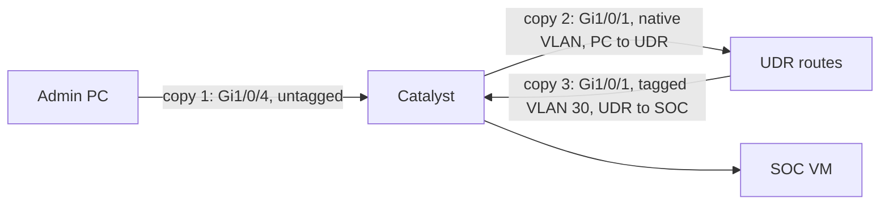

| Path | Copies on the sensor |
| --- | --- |
| PC ↔ SOC system | 3 (Gi1/0/4 untagged, Gi1/0/1 native on the way to the UDR, Gi1/0/1 tagged VLAN 30 on the way back) |
| PC ↔ internet | 2 |
| SOC system ↔ internet | 1 (Gi1/0/1, tagged VLAN 30) |
| PC ↔ Proxmox management | 1 (Gi1/0/4 only) |
| SOC ↔ SOC on the same host | 0 (stays inside `vmbr0`) |
| Wi-Fi clients | 0 |

I confirmed the triplicates with tcpdump on the sensor before installing anything. Zeek and Suricata both handle this reasonably: the VLAN tag makes the copies different flows, so counts are inflated, but nothing is lost. The last two rows are the real gaps. Wireless clients associate to the UDR and never touch the Catalyst, so the UDR's own IDS and Pi-hole are their only coverage. SOC↔SOC traffic stays inside the Proxmox bridge, so sensor01 → splunk01 log forwarding can't loop back into the sensor.

A 1 Gb/s destination fed by two 1 Gb/s ports in both directions can oversubscribe under heavy load. At home volume it hasn't dropped anything (`0 packets dropped by kernel`).

## Switch: re-cabling and the SPAN session

I first moved my PC off UDR Port 3 onto the Catalyst so its traffic could be mirrored. Gi1/0/4 became a hardened access port:

```
interface GigabitEthernet1/0/4
 description Admin PC
 switchport mode access
 switchport nonegotiate
 spanning-tree portfast edge
 spanning-tree bpduguard enable
```

The PC kept 192.168.1.11 (DHCP reservation). While I was in the config I found Gi1/0/2, Gi1/1/1–4 and Te1/1/1–2 still enabled from step 1.4, with nothing attached, and shut them down. On the UDR, Port 4 is WAN and Port 1 is the Catalyst trunk. During the move, Port 1 briefly ended up as native SOC / Allow All, which would have put untagged switch traffic into the SOC VLAN. I set it back to native Default, tagged SOC only, and disabled Ports 2, 3 and SFP+.

The SPAN session, applied with a rollback timer in case I cut myself off:

```
reload in 15
configure terminal
interface GigabitEthernet1/0/24
 description SPAN destination to pve eno2 (sensor01)
 no shutdown
monitor session 1 source interface GigabitEthernet1/0/1 both
monitor session 1 source interface GigabitEthernet1/0/4 both
monitor session 1 destination interface GigabitEthernet1/0/24 encapsulation replicate
end
write memory
reload cancel
```

A SPAN destination port stops being a normal switchport: it sends mirrored frames and ignores anything it receives. That's why the sensor needs its own cable to a separate NIC rather than sharing the Proxmox trunk on Gi1/0/5.

## Proxmox: a bridge that only carries the mirror

```bash
cp /etc/network/interfaces /etc/network/interfaces.bak-pre-span
```

Appended to `/etc/network/interfaces`:

```
auto eno2
iface eno2 inet manual
	post-up /usr/sbin/ethtool -K eno2 gro off lro off tso off gso off

auto vmbr1
iface vmbr1 inet manual
	bridge-ports eno2
	bridge-stp off
	bridge-fd 0
	bridge-ageing 0
#SPAN capture from Catalyst Gi1/0/24, no IP
```

```bash
ifreload -a
ethtool eno2 | grep -E "Speed|Link detected"
qm set 302 --net1 virtio,bridge=vmbr1,firewall=0
```

| Setting | Why |
| --- | --- |
| No IP on `eno2` or `vmbr1` | The host can't be reached or leak traffic through the capture path |
| `bridge-ageing 0` | The bridge never learns MACs, so it floods every frame to the sensor's tap instead of dropping frames for addresses it thinks are elsewhere |
| `bridge-stp off`, `bridge-fd 0` | No spanning tree on a one-way port, no forwarding delay |
| GRO/LRO/TSO/GSO off | The NIC must not merge packets into large super-frames. The sensor has to see packets as they were on the wire |
| `firewall=0`, no VLAN tag on net1 | A Proxmox firewall bridge or a tag would filter or strip the mirrored frames |

`eno2` first reported no link. It was administratively down, and `ifreload -a` brought it up.

## sensor01: the capture NIC

The second NIC appears as `ens19`. It gets no address at all, not even IPv6 link-local. `/etc/netplan/60-span.yaml` (mode 600):

```yaml
network:
  version: 2
  ethernets:
    ens19:
      dhcp4: false
      dhcp6: false
      link-local: []
      optional: true
```

`optional: true` stops boot from waiting for an interface that will never get an address. Offloads are disabled again inside the guest by a oneshot unit, `/etc/systemd/system/span-offload.service`, whose key line is:

```
ExecStart=/usr/sbin/ethtool -K ens19 gro off lro off tso off gso off
```

```bash
sudo netplan apply
sudo systemctl daemon-reload && sudo systemctl enable --now span-offload
sudo tcpdump -i ens19 -nn -e -c 20
```

tcpdump showed tagged and untagged frames, my PC's flows in triplicate, and `0 packets dropped by kernel`.

The VM came from a cloud-init template without swap, so I added the same 2 GB swapfile and `vm.swappiness=10` as on misp01 before installing anything.

## Zeek

Installed from the official Zeek repository (LTS branch):

```bash
echo 'deb [signed-by=/usr/share/keyrings/zeek.gpg] http://download.opensuse.org/repositories/security:/zeek/xUbuntu_24.04/ /' | sudo tee /etc/apt/sources.list.d/zeek.list
curl -fsSL https://download.opensuse.org/repositories/security:zeek/xUbuntu_24.04/Release.key | gpg --dearmor | sudo tee /usr/share/keyrings/zeek.gpg > /dev/null
sudo apt update && sudo apt install -y zeek-lts
echo 'export PATH=/opt/zeek/bin:$PATH' | sudo tee /etc/profile.d/zeek.sh
```

Version 8.0.10. I backed up each config file to `.orig` before editing.

`/opt/zeek/etc/node.cfg`:

```
[zeek]
type=standalone
host=localhost
interface=ens19
```

`/opt/zeek/etc/networks.cfg`, so Zeek marks which side of a connection is local:

```
192.168.1.0/24
192.168.2.0/24
10.30.0.0/24
10.40.0.0/24
```

Main, IoT, the SOC VLAN and the planned management VLAN.

Appended to `/opt/zeek/share/zeek/site/local.zeek`:

```
@load policy/tuning/json-logs.zeek
redef ignore_checksums = T;
redef restrict_filters += {
    ["no-sensor-ssh"] = "not (host 10.30.0.12 and port 22) and not (vlan and host 10.30.0.12 and port 22)"
};
```

| Line | Why |
| --- | --- |
| `json-logs` | One JSON object per line, which Splunk parses without custom field extractions |
| `ignore_checksums` | Mirrored packets from hosts with checksum offload carry checksums the NIC would have filled in later. Without this, Zeek discards them as corrupt |
| `restrict_filters` | My SSH session to the sensor crosses the mirror, so every keystroke would generate records about itself. The second clause repeats the filter for VLAN-tagged copies, because BPF only looks inside an 802.1Q tag after the `vlan` keyword |

In `zeekctl.cfg` I set `LogExpireInterval = 14day` and kept hourly rotation. A paste ran my fallback command as well, which left the setting in the file twice, so I removed the duplicate line with `sed`.

Zeek runs under systemd so it starts at boot after the offload service. `/etc/systemd/system/zeek.service` is a `Type=forking` unit ordered `After=span-offload.service`, with:

```
ExecStart=/opt/zeek/bin/zeekctl deploy
ExecStop=/opt/zeek/bin/zeekctl stop
```

`/etc/cron.d/zeek` lets zeekctl restart a crashed worker and handle log housekeeping:

```
*/5 * * * * root /opt/zeek/bin/zeekctl cron
```

```bash
sudo systemctl daemon-reload && sudo systemctl enable --now zeek
sudo zeekctl status
sudo ls /opt/zeek/logs/current/
```

Zeek settled at about 250 MB of RAM. The logs are only readable by root and the `zeek` group, so the first `ls` without `sudo` was denied. In `conn.log` I could see my PC's sessions to the Proxmox web UI on 8006, traffic only visible because Gi1/0/4 is mirrored, and no records of my own SSH session to the sensor.

## Suricata

### Install and memory budget

With Zeek running, sensor01 still had 2.6 GB available, enough to add Suricata.

```bash
sudo add-apt-repository -y ppa:oisf/suricata-stable
sudo apt install -y suricata jq
sudo cp /etc/suricata/suricata.yaml /etc/suricata/suricata.yaml.orig
echo 'include: /etc/suricata/local.yaml' | sudo tee -a /etc/suricata/suricata.yaml
```

I kept my changes in an include file so the packaged `suricata.yaml` stays close to upstream. `/etc/suricata/local.yaml` as it stands now:

```yaml
%YAML 1.1
---
af-packet:
  - interface: ens19
    threads: 1
    cluster-id: 99
    cluster-type: cluster_flow
    defrag: yes
    checksum-checks: no
    bpf-filter: "not ether dst 01:80:c2:00:00:00 and not ether dst 01:00:0c:cc:cc:cd and not ether dst 01:00:0c:cc:cc:cc and not ether proto 0x9000 and not (host 10.30.0.12 and port 22) and not (vlan and host 10.30.0.12 and port 22)"
rule-files:
  - suricata.rules
  - /etc/suricata/rules/local.rules
detect:
  profile: low
mpm-algo: hs
spm-algo: hs
flow:
  memcap: 64mb
stream:
  memcap: 64mb
  checksum-validation: no
  reassembly:
    memcap: 128mb
defrag:
  memcap: 32mb
host:
  memcap: 16mb
```

| Setting | Why |
| --- | --- |
| `threads: 1` | One capture thread is plenty for home traffic and keeps memory down |
| `profile: low` + Hyperscan (`hs`) | Smaller detection engine; Hyperscan is the fastest pattern matcher on x86 |
| Memcaps | Hard ceilings so a traffic burst can't push the VM into the OOM killer |
| Checksum checks off | Same reason as Zeek's `ignore_checksums` |

### Issue: the include replaced all of `vars`

My first `local.yaml` also set `HOME_NET` under `vars:`. `suricata-update` failed its test run with hundreds of errors and rolled back:

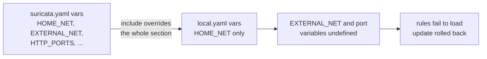

An include doesn't merge a section into the main file. It replaces it. Defining `vars` in `local.yaml` wiped out `EXTERNAL_NET` and every port group the rules reference. I removed `vars` from the include and set `HOME_NET` in place in the main file:

```bash
sudo sed -i 's|^\(\s*\)HOME_NET:.*|\1HOME_NET: "[192.168.1.0/24,192.168.2.0/24,10.30.0.0/24,10.40.0.0/24]"|' /etc/suricata/suricata.yaml
sudo grep -n "^\s*HOME_NET:" /etc/suricata/suricata.yaml
sudo suricata-update
sudo suricata -T -c /etc/suricata/suricata.yaml -v 2>&1 | tail -n 3
sudo suricata --dump-config -c /etc/suricata/suricata.yaml 2>/dev/null | grep -E "^vars.address-groups.(HOME_NET|EXTERNAL_NET)|^af-packet.0.(interface|threads|bpf-filter)|^detect.profile|^mpm-algo|^flow.memcap|^stream.memcap|^stream.reassembly.memcap"
```

`suricata-update` passed, `-T` processed 53,216 signatures, and `--dump-config` showed `EXTERNAL_NET = !$HOME_NET` again alongside my overrides. The same rule applies to `rule-files` later: the include lists both rule files, because listing only my local file would have dropped the ET Open set.

```bash
sudo systemctl enable --now suricata
sudo grep -E "ens19|rules successfully loaded|Engine started|<Error>" /var/log/suricata/suricata.log | tail -n 8
```

```
detect: 1 rule files processed. 53211 rules successfully loaded, 0 rules failed, 0 rules skipped
af-packet: ens19: using BPF 'not (host 10.30.0.12 and port 22) and not (vlan and host 10.30.0.12 and port 22)'
threads: Threads created -> W: 1 FM: 1 FR: 1   Engine started.
```

### Proving detection end to end

The usual test, `curl http://testmynids.org/uid/index.html`, printed nothing. `curl -sS` showed `Could not resolve host`, and `dig` returned `NXDOMAIN` from both Pi-hole and 1.1.1.1. The domain is gone, so I wrote my own test rule in `/etc/suricata/rules/local.rules`:

```
alert http any any -> any any (msg:"SOC-LAB NIDS pipeline test"; flow:to_server,established; http.uri; content:"/soc-lab-nids-test"; classtype:misc-activity; sid:9000001; rev:1;)
```

Rule IDs from 9,000,000 up are reserved for local rules. I triggered it with plain HTTP to an IP, so no DNS was involved:

```bash
curl -s -o /dev/null -m 10 -w "%{http_code}\n" http://1.1.1.1/soc-lab-nids-test
sudo jq -c 'select(.event_type=="alert" and .alert.signature_id==9000001) | {ts: .timestamp, sig: .alert.signature, src: .src_ip, dst: .dest_ip, vlan: .vlan}' /var/log/suricata/eve.json
```

```
301
{"ts":"2026-10-18T15:05:38.257665+0000","sig":"SOC-LAB NIDS pipeline test","src":"10.30.0.12","dst":"1.1.1.1","vlan":[30]}
```

One alert, tagged VLAN 30. sensor01's internet traffic crosses only Gi1/0/1, so it's seen once, which matches the duplicate table above.

### Issue: 742 "Ethertype unknown" alerts

The first alert summary was dominated by a decoder event:

```bash
sudo jq -r 'select(.event_type=="alert") | "\(.alert.signature_id) \(.alert.signature)"' /var/log/suricata/eve.json | sort | uniq -c | sort -rn | head
```

```
    742 2200121 SURICATA Ethertype unknown
```

The rest were informational ET INFO/DNS policy hits from household devices, which I left for Phase 4 tuning. `src_ip` and `dest_ip` were `null` on 2200121, so these weren't IP packets. I captured everything that wasn't IP or ARP, tagged or untagged:

```bash
sudo timeout 60 tcpdump -i ens19 -nn -e -c 15 'not (ip or ip6 or arp) and not (vlan and (ip or ip6 or arp))'
```

```
78:da:6e:cd:db:01 > 01:00:0c:cc:cc:cd, 802.3, length 50: LLC ... oui Cisco (0x00000c), pid PVST (0x010b) ... STP 802.1w, Rapid STP
78:da:6e:cd:db:01 > 01:80:c2:00:00:00, 802.3, length 39: LLC, dsap STP (0x42) ... STP 802.1w, Rapid STP
78:da:6e:cd:db:04 > 01:80:c2:00:00:00, 802.3, length 39: LLC, dsap STP (0x42) ... STP 802.1w, Rapid STP
78:da:6e:cd:db:01 > 01:00:0c:cc:cc:cd, ethertype 802.1Q (0x8100), length 68: vlan 30, p 7, 802.3LLC ... pid PVST (0x010b)
```

Every frame came from the switch's own port MACs (`:01` is Gi1/0/1, `:04` is Gi1/0/4): spanning-tree BPDUs every 2 seconds, both IEEE STP and Cisco PVST+, untagged and tagged per VLAN. They're old-style 802.3 frames with a length field where the ethertype would be, which Suricata's decoder reports as unknown. I dropped them in the BPF filter by destination MAC rather than disabling sid 2200121, which would also hide a real unknown ethertype.

The MAC clauses go before the `vlan` clause. In BPF, `vlan` shifts the offset of every test that follows it, so a MAC test placed after it would read the wrong bytes. I compiled each filter before using it:

```bash
sudo tcpdump -i ens19 -d '<filter>' > /dev/null && echo OK
```

The rate dropped but didn't stop, about 14 alerts a minute. A two-minute capture excluding the STP MACs, summarized:

```bash
sudo timeout 120 tcpdump -i ens19 -nn -e 'not ether dst 01:80:c2:00:00:00 and not ether dst 01:00:0c:cc:cc:cd and not (ip or ip6 or arp) and not (vlan and (ip or ip6 or arp))' 2>/dev/null | awk '{print $2, $4, $5, $6, $7}' | sort | uniq -c | sort -rn | head -n 15
```

```
     12 78:da:6e:cd:db:04 78:da:6e:cd:db:04, ethertype Loopback (0x9000),
     12 78:da:6e:cd:db:01 78:da:6e:cd:db:01, ethertype Loopback (0x9000),
```

followed by hex-dump lines that decode to Cisco CDP announcements: `cisco WS-C37...` and the IOS version string. That's 12 keepalive loopback frames (a Cisco port sends one to itself every 10 seconds to detect loops) plus 2 CDP frames a minute, which matched the 14 per minute exactly. I added `not ether dst 01:00:0c:cc:cc:cc and not ether proto 0x9000` and verified over three minutes:

```bash
sudo suricata -T -c /etc/suricata/suricata.yaml 2>&1 | tail -n 1 && T=$(date -u +%Y-%m-%dT%H:%M:%S) && sudo systemctl restart suricata && sleep 180 && sudo grep "using BPF" /var/log/suricata/suricata.log | tail -n 1 && echo "2200121 since $T:" && sudo jq -r --arg t "$T" 'select(.event_type=="alert" and .alert.signature_id==2200121 and .timestamp > $t) | .timestamp' /var/log/suricata/eve.json | wc -l
```

```
2200121 since 2026-10-18T15:15:43:
0
```

### Hardening finding: CDP

The CDP frames showed the switch announcing its model and IOS version out the uplink and my PC's port. The UDR speaks LLDP, not CDP, and my PC has no use for it, so it was only handing reconnaissance details to anything on those links. I disabled it on both ports:

```
configure terminal
interface range GigabitEthernet1/0/1 , GigabitEthernet1/0/4
no cdp enable
end
write memory
show running-config interface GigabitEthernet1/0/4 | include cdp
```

The sensor's BPF filter stays in place regardless, so the sensor doesn't depend on the switch config.

### Daily rule updates

The package's unit reloads rules with `ExecReload=/bin/kill -USR2 $MAINPID`, which swaps the detection engine without stopping capture. A manual run first:

```bash
sudo suricata-update -q; echo "update exit=$?"; sudo systemctl reload suricata && sleep 90 && sudo grep -iE "rule reload|rules successfully loaded" /var/log/suricata/suricata.log | tail -n 3
```

```
update exit=0
detect: rule reload starting
detect: tenant id 0:  2 rule files processed. 53212 rules successfully loaded, 0 rules failed, 0 rules skipped
detect: rule reload complete
```

During a reload the old and new engines are in memory together for a few seconds, about 500 MB extra, which fits in the headroom. `/etc/cron.d/suricata-update` (root, 644):

```
37 4 * * * root /usr/bin/suricata-update -q >> /var/log/suricata/suricata-update.log 2>&1 && /usr/bin/systemctl reload suricata
```

The reload only runs if the update and its built-in test succeed.

### Memory

```
Mem:  2.9Gi total, 1.0Gi used, 1.9Gi available
Swap: 2.0Gi, 0B used
252 MB  /opt/zeek/bin/zeek
491 MB  /usr/bin/suricata
```

## Splunk side

### Sizing against the license

Splunk is on the 60-day trial (500 MB/day) until the developer license arrives. Before forwarding anything, I measured:

| Source | Measured | Per day (estimate) |
| --- | --- | --- |
| Existing sources | 40–56 MB/day over the last two days | ~56 MB |
| Zeek | `conn.log` 3.0 MB + `dns.log` 0.46 MB in 27 minutes | ~150–200 MB |
| Suricata `eve.json`, all event types | 15 MB in 49 minutes | ~440 MB |

eve.json broke down as `flow` 8,826, `tls` 6,836, `alert` 2,423, `dns` 2,281, `quic` 1,292, `mdns` 308, `stats` 248, `http` 12. Everything except alerts duplicates what Zeek logs in more detail. Forwarding all of it would have taken the total to about 700 MB/day, so Zeek is the metadata source and Suricata contributes only alerts and anomalies. Projected total: about 250 MB/day.

### Indexes

```bash
sudo -u splunk /opt/splunk/bin/splunk login
for i in zeek suricata; do sudo -u splunk /opt/splunk/bin/splunk add index $i; done
```

### Parsing and filtering in TA-soc-homelab

One sourcetype per Zeek log, so searches can target `sourcetype=zeek:conn` or `zeek:dns` directly. Zeek's `ts` is epoch seconds with microseconds. The 14 Zeek stanzas are identical apart from the name, so I generated them:

```bash
{ for l in conn dns http ssl x509 files notice weird dhcp ssh software capture_loss known_hosts known_services; do printf '\n[zeek:%s]\nSHOULD_LINEMERGE = false\nLINE_BREAKER = ([\\r\\n]+)\nTIME_PREFIX = ^\\{"ts":\nTIME_FORMAT = %%s.%%6N\nMAX_TIMESTAMP_LOOKAHEAD = 20\nTRUNCATE = 20000\nKV_MODE = json\n' $l; done; printf '\n[suricata:eve]\nSHOULD_LINEMERGE = false\nLINE_BREAKER = ([\\r\\n]+)\nTIME_PREFIX = "timestamp":"\nTIME_FORMAT = %%Y-%%m-%%dT%%H:%%M:%%S.%%6N%%z\nMAX_TIMESTAMP_LOOKAHEAD = 40\nTRUNCATE = 50000\nKV_MODE = json\nTRANSFORMS-eve_filter = suricata_eve_drop_all, suricata_eve_keep_alerts\n'; } | sudo -u splunk tee -a /opt/splunk/etc/apps/TA-soc-homelab/default/props.conf > /dev/null
```

Result (one of the 14 Zeek stanzas shown):

```
[zeek:conn]
SHOULD_LINEMERGE = false
LINE_BREAKER = ([\r\n]+)
TIME_PREFIX = ^\{"ts":
TIME_FORMAT = %s.%6N
MAX_TIMESTAMP_LOOKAHEAD = 20
TRUNCATE = 20000
KV_MODE = json

[suricata:eve]
SHOULD_LINEMERGE = false
LINE_BREAKER = ([\r\n]+)
TIME_PREFIX = "timestamp":"
TIME_FORMAT = %Y-%m-%dT%H:%M:%S.%6N%z
MAX_TIMESTAMP_LOOKAHEAD = 40
TRUNCATE = 50000
KV_MODE = json
TRANSFORMS-eve_filter = suricata_eve_drop_all, suricata_eve_keep_alerts
```

`transforms.conf`:

```
[suricata_eve_drop_all]
REGEX = .
DEST_KEY = queue
FORMAT = nullQueue

[suricata_eve_keep_alerts]
REGEX = "event_type":"(alert|anomaly)"
DEST_KEY = queue
FORMAT = indexQueue
```

Transforms run in the order listed: every eve event is first routed to the nullQueue, then alerts and anomalies are routed back to the index queue. Events left in the nullQueue are discarded before indexing and don't count against the license. The full eve.json stays on sensor01 for pivoting during an investigation.

```bash
sudo -u splunk /opt/splunk/bin/splunk btool props list suricata:eve --debug | grep -E "TRANSFORMS|TIME_FORMAT"
sudo -u splunk /opt/splunk/bin/splunk btool props list zeek:conn | grep -E "TIME_PREFIX|TIME_FORMAT"
```

### Deployment app and server class

`deployment-apps/soc_sensor_inputs/local/inputs.conf` has one monitor per Zeek log (14) plus eve.json. Generated the same way, with the first and last stanzas shown:

```
[monitor:///opt/zeek/logs/current/conn.log]
index = zeek
sourcetype = zeek:conn
disabled = 0

[monitor:///var/log/suricata/eve.json]
index = suricata
sourcetype = suricata:eve
disabled = 0
```

I listed the Zeek logs explicitly rather than using a wildcard, so Zeek's `stdout.log`, `stderr.log`, `stats.log` and `loaded_scripts.log` stay off the license.

Added to `serverclass.conf`:

```
[serverClass:sensor]
whitelist.0 = sensor01

[serverClass:sensor:app:soc_sensor_inputs]
restartSplunkd = true
stateOnClient = enabled
```

```bash
sudo systemctl restart Splunkd && sleep 30 && systemctl is-active Splunkd && sudo -u splunk /opt/splunk/bin/splunk reload deploy-server
```

Line breaking, timestamps and `TRANSFORMS` are read at parse time, so splunkd needed a full restart. Search-time settings like `KV_MODE` would have applied without one.

### Permissions plan for the forwarder

| Path | Owner and mode | Access for `splunkfwd` |
| --- | --- | --- |
| `/opt/zeek/logs` | `root:zeek`, `drwxrws---` | join the `zeek` group |
| `/opt/zeek/spool/zeek` (target of `current`) | `root:zeek`, files `-rw-r--r--` | readable once the parent is traversable |
| `/var/log/suricata` | `suricata:suricata`, `drwxrwx---` | join the `suricata` group |

This is the same least-privilege approach as wazuh01: no root forwarder, no loosened file modes.

## Evidence

Screenshots are redacted: MAC addresses are blacked out.

**Switch port status after cleanup: admin PC on Gi1/0/4, unused and module ports disabled, Gi1/0/24 still free.**

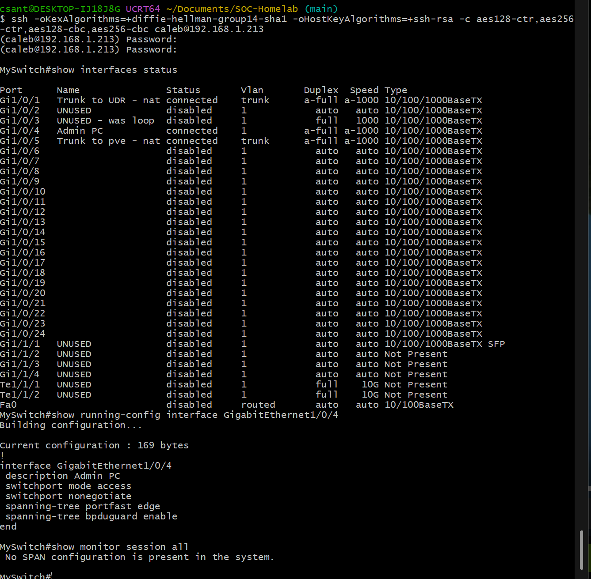

**SPAN session 1 applied under a reload timer: Gi1/0/1 and Gi1/0/4 both directions to Gi1/0/24 with replicate encapsulation.**

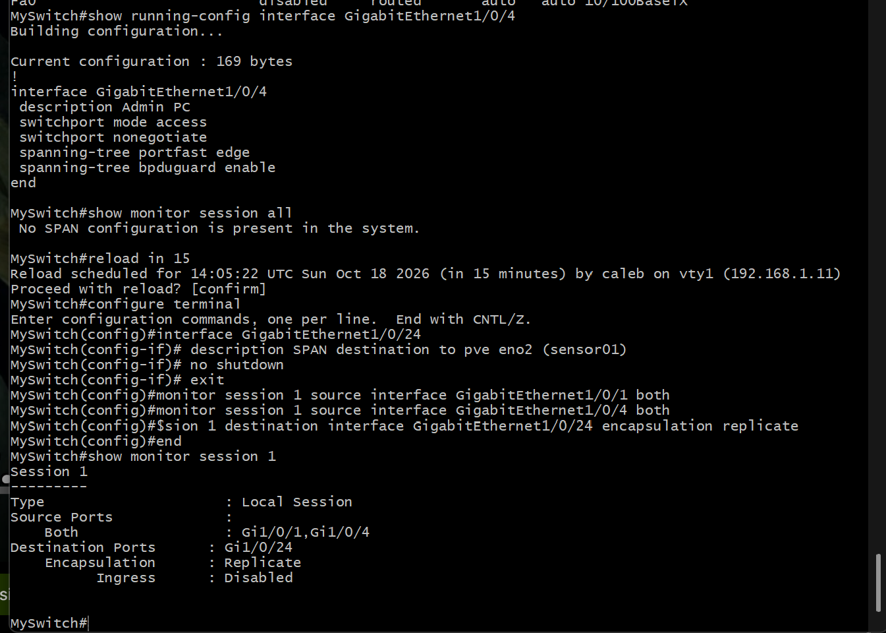

**eno2 administratively down before ifreload.**

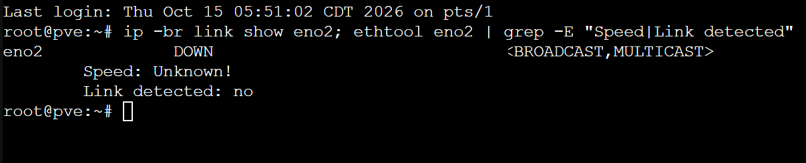

**vmbr1 on eno2 with no IP, ageing time 0, GRO/LRO off, and the sensor's second NIC (tap302i1) attached.**

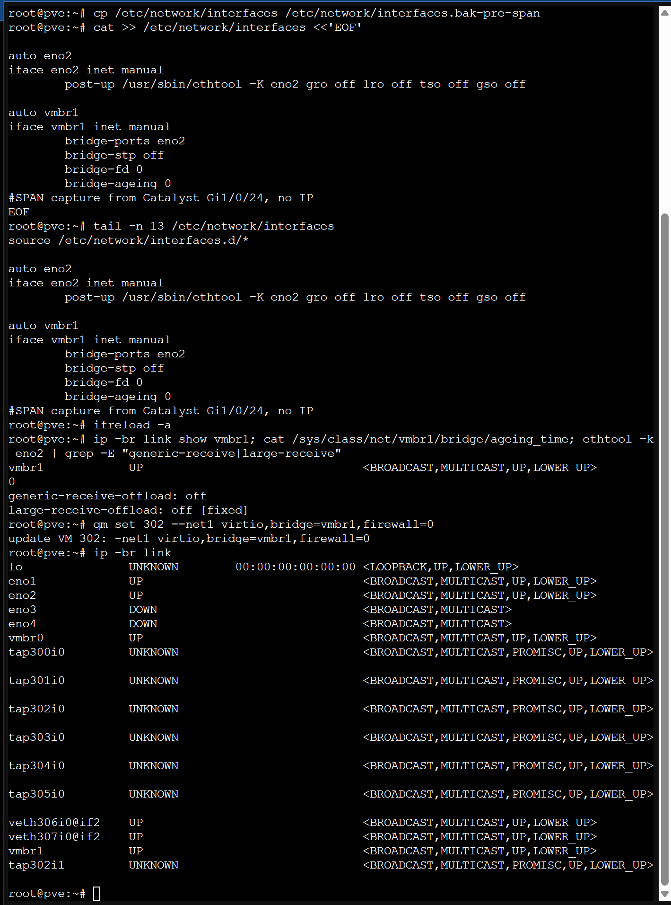

**sensor01 before Zeek and Suricata: 2.6 GB available.**

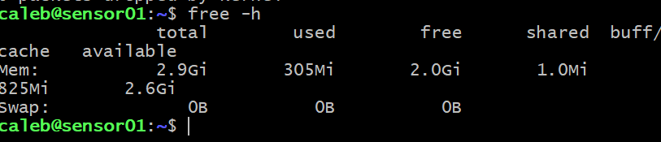

**After moving HOME_NET into suricata.yaml: suricata-update passes, 53,216 signatures load and EXTERNAL_NET is back.**

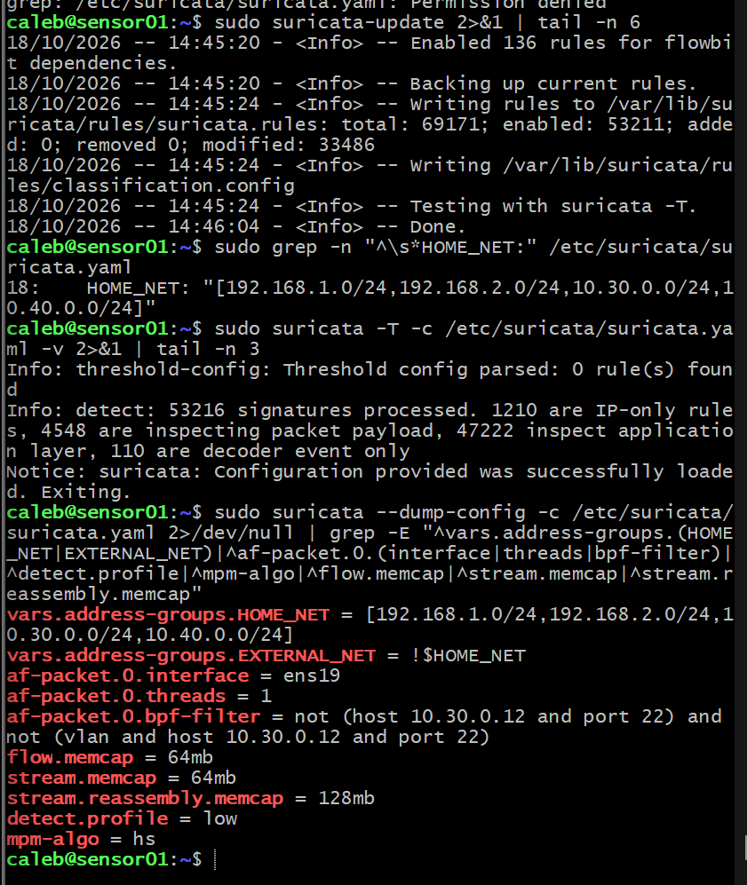

**Suricata running on ens19 with 53,211 rules, and the first alerts: Ethertype unknown with no IPs.**

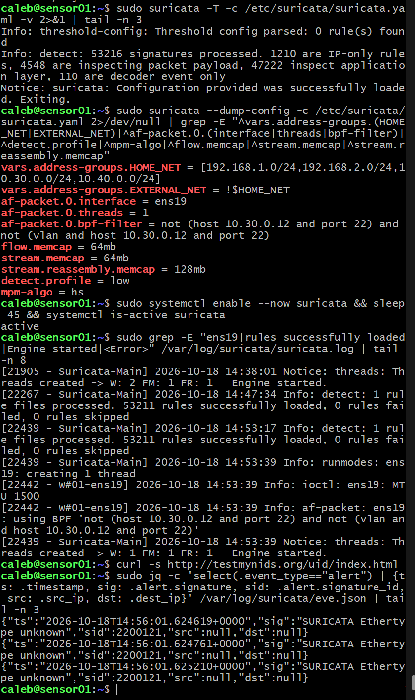

**testmynids.org no longer resolves anywhere.**

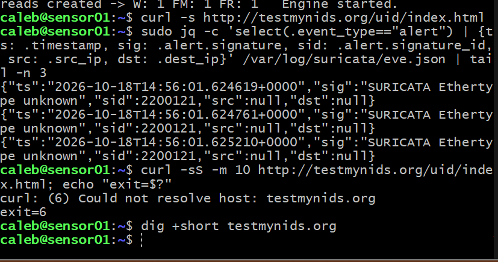

**STP filter loaded and local sid 9000001 firing once on VLAN 30. A decoder alert still appears after the restart.**

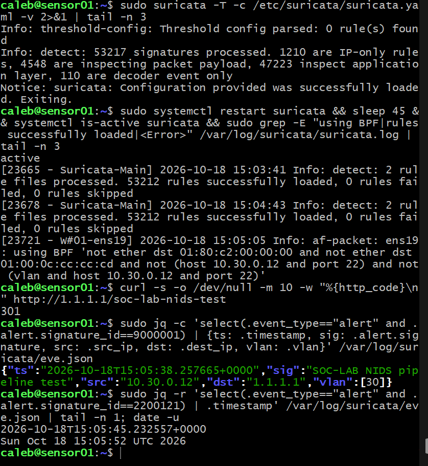

**The remaining frames: keepalive loopback (0x9000) and CDP hex, about 14 alerts a minute.**

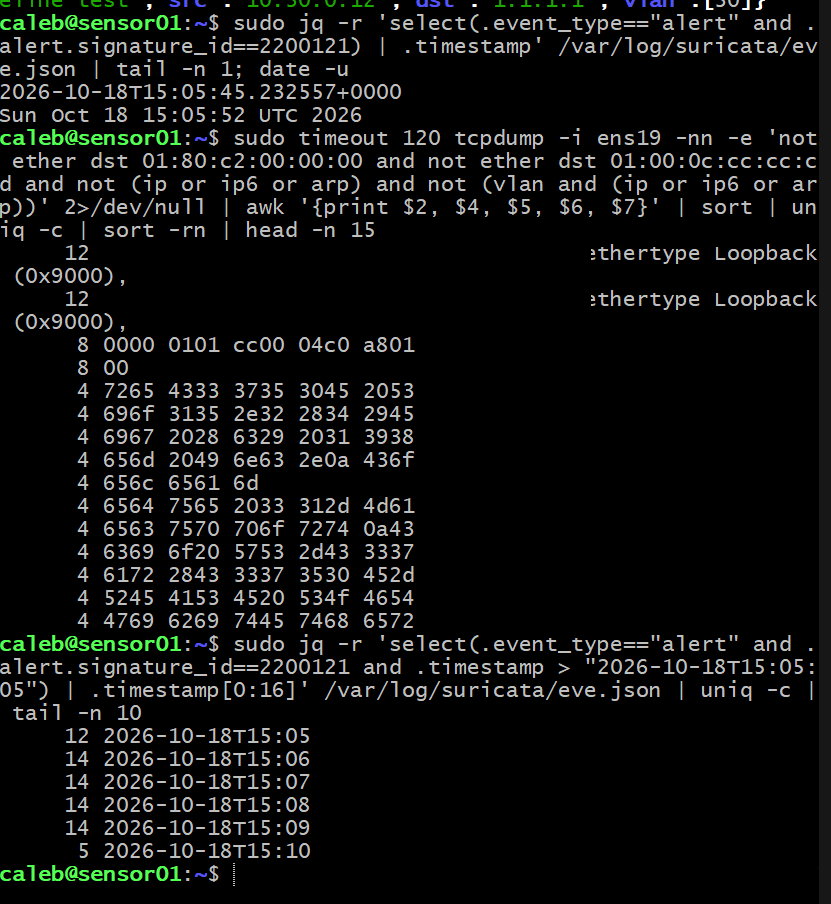

**Final BPF filter: 0 decoder alerts in three minutes.**

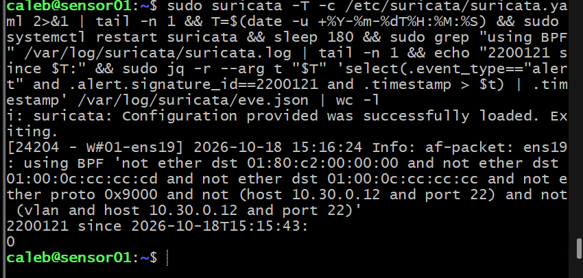

**Live rule reload via USR2 and the daily update cron.**

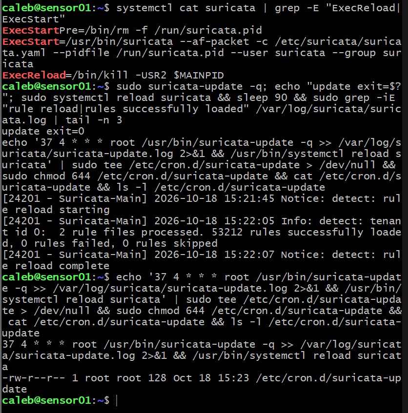

**Current Splunk license usage, log volume on the sensor, eve.json event types and file permissions.**

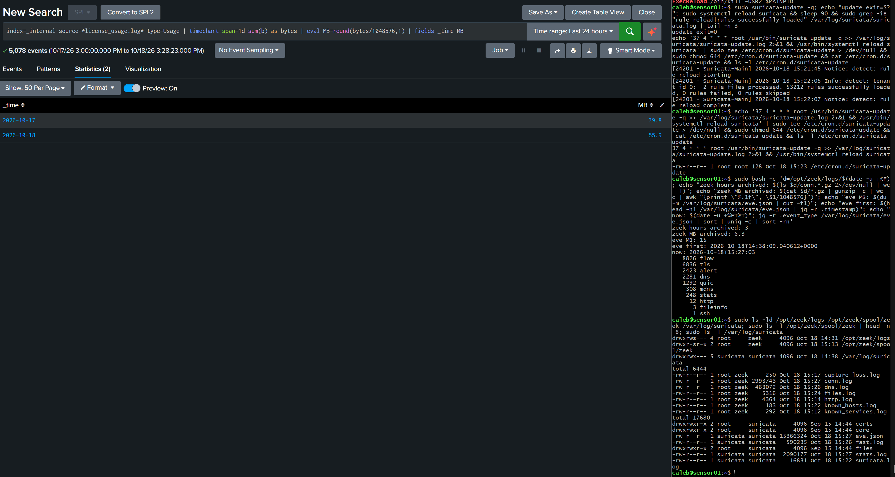

**TA-soc-homelab parsing and nullQueue filter, the soc_sensor_inputs app and sensor server class on splunk01.**

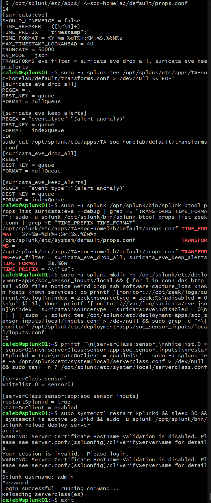

## Next in this step

- Install the Universal Forwarder on sensor01 as `splunkfwd`, in the `zeek` and `suricata` groups, pointing at the deployment server
- Verify both indexes, timestamps and the alert-only filter, and confirm the license usage matches the estimate

## Backlog

- Phase 4: tune the household ET INFO/DNS policy alerts (STUN, TLD policy rules) with threshold or suppression
- Splunk Add-ons for Zeek and Suricata or my own CIM mappings (Network_Traffic, DNS, IDS) in TA-soc-homelab
- Per-index retention for `zeek` (high volume, short-lived)
- Monitor Zeek `capture_loss.log` and Suricata drop counters from Splunk
- Revisit the Wi-Fi blind spot (UDR IDS events are already in `index=network`)
