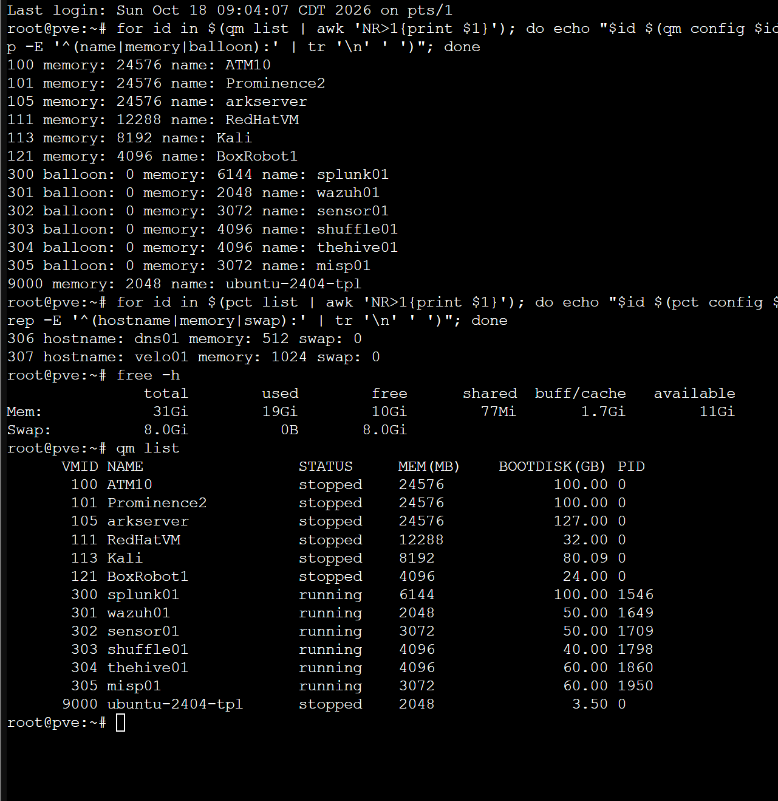
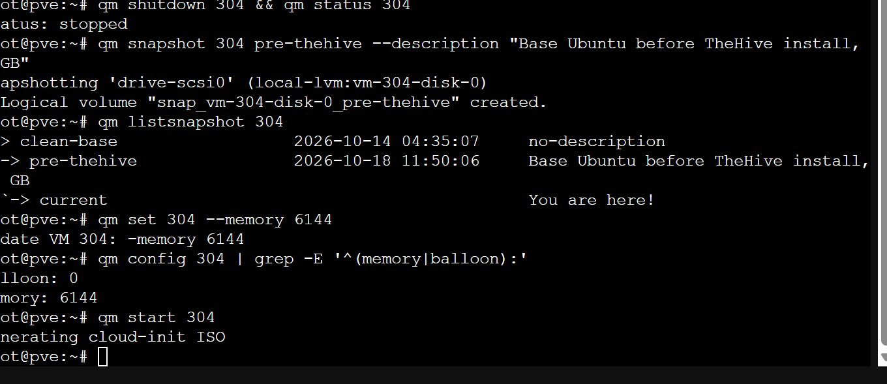
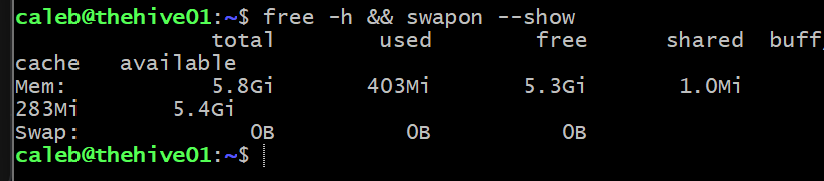
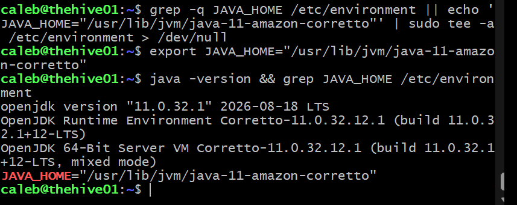
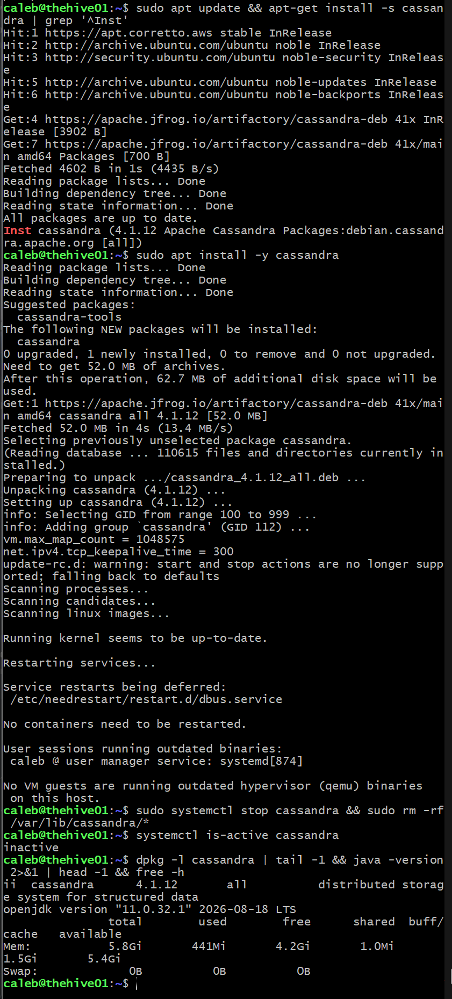
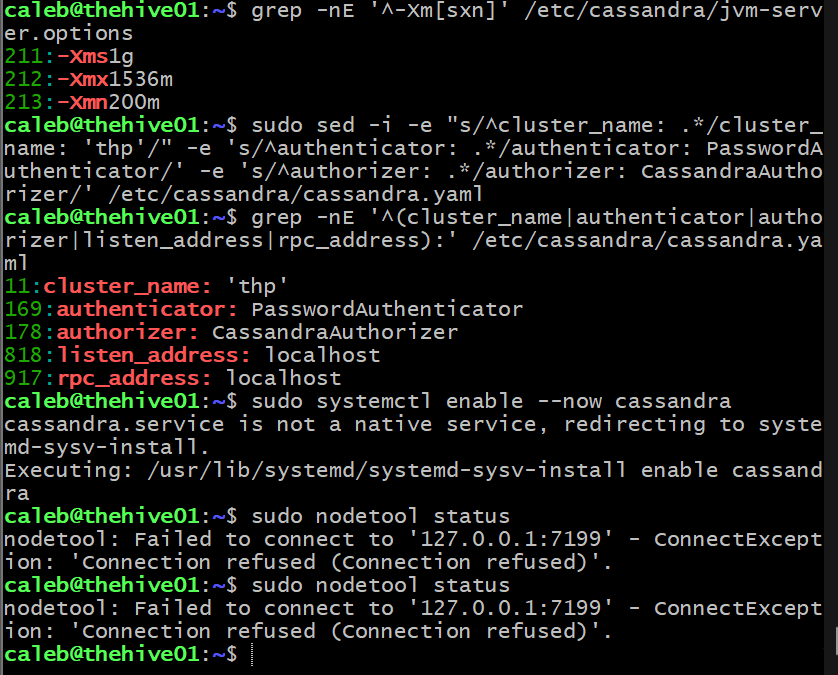
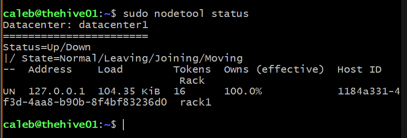
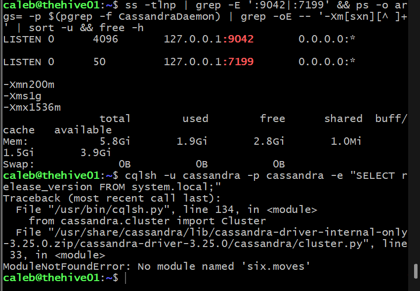
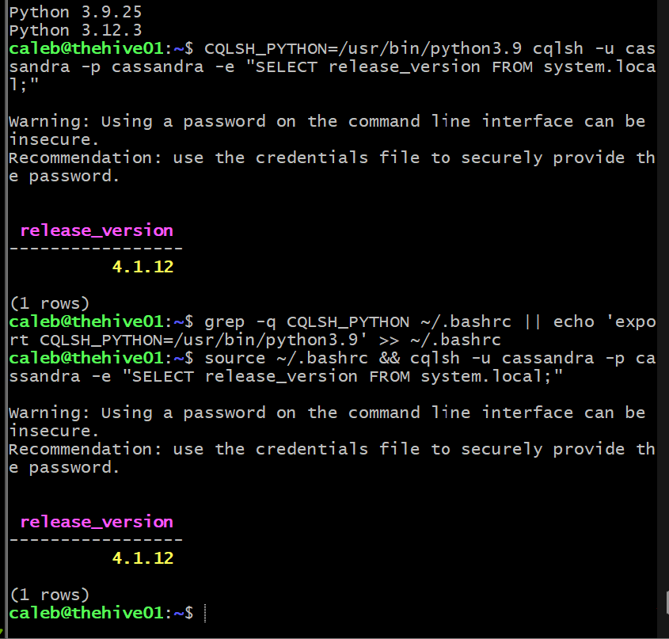
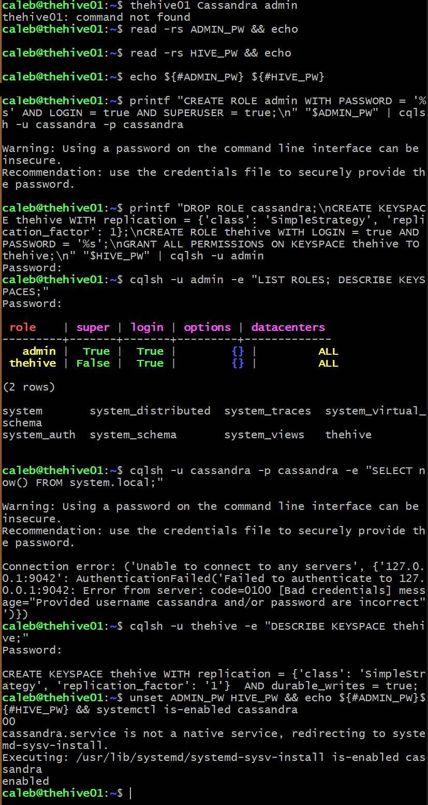

# 3.1 · TheHive (Deep Dive, in progress)

Phase 3 turns detections into cases. TheHive is the case management platform: Shuffle will create cases in it from Splunk alerts, with MISP and other enrichment attached. This entry covers sizing thehive01, then Java and Cassandra. Elasticsearch and TheHive follow.

## Sizing

### What TheHive needs

TheHive 5 is three Java services on one box: TheHive itself, Apache Cassandra (the database that stores cases) and Elasticsearch (the search index). Each runs in its own JVM with its own heap. StrangeBee's current single-host table recommends, for under 10 concurrent users:

| Service | CPU | RAM |
| --- | --- | --- |
| TheHive | 3 cores | 4 GB |
| Cassandra | 3 cores | 4 GB |
| Elasticsearch | 3 cores | 4 GB |

That's 12 GB. Their Docker Compose testing profile is 8 GB, and older documentation listed 2 GB per service (6 GB). thehive01 had 4 GB, which is below every one of those figures.

Elasticsearch's guidance also rules out the fix I used on misp01 and sensor01: swapping degrades garbage collection and cluster communication, so swap should be disabled or the heap locked in RAM. A swapfile would hide an undersized VM, not fix it.

### Options

| Option | Result |
| --- | --- |
| Stay at 4 GB with tiny heaps | Below every vendor figure; likely OOM kills once Shuffle starts using the API |
| **6 GB, SOC budget to about 26 GB** | **Chosen.** Workable for one analyst with hand-set heaps |
| Full RAM rebalance first | Most headroom, but a detour before Phase 3 starts |

### Host check

On `pve`, I listed every VM and container with its memory and balloon setting:

```bash
for id in $(qm list | awk 'NR>1{print $1}'); do echo "$id $(qm config $id | grep -E '^(name|memory|balloon):' | tr '\n' ' ')"; done
for id in $(pct list | awk 'NR>1{print $1}'); do echo "$id $(pct config $id | grep -E '^(hostname|memory|swap):' | tr '\n' ' ')"; done
free -h
qm list
```

Every non-SOC VM was stopped, so host RAM was only in use by the SOC: 22 GB of VMs plus 1.5 GB of containers, with 11 GiB available on the 31 GiB host. The extra 2 GB for thehive01 brought the SOC to 25.5 GB and still left the host about 9 GiB.

The non-SOC VMs are each configured with far more RAM than the host can spare alongside the SOC. Starting one of them with its current setting while the SOC runs would overcommit the host. Sizing those down is part of the planned RAM rebalance.

### Snapshot and resize

```bash
qm shutdown 304 && qm status 304
qm snapshot 304 pre-thehive --description "Base Ubuntu before TheHive install, 4 GB"
qm listsnapshot 304
qm set 304 --memory 6144
qm config 304 | grep -E '^(memory|balloon):'
qm start 304
```

I took the snapshot with the VM off so it holds no memory state. A Proxmox snapshot includes the VM config, so rolling back to `pre-thehive` also returns the VM to 4 GB.

Inside thehive01:

```bash
free -h && swapon --show
```

5.8 GiB total, no swap.

### Heap budget

| Component | Heap |
| --- | --- |
| Cassandra | `-Xms1g -Xmx1536m -Xmn200m` |
| Elasticsearch | `-Xms1g -Xmx1g` (planned) |
| TheHive | 1 GB (planned) |
| Off-heap, metaspace, OS | about 1.5 to 2 GB |

StrangeBee recommends at least 2 GB of heap for Cassandra. I went below that because the data set is one analyst's cases. If the VM starts hitting OOM kills, Cassandra's `-Xmx` drops to 1 GB first.

## OS and Java

```bash
sudo apt update && sudo apt -y full-upgrade
[ -f /var/run/reboot-required ] && echo REBOOT || echo OK
sudo apt install -y wget curl gnupg coreutils apt-transport-https git ca-certificates ca-certificates-java software-properties-common python3-pip lsb-release unzip
```

TheHive supports Java 11 only. I used Amazon Corretto, as StrangeBee recommends:

```bash
wget -qO- https://apt.corretto.aws/corretto.key | sudo gpg --dearmor -o /usr/share/keyrings/corretto.gpg
echo "deb [signed-by=/usr/share/keyrings/corretto.gpg] https://apt.corretto.aws stable main" | sudo tee /etc/apt/sources.list.d/corretto.sources.list > /dev/null
sudo apt update && sudo apt install -y java-common java-11-amazon-corretto-jdk
grep -q JAVA_HOME /etc/environment || echo 'JAVA_HOME="/usr/lib/jvm/java-11-amazon-corretto"' | sudo tee -a /etc/environment > /dev/null
export JAVA_HOME="/usr/lib/jvm/java-11-amazon-corretto"
java -version && grep JAVA_HOME /etc/environment
```

I used `tee` without `-a` for the repo file and a `grep -q` guard for `/etc/environment`, so re-running either line doesn't create duplicates. Result: Corretto 11.0.32.

## Cassandra

### Install

TheHive supports Cassandra 4.0 and 4.1, so I used the `41x` repository:

```bash
wget -qO- https://downloads.apache.org/cassandra/KEYS | sudo gpg --dearmor -o /usr/share/keyrings/cassandra-archive.gpg
echo "deb [signed-by=/usr/share/keyrings/cassandra-archive.gpg] https://debian.cassandra.apache.org 41x main" | sudo tee /etc/apt/sources.list.d/cassandra.sources.list > /dev/null
sudo apt update && apt-get install -s cassandra | grep '^Inst'
```

The Cassandra package accepts several Java runtimes. If apt hadn't counted Corretto as one, it would have pulled in a second JDK. The dry run listed only `cassandra (4.1.12)`, so I installed it:

```bash
sudo apt install -y cassandra
```

The install script set `vm.max_map_count = 1048575` and `net.ipv4.tcp_keepalive_time = 300`. That `max_map_count` also covers Elasticsearch's minimum.

The package starts Cassandra immediately with the default cluster name `Test Cluster`. Cassandra stores the cluster name on first start and refuses to start if the configured name changes later, so I stopped it and removed that first-start data before configuring anything:

```bash
sudo systemctl stop cassandra && sudo rm -rf /var/lib/cassandra/*
systemctl is-active cassandra
```

### Configuration

```bash
sudo cp /etc/cassandra/cassandra.yaml /etc/cassandra/cassandra.yaml.orig && sudo cp /etc/cassandra/jvm-server.options /etc/cassandra/jvm-server.options.orig
printf '%s\n' '-Xms1g' '-Xmx1536m' '-Xmn200m' | sudo tee -a /etc/cassandra/jvm-server.options > /dev/null
grep -nE '^-Xm[sxn]' /etc/cassandra/jvm-server.options
sudo sed -i -e "s/^cluster_name: .*/cluster_name: 'thp'/" -e 's/^authenticator: .*/authenticator: PasswordAuthenticator/' -e 's/^authorizer: .*/authorizer: CassandraAuthorizer/' /etc/cassandra/cassandra.yaml
grep -nE '^(cluster_name|authenticator|authorizer|listen_address|rpc_address):' /etc/cassandra/cassandra.yaml
```

Resulting settings:

```
cluster_name: 'thp'
authenticator: PasswordAuthenticator
authorizer: CassandraAuthorizer
listen_address: localhost
rpc_address: localhost
```

I left both addresses on `localhost`. TheHive runs on the same VM, so Cassandra never needs to be reachable from the SOC VLAN.

### Issue: `enable --now` and the SysV wrapper

```bash
sudo systemctl enable --now cassandra
sudo nodetool status
```

systemd replied that `cassandra.service is not a native service, redirecting to systemd-sysv-install`, and `nodetool` got `Connection refused` on 127.0.0.1:7199. The Debian package ships an old-style init script (`/etc/init.d/cassandra`), and systemd generates a wrapper unit around it. That has a second side effect: the init script backgrounds the JVM and exits, so the wrapper can report `active (exited)` even when Java has crashed. I checked the unit state and the Java process separately:

```bash
systemctl status cassandra --no-pager | head -5; pgrep -f CassandraDaemon || echo NOT RUNNING
```

After that, `nodetool status` showed the node as `UN` (Up/Normal):

```
UN  127.0.0.1  104.35 KiB  16  100.0%  ...  rack1
```

Verification of ports, heap and boot start:

```bash
ss -tlnp | grep -E ':9042|:7199' && ps -o args= -p $(pgrep -f CassandraDaemon) | grep -oE -- '-Xm[sxn][^ ]+' | sort -u && free -h
systemctl is-enabled cassandra
```

Both ports (9042 for CQL clients, 7199 for JMX) listened on 127.0.0.1 only, the JVM ran with exactly my three heap flags, the VM had 3.9 GiB available, and the service was `enabled`.

### Issue: cqlsh and Python 3.12

```
ModuleNotFoundError: No module named 'six.moves'
```

cqlsh doesn't use the system's Python packages. It loads a bundled Cassandra driver and an older `six` (a Python 2/3 compatibility library) from `/usr/share/cassandra/lib/`. That version of `six` registers `six.moves` through an import hook that Python 3.12 removed. Installing `python3-six` from apt wouldn't help, because cqlsh puts its bundled copy first on the import path.

StrangeBee documents the fix: run cqlsh on Python 3.9 through `CQLSH_PYTHON`. I installed 3.9 from the deadsnakes PPA alongside the system Python:

```bash
sudo add-apt-repository -y ppa:deadsnakes/ppa
apt-get install -s python3.9 | grep '^Inst'
sudo apt install -y python3.9 && python3.9 --version && python3 --version
CQLSH_PYTHON=/usr/bin/python3.9 cqlsh -u cassandra -p cassandra -e "SELECT release_version FROM system.local;"
grep -q CQLSH_PYTHON ~/.bashrc || echo 'export CQLSH_PYTHON=/usr/bin/python3.9' >> ~/.bashrc
```

The system Python stayed at 3.12.3, and cqlsh returned `4.1.12`. This only affects the command-line client. TheHive connects through a Java driver.

### Accounts, keyspace and role

I kept passwords off the screen and out of shell history. `read -rs` loads each one into a variable, and `printf`, a bash builtin that doesn't show up in `ps`, pipes the CQL into cqlsh's standard input. For admin logins, cqlsh prompts for the password.

```bash
read -rs ADMIN_PW && echo
read -rs HIVE_PW && echo
printf "CREATE ROLE admin WITH PASSWORD = '%s' AND LOGIN = true AND SUPERUSER = true;\n" "$ADMIN_PW" | cqlsh -u cassandra -p cassandra
printf "DROP ROLE cassandra;\nCREATE KEYSPACE thehive WITH replication = {'class': 'SimpleStrategy', 'replication_factor': 1};\nCREATE ROLE thehive WITH LOGIN = true AND PASSWORD = '%s';\nGRANT ALL PERMISSIONS ON KEYSPACE thehive TO thehive;\n" "$HIVE_PW" | cqlsh -u admin
```

A role can't drop itself, so I created `admin` while logged in as the default user and dropped `cassandra` from an `admin` session. I chose passwords without quote characters, because a `'` would end the CQL string literal early.

Verification:

```bash
cqlsh -u admin -e "LIST ROLES; DESCRIBE KEYSPACES;"
cqlsh -u cassandra -p cassandra -e "SELECT now() FROM system.local;"
cqlsh -u thehive -e "DESCRIBE KEYSPACE thehive;"
unset ADMIN_PW HIVE_PW && echo ${#ADMIN_PW}${#HIVE_PW}
```

- **Roles:** `admin` (superuser) and `thehive` (not a superuser), with no `cassandra`
- **Default login:** rejected with `Bad credentials`
- **`thehive` role:** logs in and sees its keyspace (`SimpleStrategy`, replication factor 1)
- **Variables:** cleared

## Next

- Elasticsearch 8.x: install with the output discarded (the package prints a generated `elastic` superuser password), keep X-Pack authentication, serve HTTP without TLS on 127.0.0.1 only, set the heap to 1 GB
- TheHive 5.8.1 from the signed package, with checksum and GPG verification
- Heap for TheHive, first login, and a community license

## Evidence

**Host RAM before the resize: every non-SOC VM stopped, SOC VMs with ballooning off, 11 GiB available on the host.**



**thehive01 shut down, snapshot pre-thehive taken, memory set to 6144 MB with ballooning off, VM started.**



**Inside thehive01: 5.8 GiB and no swap.**



**Corretto 11.0.32 and JAVA_HOME set once.**



**The dry run shows only Cassandra 4.1.12, then the install, first-start data removed, and Java unchanged.**



**Heap flags, cluster name, authentication and localhost binding; nodetool refused right after the SysV enable.**



**Cassandra up and normal on 127.0.0.1.**



**Ports on localhost only, the three heap flags in the running JVM, and the cqlsh six.moves error on Python 3.12.**



**cqlsh working on Python 3.9 with the system Python still 3.12.**



**Roles admin and thehive, the default account rejected, the thehive keyspace, cleared variables and boot start enabled.**



## Backlog

- Size down the non-SOC VMs as part of the RAM rebalance, so any of them can run alongside the SOC
- Revisit the heaps after a baseline week with real cases (Cassandra is below StrangeBee's 2 GB floor)
- Cassandra and Elasticsearch backups (StrangeBee documents cold and hot procedures)
- Ship Cassandra, Elasticsearch and TheHive logs to Splunk
- A host firewall on thehive01 that allows only TheHive's web port from the Default network and Shuffle
